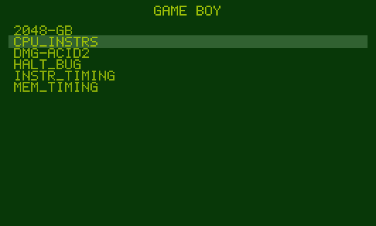
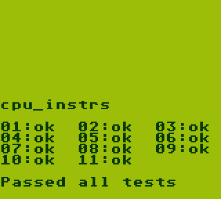
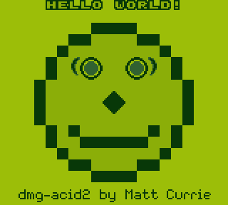

<div align="center">

# ⚡ ESPLiveScript 2

**Write C-like scripts, compile them to real Xtensa machine code _on the ESP32 itself_, and run them. No IDE, no re-flash.**


[Quick start](#first-light-) · [The language](#what-you-can-do-with-the-language) · [More than leds](#more-than-a-led-language) · [Performance](#performance) · [Examples](#examples) · [Changes](changes.md)

</div>

---

## 📖 The story

A while back I got tired of loading code onto the esp32 through an IDE every time I wanted to try a new led animation, so I wrote [ESPLiveScript](https://github.com/hpwit/asmparser): a small C-like language that compiles straight to Xtensa machine code on the esp32 itself. No interpreter, no re-flash.

It worked, people used it and [StarLight](https://github.com/MoonModules/StarLight) picked it up. This is v2: same idea, same language, rewritten from scratch, and this time checked by a test suite instead of "works on my board". I started the rewrite by hand, without any help from AI: [this commit](https://github.com/hpwit/new-parser/tree/162cedb50e240d6bd2b18e7f1c54c5674d9dde89) (May 2025) is the last version written that way. Then I used AI to complete the work: finishing the compiler, the tests, the examples and this documentation. The first version, v1, is still there: [hpwit/asmparser](https://github.com/hpwit/asmparser).

**If you know v1:** the language is very close, so most of what you know still applies. The C++ side you call from your sketch is new (`ScriptExecutable`, `parseScript()`, `bindFunction()`, `bindVariable()`), some v1 features are not there yet (see [Known limitations](#known-limitations)) and a few things changed on purpose. The differences are pointed out as we go.

---

## 🚀 Built for speed

Two goals drive this compiler. The code it makes must run as fast as code compiled by gcc, since a script is turned into Xtensa machine code on the chip, not interpreted. And the compiler itself must be fast and frugal enough to compile whole programs on the board, in seconds rather than minutes. Every change toward either goal is checked the same way: the examples, the games and the fuzzer's scripts must compile to the same bytes as before (or to code that is faster and gives the same results), on a computer, in QEMU and on the board.

Two programs show where this has got to.

### A Game Boy emulator at full speed

[matouch/GameBoy](examples/matouch/GameBoy) is an emulator of the first Game Boy written as one script of 1342 lines: its processor with every instruction timed to the clock cycle, the cartridge chips MBC1, MBC3 and MBC5, the timer, the interrupts, the picture drawn a line at a time (background, window, sprites) and the buttons. It lists the `.gb` cartridges on the SD card (or SolarOS's `/flash`) and plays the one you pick.

On the ESP32-S3 it runs **at the real Game Boy's speed: 59.7 frames a second**, measured on the board over a minute of Super Mario Land and of The Legend of Zelda: Link's Awakening (title, menus, play). Each second about 49 of those frames are drawn, as many as the 800x480 panel shows; the others are emulated without being drawn, so the game never slows down. It is exact as well as fast: it passes Blargg's `cpu_instrs` (all 11 tests) and `instr_timing`, its picture of `dmg-acid2` is identical to the reference pixel for pixel, and the emulated machine is in the same state on the board as on a computer, frame after frame (1098 frames compared). It compiles on the board in 15 seconds.

| | |
|:---:|:---:|
|  |  |
| *[2048-gb](https://github.com/Sanqui/2048-gb) by Sanqui (zlib licence), played by the emulator* | *The list of the cartridges found* |
|  |  |
| *Blargg's `cpu_instrs`: the 11 tests of the processor pass* | *[dmg-acid2](https://github.com/mattcurrie/dmg-acid2) by Matt Currie (MIT): the reference picture, pixel for pixel* |

### GT 32: a city in 3D

[matouch/CitySandbox](examples/matouch/CitySandbox) is GT 32, a city of 16 by 16 blocks to drive and walk through, in 3900 lines of script: traffic and traffic lights, people, shops, the police, missions, day and night. Everything is drawn by the script at 400x240: perspective projection in fixed point, polygons drawn nearest first with a coverage mask so that no pixel is drawn twice, straight into the panel's frame buffer. On the ESP32-S3 it runs at **24.4 frames a second** (27 by day). It compiles on the board in 82 seconds, or loads in a fraction of a second from a saved binary.


*The title, then a drive through the city (rendered by the script as C on a computer, frame for frame what the board draws).*

### The largest programs compiled

The largest scripts compiled so far, on the ESP32-S3 (240 MHz, with the compiler's working memory in PSRAM). The binary is what `parseScriptToBinary()` saves and `createExecutableFromBuffer()` loads back, its code and the description of its functions and data:

|Script|Lines|Source|Machine code|Saved binary|Compiled on the board in|
|:----|----:|----:|----:|----:|----:|
|[Wickwire](README_GAMES.md#wickwire-a-3d-platform-game-rendered-by-the-script) (3D platform game)|5164|127 KB|77.9 KB|104 KB|131 s|
|[GT 32](README_GAMES.md#gt-32-a-city-to-drive-and-walk-through) (3D city)|3900|102 KB|46.3 KB|61 KB|82 s|
|[Lumenfall](README_GAMES.md#lumenfall-a-platform-game-with-parallax-scrolling) (parallax platformer)|3441|80 KB|38.8 KB|48 KB|61 s|
|[Driftwing](README_GAMES.md#driftwing-a-flying-game-over-a-voxel-world) (voxel flight)|2761|72 KB|31.2 KB|40 KB|52 s|
|[Game Boy](examples/matouch/GameBoy) (emulator)|1342|30 KB|14.0 KB|19 KB|15 s|

The largest source is Wickwire's, 127 KB and 5164 lines, which gives the largest code, 77.9 KB, and the largest binary, 104 KB. The most data belongs to Driftwing: 2.2 MB of global arrays (a 1024x1024 height map and colour map), placed in PSRAM.

### How fast the compiler has become

The compiler runs on the chip, where memory is slow and scarce, so it is written for that. Its line store is a hash rather than lists it scanned for every line, which made it 2 to 3 times faster; and it no longer empties its lists one item at a time from the front, which in PSRAM moved gigabytes of memory for a large script and halved the compile time on the ESP32-S3 (GT 32 185 s to 82 s, Wickwire 332 s to 131 s). The details and measurements are in [changes.md](changes.md). A compile gives back all of its memory except the compiled script, so a board can compile one program after another.

For the speed of the code itself, see [Performance](#performance).

---

## ✨ At a glance

| | |
|:--|:--|
| 🚀 **Native speed** | No interpreter: the script becomes machine code on the chip. Loops and floats run at 0.9 to 1.2 times the time of the same code compiled by gcc, the Mandelbrot set at 25fps on 128x96 ([numbers](#performance)). |
| 🧱 **A real language** | Structs with methods and constructors, `switch`, pointers, strings, recursion, `float` and built-in fixed point (`ffloat`), multidimensional arrays ([more than leds](#more-than-a-led-language)). |
| 🔌 **Talks to your C++** | Call your own functions and use your variables (FastLED, WiFi, sensors...) with `bindFunction()` / `bindVariable()`, and share your structures. |
| 🧵 **Runs alongside your sketch** | Several scripts at once, each on its own FreeRTOS task, listed with their CPU use and paused, restarted or killed by name; GPIO interrupts calling back into the script; direct register access (a pin switched at 10MHz). |
| 📜 **Large programs too** | Whole programs of thousands of lines compile on the board, like [Valmora](README_GAMES.md#valmora-an-adventure-in-the-style-of-the-early-role-playing-games), a top-down adventure, [Ironforge](README_GAMES.md#ironforge-a-shooter-with-mid-90s-technology), a first-person shooter, or [Wickwire](README_GAMES.md#wickwire-a-3d-platform-game-rendered-by-the-script), a 3D platform game of 5200 lines, and a [Game Boy emulator](#a-game-boy-emulator-at-full-speed) that runs at the real machine's speed ([games](README_GAMES.md), [built for speed](#-built-for-speed)). |
| 💾 **Compile once, run anywhere** | Save the compiled binary to flash or SD and load it later, without the source, even from another sketch. |

---

## 🆕 What's new

Faster code (zero-overhead loops, smaller instructions), a compiler 2 to 3 times faster, structures shared with your sketch, a script scheduler, compile errors you can show: the latest changes and their measurements are in **[changes.md](changes.md)**.

---

## 🗺️ Contents

<!-- TOC start -->

- [Which language?](#which-language)
- [More than a led language](#more-than-a-led-language)
- [First light](#first-light-)
  * [Checking for errors](#checking-for-errors)
  * [Watching a long compile](#watching-a-long-compile)
  * [Freeing an executable](#freeing-an-executable)
  * [Where the code goes](#where-the-code-goes)
- [The function you call can have input parameters](#the-function-you-call-can-have-input-parameters)
  * [Fewer values than parameters: `argc`](#fewer-values-than-parameters-argc)
- [Filling variables from JSON](#filling-variables-from-json)
  * [Changing the settings of a running script](#changing-the-settings-of-a-running-script)
- [Interaction with pre-compiled functions](#interaction-with-pre-compiled-functions)
  * [Access to pre-compiled variables](#access-to-pre-compiled-variables)
  * [Binding an array or a pointer](#binding-an-array-or-a-pointer)
  * [Calling pre-compiled functions](#calling-pre-compiled-functions)
- [Arguments, JSON variables or bound variables?](#arguments-json-variables-or-bound-variables)
  * [Changing a bound variable from your C++ code](#changing-a-bound-variable-from-your-c-code)
- [CRGB and the hue function](#crgb-and-the-hue-function)
- [Safe mode and arrays](#safe-mode-and-arrays)
- [Variable types](#variable-types)
  * [Fixed point: ffloat](#fixed-point-ffloat)
  * [Arrays and multidimensional arrays](#arrays-and-multidimensional-arrays)
- [Structures](#structures)
- [A USB keyboard driving a script](#a-usb-keyboard-driving-a-script)
- [Saving executables](#saving-executables)
- [What you can do with the language](#what-you-can-do-with-the-language)
  * [Use of define](#use-of-define)
  * [Assembly functions: `__ASM__`](#assembly-functions-__asm__)
- [ESP32-S3: vector code](#esp32-s3-vector-code)
  * [Loops the compiler vectorizes](#loops-the-compiler-vectorizes)
  * [Writing a loop so that it vectorizes: the game of life](#writing-a-loop-so-that-it-vectorizes-the-game-of-life)
  * [What happens inside](#what-happens-inside)
  * [Vector instructions in assembly](#vector-instructions-in-assembly)
- [Running scripts in the background](#running-scripts-in-the-background)
  * [Parameters for a task](#parameters-for-a-task)
  * [The script scheduler](#the-script-scheduler)
- [Interrupts](#interrupts)
- [Performance](#performance)
- [Examples](#examples)
- [Testing](#testing)
- [Known limitations](#known-limitations)
- [Conclusion](#conclusion)
- [API reference](#api-reference)

<!-- TOC end -->

---

# Which language?

A C like syntax, close to JavaScript with stronger typing. It is a loose adaptation of C, not a strict subset, but you can write programs like this:

```c
void main()
{
   int h = 1;
   while (h > 0)
   {
      for (int i = 0; i < width; i++)
      {
         for (int j = 0; j < height; j++)
         {
            render2D(i, j);
         }
      }
      show();
      h++;
   }
}
```

This library compiles and runs scripts; it doesn't give you a place to write them. SolarOS has a terminal with an editor and `asm run` / `asm save`; [LedOS](https://github.com/hpwit/LedOS) and [StarLight](https://github.com/MoonModules/StarLight) use v1.

---

# More than a led language

ESPLiveScript started as a way to try led animations without re-flashing, and the led side is still where it shines. But what you write is plain C-like code that has nothing to do with leds:

```c
struct Account
{
   int balance;
   int id;
   void deposit(int amount)
   {
      balance += amount;
   }
};

Account accounts[3];

char *level(int b)
{
   if (b >= 100)
      return "gold";
   return "standard";
}

int fact(int n)
{
   if (n <= 1)
      return 1;
   return n * fact(n - 1);
}

void main()
{
   for (int i = 0; i < 3; i++)
   {
      accounts[i].id = i;
      accounts[i].balance = 0;
      accounts[i].deposit(fact(i + 3));
   }
   for (int i = 0; i < 3; i++)
   {
      switch (accounts[i].id)
      {
      case 0:
         printfln("first account: %d (%s)", accounts[i].balance, level(accounts[i].balance));
         break;
      default:
         printfln("account %d: %d (%s)", accounts[i].id, accounts[i].balance, level(accounts[i].balance));
      }
   }
}
```

```
first account: 6 (standard)
account 1: 24 (standard)
account 2: 120 (gold)
```

What you get, led or no led:

| | |
|:--|:--|
| 🧮 **Numbers** | `int`, `uint8_t`... `uint32_t`, `float`, `ffloat` fixed point, `^` power, `<<` `>>`, bitwise `&` / `\|` |
| 🧱 **Data** | structs with methods and constructors, arrays of structs, structs by value and by pointer, 1D/2D/3D arrays, pointers, `char *` strings |
| 🔀 **Control flow** | `if`/`else`, `while`, `for`, `break`/`continue`, `switch`/`case`/`default`, the ternary operator, short-circuit `&&` / `\|\|`, recursion |
| 🧠 **Memory** | `alloc()` / `free()` with `writeInt()` / `readInt()`, `safe_mode` bounds checking |
| 🔌 **Your C++** | any function or variable of the sketch, bound by name; scripts calling them and them calling back into the script |
| 🧵 **System** | background FreeRTOS tasks, GPIO interrupts, direct register access, binaries saved and loaded |

Examples that have nothing to do with leds: [Factorial](examples/Factorial), [SwitchCase](examples/SwitchCase), [StringFunctions](examples/StringFunctions), [MemoryAllocator](examples/MemoryAllocator), [PinInterrupt](examples/PinInterrupt), [DirectGPIO](examples/DirectGPIO), [ExecuteAsTask](examples/ExecuteAsTask), [SaveScriptBinary](examples/SaveScriptBinary).

---

# First light :)

- Compile a script: `ScriptExecutable exec = parseScript(script);`
- Check that it compiled: `if (exec.isExeExists())`
- Call a function of the script by its name, for instance `main`: `exec.execute("main");`

If you run this program ([SimpleScript](examples/SimpleScript)):

```cpp
#include "script_executable.h"

char script[] = R"EOF(
void main()
{
   for (int i = 0; i < 20; i++)
   {
      printfln("i:%2d  3*i:%2d", i, 3 * i);
   }
}
)EOF";

void setup()
{
   Serial.begin(115200);

   ScriptExecutable exec = parseScript(script);
   if (exec.isExeExists())
   {
      exec.execute("main");
   }
}

void loop()
{
}
```

the output will be:

```
i: 0 3*i: 0
i: 1 3*i: 3
i: 2 3*i: 6
...
i:19 3*i:57
```

> [!NOTE]
> `printf` and `printfln` are built in, there is nothing to bind. Same for `alloc`, `free`, `writeInt` and `readInt` (see [What you can do with the language](#what-you-can-do-with-the-language)). You can call any function of the script, not only `main`, and you get its return value back (see the next section).

## Checking for errors

`exec.isExeExists()` is `true` when the script compiled and loaded. When it is `false`, don't run it, and show why with `showCompileError()`:

```cpp
ScriptExecutable exec = parseScript(script);
if (exec.isExeExists())
{
   exec.execute("main");
}
else
{
   showCompileError();
}
```

`showCompileError()` prints the message, the line of the script, and a `^` under the place where the problem was found. Two broken scripts from [CompileErrors](examples/CompileErrors), one using a variable that was never declared, the other missing a `;`:

```c
void main()
{
   int a = 3;
   b = a + 1;          // b was never declared
   printfln("b = %d", b);
}
```

```c
void main()
{
   int a = 3           // no ;
   a = a + 1;
   printfln("a = %d", a);
}
```

give:

```
error   : Impossible to find variable declaration
line 5  :    b = a + 1;
             ^
```

```
error   : Expecting ;
line 5  :    a = a + 1;
             ^
```

> [!NOTE]
> A missing `;` is noticed where the next statement starts, so the error points at the line after the one that lacks it. Lines count from the first line of the script text: with `R"EOF(` followed by a new line, the script's first line is an empty line 1.

`parseScript()` also prints the error by itself, in a shorter form, so you see it in the console even without calling anything.

### Calling a function the wrong way

When a call matches no function, the message says what the call asked for and which functions of that name exist:

```
error   : Function not found: setTag(P *, number); there is setTag(P *, char)
error   : Function not found: blink(number); no function has that name
error   : Function not found: make() can't give a structure: functions can't return one yet
```

`number` is any of `int`, `float`, `uint8_t`...; `char` and pointers must match.

### Showing the error your own way

To put the error on a display, a web page or a log, `lastCompileError()` gives you the same information after a failed `parseScript()` or `parseScriptToBinary()`:

```cpp
const CompileError &e = lastCompileError();
if (e.failed)
   myDisplay.printf("line %d: %s", e.line, e.message);   // "line 5: Expecting ;"
```

|`CompileError` field|What it holds|
|:----|:----|
|`failed`|`true` if the last compile failed|
|`message`|the error, e.g. `Expecting ;`|
|`line`, `position`|where it was noticed, both from 1|
|`sourceLine`|that line of the script, as written|

A failed compile leaves nothing behind: fix the script and compile it again.

## Watching a long compile

A short script compiles in a moment, but a long one takes a while on an esp32 (Wickwire's 5200 lines: five and a half minutes). `setCompileProgress()` lets your sketch show that it is working:

```cpp
void showProgress(int percent, const char *stage, void *ctx)
{
   Serial.printf("%3d%%  %s\n", percent, stage);      // " 40%  optimizing"
}

setCompileProgress(showProgress, NULL);    // before compiling
ScriptExecutable exec = parseScript(script);
setCompileProgress(NULL, NULL);            // optional: no more calls
```

|Parameter|What it holds|
|:----|:----|
|`percent`|0 to 100, never going back; 100 only once the compile succeeded|
|`stage`|`"reading"`, `"parsing"`, `"generating"`, `"optimizing"`, `"assembling"`, then `"done"` with 100|
|`ctx`|the second argument of `setCompileProgress()`, passed back unchanged: a display, a progress bar object... (`NULL` if nothing)|

- It is called for every compile (`parseScript()`, `parseScriptToBinary()`) until you call `setCompileProgress(NULL, NULL)`, about 70 to 100 times per compile, so printing a line or drawing a bar costs nothing noticeable.
- The percentage follows the clock: 50% is about half the time.
- A script with an error stops where the error is found: there is no `"done"`.
- Your function runs inside the compiler: it must not compile, load or free a script itself, and it should return quickly.

A bar on a screen, using `ctx` to reach it:

```cpp
void drawBar(int percent, const char *stage, void *ctx)
{
   LGFX *lcd = (LGFX *)ctx;
   lcd->fillRect(100, 200, percent * 6, 20, TFT_GREEN);    // 600 pixels at 100%
   lcd->setCursor(100, 230);
   lcd->printf("%-12s %3d%%", stage, percent);
}

setCompileProgress(drawBar, &lcd);
```

See [CompileProgress](examples/CompileProgress).

## Freeing an executable

A `ScriptExecutable` frees its memory by itself when it goes out of scope. To get the memory back sooner, for instance before compiling a second script, use `exec.free()`:

```cpp
ScriptExecutable exec1 = parseScript(script1);
if (exec1.isExeExists())
{
   exec1.execute("main");
}
exec1.free(); // script1's memory is released now

ScriptExecutable exec2 = parseScript(script2);
if (exec2.isExeExists())
{
   exec2.execute("main");
}
```

> [!WARNING]
> A `ScriptExecutable` can't be copied or reassigned. For a second script, create a second `ScriptExecutable` as above.

`free()` can be called several times without harm. See [TwoScripts](examples/TwoScripts).

## Where the code goes

By default a script's code goes into executable internal RAM and its global variables into the ordinary heap. A large script's code is tens of KB, and a firmware that has been running a while may have no free piece that big left. Two ways out:

**Hand the loader a block of your own**, set aside at start:

```cpp
#include "asm_execute.h"

static void *codeBlock;       // heap_caps_malloc(48 * 1024, MALLOC_CAP_EXEC) at start
static bool codeBlockUsed;

void *codeAlloc(size_t size)
{
   if (codeBlock && !codeBlockUsed && size <= 48 * 1024)
   {
      codeBlockUsed = true;
      return codeBlock;
   }
   return heap_caps_malloc(size, MALLOC_CAP_EXEC);   // too big, or already taken
}

void codeFree(void *code)
{
   if (code == codeBlock)
      codeBlockUsed = false;
   else
      heap_caps_free(code);
}

setExecutableAllocator(codeAlloc, codeFree);   // before loading a script
```

`setExecutableAllocator(NULL, NULL)` goes back to the default. When the code doesn't fit, the load error gives its size and the largest block there was.

**Run the code from PSRAM** (ESP32-S3 with PSRAM):

```cpp
#include "asm_execute.h"

if (!setScriptCodeMemory(SCRIPT_CODE_PSRAM))   // false on a chip that can't
   printf("no PSRAM code here\n");
ScriptExecutable exec = parseScript(script);    // this one's code is in PSRAM
setScriptCodeMemory(SCRIPT_CODE_IRAM);          // back to the default
```

`SCRIPT_CODE_AUTO` puts the code in internal RAM when a block that big is free and in PSRAM otherwise. A small script runs about as fast from PSRAM; a large one may be slower. `executableCodeMemory(&exe)` says where a loaded script went.

---

# The function you call can have input parameters

```cpp
Arguments args;
args.add(5);
int32_t result = 0;
exec.execute("fact", &args, &result);
```

> [!NOTE]
> Arguments can be `int` or `float` (and pointers, given as an `int`).

A factorial computed in the script and read back in the sketch ([Factorial](examples/Factorial)):

```cpp
#include "script_executable.h"

char script[] = R"EOF(
int fact(int h)
{
   if (h == 1)
   {
      return 1;
   }
   return h * fact(h - 1);
}

void main()
{
}
)EOF";

void setup()
{
   Serial.begin(115200);

   ScriptExecutable exec = parseScript(script);
   if (exec.isExeExists())
   {
      Arguments args;
      for (int g = 5; g <= 7; g++)
      {
         args.clear();
         args.add(g);
         int32_t result = 0;
         if (exec.execute("fact", &args, &result))
         {
            printf("factorial of %d is %d\n", g, result);
         }
      }
   }
}

void loop()
{
}
```

```
factorial of 5 is 120
factorial of 6 is 720
factorial of 7 is 5040
```

`main()` is no exception: `exec.execute("main", &result)` gives its return value too.

## Fewer values than parameters: `argc`

A call carries up to 6 values, and they fill the parameters in order: a parameter with no value gets **0** (`0`, `0.0`, or `NULL` for a pointer), and values beyond the parameters are ignored. So a function can have optional parameters. When "0" and "nothing" must be told apart, bind a variable, conventionally `argc`, and set it before each call:

```cpp
int argc = 0;    // how many values the sketch gives main()

void setup()
{
   bindVariable((char *)"int", (char *)"argc", NULL, &argc);    // before compiling
   ScriptExecutable exec = parseScript(script);

   argc = 0;
   exec.execute("main");                    // main() with no value: the whole table

   int32_t values[1] = {40};
   argc = 1;
   exec.execute("main", values, 1);         // main(40): only fib(40)
}
```

```c
int fib(int n)
{
   if (n < 2)
      return n;
   return fib(n - 1) + fib(n - 2);
}

int main(int n)
{
   if (argc > 0)                            // a value was given: n is it
   {
      printfln("fib(%d) = %d", n, fib(n));
      return 0;
   }
   for (int i = 0; i <= 20; i++)            // none: n is 0, and means nothing
      printfln("fib(%d) = %d", i, fib(i));
   return 0;
}
```

A script then works like a command-line program: SolarOS's `asm run fib.sc 40` passes the `40` to `main` this way.

---

# Filling variables from JSON

A script can take its settings from a JSON document: a web page, an MQTT message or a file sends new values, and the script uses them without being recompiled. In the script, `json` says where each variable's value is in the document:

```c
json dp.value as int g2;              // the number at dp.value
json dp2 as float x;
json "name" as char label[16];        // a string, cut to fit if longer
json "steps" as int steps[3];         // a JSON array fills an array
json "speed" as int speed = 50;       // 50 unless the JSON has a "speed"

void main()
{
   printfln("%s: x = %f, g2 = %d, speed %d", label, x, g2, speed);
}
```

and the sketch gives the document when it runs a function:

```cpp
#include <ArduinoJson.h>               // switches the JSON support on
#include "script_executable.h"

static ScriptExecutable exec = parseScript(script);
exec.execute("main", "{\"dp\":{\"value\":6},\"dp2\":4.5,\"name\":\"first run\",\"steps\":[1,2,3]}");
```

| Call | What it does |
|---|---|
| `execute(name, json, result)` | Runs the script's initialization, then fills the `json` variables, then calls `name`. A JSON value wins over the variable's initial value. |
| `executeOnly(name, json, result)` | Fills the variables and calls `name`, without the initialization: the other globals keep their values. |
| `updateJson(json)` | Only fills the variables (v1's `updateParam()`), for a script that runs on its own task, say. |

Each returns `false` when the JSON can't be read, and says why on the console.

| In the script | Meaning |
|---|---|
| `json a.b.c as int v;` | The value at key `a`, then `b`, then `c`. |
| `json "a.b" as int v;` | The same, quoted: needed when a key isn't a plain name, or for an array index (`"list.1"`, the second element). |
| `json "p" as int v = 50;` | An initial value, used until a JSON sets it. |

> [!NOTE]
> - The types are `int`, `uint32_t`, `uint16_t`, `s_int`, `uint8_t`, `bool`, `char`, `float` and `ffloat`. A `char` array takes a string, cut to its size; any other array takes a JSON array.
> - A key the document doesn't have leaves its variable as it was, so a JSON can change only some of the settings.
> - The JSON support needs the [ArduinoJson](https://arduinojson.org) library (version 6 or 7) and comes on when the sketch includes `<ArduinoJson.h>`.
> - A script saved with [parseScriptToBinary()](#saving-executables) keeps its `json` variables.

See [JsonInput](examples/JsonInput).

## Changing the settings of a running script

A script running on its own task (`executeAsTask()`) can get new settings while it runs: `updateJson()` writes the values into the script's variables, from any task, and the script sees them at its next read. A value the script copied into a local variable stays old, and the values change one after another, so a frame can mix old and new settings.

When the settings must change together, let the script pick them up at a point it chooses, through a function it calls at the top of its loop:

```cpp
static ScriptExecutable *script = NULL;
static const char *volatile pendingJson = NULL;   // set by your web or MQTT handler

void applySettings()                              // called by the script
{
   const char *json = __atomic_exchange_n(&pendingJson, (const char *)NULL, __ATOMIC_ACQ_REL);
   if (json != NULL && script != NULL)
      script->updateJson(json);
}
```

```c
void main()
{
   while (true)
   {
      applySettings();          // the settings change here, all at once
      ...                       // one frame with consistent settings
      wait(50);
   }
}
```

On a running script, use `updateJson()` only, not `execute()`/`executeOnly()` from another task. See [JsonLiveSettings](examples/JsonLiveSettings).

---

# Interaction with pre-compiled functions

A script can't do everything the Espressif compiler can: no WiFi, no SPI or I2C, and you don't want to rewrite FastLED in a script. So a script can call your pre-compiled C++ functions and read/write your C++ variables, bound by name with `bindFunction()` and `bindVariable()` (`binding.h`), called **before** `parseScript()`.

## Access to pre-compiled variables

```cpp
bindVariable((char *)"type", (char *)"name_in_the_script", arraySizeOrNull, (void *)&variable);
```

The script declares the variable `external` and works on your variable itself, not a copy:

```cpp
#include "script_executable.h"
#include "binding.h"

int variable = 0;
uint16_t _array[10];

char script[] = R"EOF(
external int value;
external uint16_t array[10];

void fillArray()
{
   for (int i = 0; i < 10; i++)
   {
      array[i] = i * 3;
   }
}
void change()
{
   value = value + 2;
}
void main()
{
   printfln("value: %d", value);
}
)EOF";

void setup()
{
   Serial.begin(115200);

   bindVariable((char *)"int", (char *)"value", NULL, (void *)&variable);
   bindVariable((char *)"uint16_t", (char *)"array", (char *)"[10]", (void *)_array);

   ScriptExecutable exec = parseScript(script);
   if (exec.isExeExists())
   {
      variable = 5;
      exec.execute("main");
      variable = 240;
      exec.execute("main");

      variable = 15;
      printf("old value:%d ", variable);
      exec.execute("change");
      printf("new value:%d\n", variable);

      exec.execute("fillArray");
      for (int i = 0; i < 10; i++)
      {
         printf("%d:%d\n", i, _array[i]);
      }
   }
}

void loop()
{
}
```

```
value: 5
value: 240
old value:15 new value:17
0:0
1:3
2:6
...
9:27
```

## Binding an array or a pointer

An array and a pointer are bound differently, as in C:

- an **array**, `CRGB leds[64];`, *is* the pixels: give the array's address and its size (or `"[]"`);
- a **pointer**, `CRGB *frame;`, *holds* the address of the pixels: give the address of the pointer variable, and the script follows it each time, so you can point it elsewhere while the script runs (double buffering).

```cpp
#include "script_executable.h"
#include "binding.h"

CRGB leds[64];                 // an array
CRGB bufferA[64], bufferB[64];
CRGB *frame = bufferA;         // a pointer

char script[] = R"EOF(
void main()
{
   leds[3] = CRGB(255, 0, 0);     // into the array leds
   frame[3] = CRGB(0, 255, 0);    // where frame points
}
)EOF";

void setup()
{
   // the array: its own address; the size can be left out with "[]"
   bindVariable((char *)"CRGB", (char *)"leds", (char *)"[]", (void *)leds);
   // the pointer: the address of the pointer variable, no size
   bindVariable((char *)"CRGB *", (char *)"frame", NULL, (void *)&frame);

   static ScriptExecutable exec = parseScript(script);
   exec.execute("main");          // leds[3] is red, bufferA[3] green

   frame = bufferB;               // point elsewhere: the script follows
   exec.execute("main");          // bufferB[3] is green
}
```

| | Array | Pointer |
|---|---|---|
| Type | `"CRGB"` | `"CRGB *"` |
| Size | `"[64]"`, or `"[]"` | `NULL` |
| Address | `(void *)leds` | `(void *)&frame` |
| Use it for | a buffer that stays where it is | a buffer you change while the script runs |

> [!WARNING]
> Mixing them up crashes the board: `bindVariable("CRGB *", "leds", "", (void *)leds)` tells the script that a pointer is stored where the pixels are. Give the array type with `"[]"`, or bind a pointer variable with `&`.

A script can give a bound variable dimensions by declaring it: with `external CRGB leds[96, 128];`, both `leds[y, x]` and `leds[i]` work, for an array binding as for a pointer binding.

## Calling pre-compiled functions

```cpp
bindFunction((char *)"return_type", (char *)"name_in_the_script", (char *)"argument_types", (void *)function);
```

```cpp
#include "script_executable.h"
#include "binding.h"

void displayfloat(float nb)
{
   printf("from pre-compiled %f\n", nb);
}
float calcul(int pos)
{
   return (float)pos / 34.0;
}
void otherfunction()
{
   printf("from other function\n");
}

char script[] = R"EOF(
external float calc(int pos);
external void displayfloat(float nb);
external void otherfunction();

void main()
{
   float h = calc(52);
   displayfloat(h);
   otherfunction();
}
)EOF";

void setup()
{
   Serial.begin(115200);

   bindFunction((char *)"float", (char *)"calc", (char *)"int", (void *)calcul);
   bindFunction((char *)"void", (char *)"displayfloat", (char *)"float", (void *)displayfloat);
   bindFunction((char *)"void", (char *)"otherfunction", NULL, (void *)otherfunction);

   ScriptExecutable exec = parseScript(script);
   if (exec.isExeExists())
   {
      exec.execute("main");
   }
}

void loop()
{
}
```

```
from pre-compiled 1.529412
from other function
```

The argument types may also name the parameters, as in C: `"int x,int y"`, `"uint8_t *buf, int len"`, or only some of them (`"int ,int h"`). The names are only for the reader (an editor can show them as a hint); the types are what count, so `"int,int"` and `"int x,int y"` bind the same function.

For bigger sketches built the same way, see [StructsAndHostBindings](examples/StructsAndHostBindings) and [BouncingBalls](examples/BouncingBalls). A variable or a parameter can also have the type of one of your sketch's structures: see [Structures](#structures).

---

# Arguments, JSON variables or bound variables?

There are three ways to give values to a script:

```c
void run(int speed) { ... }                  // 1. an argument
json "speed" as int speed;                   // 2. a JSON variable
external int speed;                          // 3. a bound variable (bindVariable() in the sketch)
```

| | Argument | JSON variable | Bound variable |
|---|---|---|---|
| The sketch gives it with | `execute(name, args)`, at each call | a JSON text: `execute(name, json)` or `updateJson(json)` | nothing: the script uses the sketch's variable itself |
| A change reaches the script | at the next call | when `updateJson()` runs | at once |
| What the script writes | stays in the function | stays in the script | goes straight into the sketch's variable |
| Cost per call | 6.1 µs with 3 values (4.2 µs with none) | 112 µs with a 3-key JSON | nothing to pass |
| Types | numbers, `char *`, structures and pointers | numbers, `char` strings, arrays | any: arrays, structures, pointers |
| Best for | values that change at every call | settings that arrive as text (web page, MQTT, file) | data both sides use while the script runs (a sensor, a led buffer) |

Costs measured on an esp32 at 240MHz. Reading a JSON document takes about 100 µs: give JSON when settings change, not at every frame.

## Changing a bound variable from your C++ code

The script reads and writes a bound variable in your variable's own memory. When your code changes it, the script sees the new value at its next read, even while it runs on its own task on the other core:

```cpp
volatile int brightness = 100;                // shared with a running script
bindVariable((char *)"int", (char *)"brightness", NULL, (void *)&brightness);
...
exec.executeAsTask("main");                   // the script loops, reading brightness

void loop()
{
   brightness = analogRead(34) / 16;          // the script's next frame uses it
}
```

> [!NOTE]
> - Declare a variable `volatile` when your code and a running script both use it.
> - A copy stays old: `int b = brightness;` in the script keeps the value of that moment.
> - Each number changes in one go, but several variables change one after another. When several values must change together, let the script take them through a function it calls (as in [Changing the settings of a running script](#changing-the-settings-of-a-running-script)), or use a mutex in a function both call.

---

# CRGB and the hue function

If you are playing with leds, `CRGB` (and `CRGBW`) is part of the language, nothing to bind:
```c
CRGB color = CRGB(red, green, blue);
```

**Unlike v1 there is no built-in `hsv()` and no `USE_FASTLED` switch.** Bind `hsv()`, your `leds` array and your driver's `show()` like any other function or variable:

```cpp
#include "script_executable.h"
#include "binding.h"
#define NUM_LEDS 256

CRGB ledsBuffer[NUM_LEDS];
CRGB scriptHsv(int hue, int sat, int val) { return CHSV(hue, sat, val); } // with FastLED
void scriptShow() { FastLED.show(); }

char script[] = R"EOF(
external CRGB leds[256];
external CRGB hsv(int h, int s, int v);
external void show();

void main()
{
   int k = 0;
   while (true)
   {
      for (int i = 0; i < 16; i++)
         for (int j = 0; j < 16; j++)
            leds[j * 16 + i] = hsv(i + j + k, 255, 255);
      k++;
      show();
   }
}
)EOF";

void setup()
{
   Serial.begin(115200);
   FastLED.addLeds<NEOPIXEL, DATA_PIN>(ledsBuffer, NUM_LEDS);

   bindVariable((char *)"CRGB", (char *)"leds", (char *)"[256]", (void *)ledsBuffer);
   bindFunction((char *)"CRGB", (char *)"hsv", (char *)"int,int,int", (void *)scriptHsv);
   bindFunction((char *)"void", (char *)"show", NULL, (void *)scriptShow);

   ScriptExecutable exec = parseScript(script);
   if (exec.isExeExists())
   {
      exec.execute("main");
   }
}

void loop()
{
}
```

See [BouncingBalls](examples/BouncingBalls) for a complete working version, and [DisplayIcon](examples/DisplayIcon), v1's `dsiplayicon.sc`: a ghost, Mario and a cherry moving over a scrolling rainbow on a 128x96 matrix, with two lines of text scrolling in the Amstrad CPC 464's 8x8 letters.


---

# Safe mode and arrays

This script writes past the end of its array, with unintended consequences:

```c
external uint16_t array[10];

void main()
{
   for (int i = 0; i < 200; i++)
   {
      array[i] = 200;
   }
}
```

Put `safe_mode` in the script (no `#`, same as v1):

```c
safe_mode
external uint16_t array[10];
...
```

and you get

```
Execution error: index 10 is out of bounds for array 'array' (size 10)
```

The write doesn't happen and the script stops: you are back in your sketch and `execute()` returns `false`. The details stay available until the next call:

```cpp
ScriptExecutable exec = parseScript(script);
if (!exec.execute("main") && exec.hasRuntimeError())
{
   const runtime_error_struct &e = exec.runtimeError();
   // e.array == "array", e.size == 10, e.index == 10
}
```

To report the error your own way, install a handler, called instead of the console message:

```cpp
#include "runtime_functions.h"

void onBoundsError(const runtime_error_struct *e)
{
   Serial.printf("%s[%d] out of range (size %u)\n", e->array, (int)e->index, (unsigned)e->size);
}

onScriptRuntimeError = onBoundsError;
```

Checked: writes to global and `external` arrays declared with a size, negative indexes included. Not checked: reads, plain pointers, and arrays declared without a size. `safe_mode` applies to the script it is written in.

> [!TIP]
> Checked writes are slower: use `safe_mode` when you are hunting an indexing bug. See [SafeMode](examples/SafeMode).

---

# Variable types

* `uint8_t`
* `char`
* `bool`: `true`, `false`
* `int`: 4 bytes
* `s_int`: 2 bytes
* `uint16_t`
* `uint32_t`
* `float`
* `ffloat`: fixed point written like a float (see below)
* `CRGB`
* `CRGBW`

## Fixed point: ffloat

`ffloat` is a 32-bit fixed-point number, about ±32768 in steps of 1/65536. You write it exactly like a float, and it is computed with integer instructions:

```c
ffloat m = 2.3 / 4 + 2;     // computed at compile time: 2.575
ffloat k = m * 0.5;
if (k > 1.25)
   k = k / 3;
int i = m;                  // 2 (toward zero, like a float)
```

What you need to know:
- an `int` meeting an `ffloat` is converted for you, and `int i = x;` truncates toward zero like a float;
- the type you assign to decides how the expression is computed: `ffloat r = 7 / 2;` is 3.5, `int k = m * 2;` converts `m` to an int first;
- dividing by zero gives the largest value with the result's sign; it doesn't crash;
- results outside ±32768 wrap around like an int. Watch squares and powers: [BouncingBallsFfloat](examples/BouncingBallsFfloat) computes `(distance / r²)²` instead of `distance² / r⁴`;
- `printfln("%f", x)` reads a `float`: convert first, `printfln("%f", (float)x)`.

> [!TIP]
> The esp32 has a hardware FPU, so `float` is already fast. `ffloat` wins where there are many conversions, divisions and integer mixing: the Mandelbrot runs 31% faster in `ffloat` (see [Performance](#performance)).

See [MandelbrotFfloat](examples/MandelbrotFfloat), [MandelbrotFixedPoint](examples/MandelbrotFixedPoint) (the same picture with the scaling done by hand) and [FloatVsFfloat](examples/FloatVsFfloat).

## Arrays and multidimensional arrays

```c
//definitions
int array[23];
int array2D[height, width];
int array3D[depth, height, width];

//usage
int h = array3D[2, 12, 23];
```

An array given its values can leave its size out, and `for (x in array)` goes through its elements:

```c
int notes[] = {60, 62, 64, 65};   // 4 elements

void main()
{
   for (n in notes)               // n takes each element in turn
      printfln("%d", n);
   for (int n : notes) { }        // the C++ form, with a type
}
```

`break` and `continue` work as in any loop. The array needs one dimension and a known size. Without a type, a variable of that name that already exists receives the elements.

An array of structures takes one `{...}` per element, laid out as in C. In the loop, the variable *is* the element, so changing a field changes the array:

```c
struct voice { int note; float gain; };
voice voices[] = {{60, 0.5}, {64, 1.0}, {67, 0.25}};

for (v in voices)
   v.gain = v.gain * 2;
```

Strings work the same way: an array of `char *`, and a `char *` field in a structure, take their strings in the braces:

```c
char *colors[] = {"red", "green", "blue"};

struct item { char *name; int price; };
item shop[] = {{"apple", 3}, {"kiwi", 25}};

for (c in colors) printfln("%s", c);          // c is a char *
for (i in shop) printfln("%s costs %d", i.name, i.price);
shop[1].name = "golden kiwi";
```

Example: [ForInArrays](examples/ForInArrays/ForInArrays.ino).

---

# Structures

A structure groups fields, and optionally methods and a constructor, into a type of its own. They behave like C's: same memory layout, passed to functions by value or by pointer, and shared with your sketch's C++ structures.

## Defining a structure

```c
struct ball
{
   float vx, vy, xc, yc, r;
   int color;

   ball()                      // constructor: runs for every ball declared
   {
      vx = rand(300) / 255.0;
      color = rand(255);
   }

   void move()                 // method: the fields are in scope
   {
      xc = xc + vx;
   }
};

ball balls[20];                // an array of structures

void main()
{
   balls[3].move();
   ball one = ball();          // same as `ball one;`
}
```

> [!NOTE]
> - A definition ends with `};` as in C.
> - A constructor can take arguments: `varname d2 = varname(23);`.
> - A function or method must be defined before it is called.

The fields are laid out as the ESP32's C compiler lays them out (each at a multiple of its own alignment), so a script and your sketch can read the same bytes:

| Type | Size | Aligned on |
|---|---|---|
| `char`, `uint8_t`, `bool` | 1 | 1 |
| `uint16_t`, `s_int` | 2 | 2 |
| `int`, `uint32_t`, `float`, `ffloat` | 4 | 4 |
| `CRGB` / `CRGBW` | 3 / 4 | 1 |

## Structures as function arguments

**By value**, the function works on its own copy; **by pointer**, on the caller's structure:

```c
struct ball
{
   int x;
   int y;
   int dx;
   int dy;
};

ball balls[3];

int distance2(ball b, int x, int y)   // by value: changes stay in the copy
{
   b.x = b.x - x;
   b.y = b.y - y;
   return b.x * b.x + b.y * b.y;
}

void step(ball *b)                    // by pointer: changes the caller's ball
{
   b->x = b->x + b->dx;
   b->y = b->y + b->dy;
}

void stepAll(ball *b, int n)          // a pointer to the first of n balls
{
   for (int i = 0; i < n; i++)
      step(&b[i]);
}

void main()
{
   ball one;
   one.x = 0;
   one.dx = 5;
   step(&one);                        // one.x is now 5
   stepAll(balls, 3);                 // an array name is a pointer to its first element
   int d = distance2(balls[1], 50, 50);
}
```

| You write | It means |
|---|---|
| `void f(ball b)` | `b` is a copy of the argument: `f(g)`, `f(arr[i])`, `f(p[i])` |
| `void f(ball *b)` | `b` points to the caller's structure: `f(&g)`, `f(arr)`, `f(&arr[i])`, `f(p)` |
| `b->x`, `b[i].x` | a field through the pointer (`b.x` is accepted too) |
| `&g`, `&arr[i]`, `&g.x`, `&b[i]` | the address of a variable, an element, a field |
| `*p` | the value `p` points to, the same as `p[0]` |

Pointers to numbers work the same way: `int *q = &arr[2]; *q = 9;`.

## Sharing a structure with the sketch

`bindStruct()` gives the script the definition of one of your sketch's structures, once for every script compiled afterwards. `SCRIPT_STRUCT(name, { fields })` declares the C++ struct and keeps its text in `name_definition`, so you write it only once:

```cpp
#include "script_executable.h"
#include "binding.h"

SCRIPT_STRUCT(sensor, {
   char id;
   int value;
   uint16_t count;
   float average;
})

sensor probe = {'A', 10, 0, 0};
sensor probes[3];

char script[] = R"EOF(
void main()
{
   probe.count = probe.count + 1;            // sensor is not defined in the script
   for (int i = 0; i < 3; i++)
      probes[i].average = probes[i].value / 8.0;
}
)EOF";

void setup()
{
   bindStruct(sensor_definition);
   bindVariable((char *)"sensor", (char *)"probe", NULL, (void *)&probe);
   bindVariable((char *)"sensor", (char *)"probes", (char *)"[3]", (void *)probes);
   static ScriptExecutable exec = parseScript(script);
   exec.execute("main");
   // probe and probes now hold what the script wrote
}
```

Call `bindStruct()` before `parseScript()`. Bound structures work everywhere a script structure does: by value, with `&probe`, through pointers. See [HostStructs](examples/HostStructs).

## A structure from a library

When the structure comes from a library's header, like the USB keyboard library's `key_return`, use `BIND_STRUCT` with the type and every field in order:

```cpp
#include "binding.h"
#include "keyboard.h"          // struct key_return { unsigned char key_char; unsigned char key_code; };

key_return key_char;           // the library fills it

void setup()
{
   BIND_STRUCT(key_return, key_char, key_code);
   bindVariable((char *)"key_return", (char *)"key", NULL, (void *)&key_char);
   ...
}
```

```c
void keyboard()
{
   printfln("%d:%c", key.key_code, key.key_char);
}
```

`BIND_STRUCT` checks that the script would see every field where C has it; if not, nothing is bound and it says why (`BIND_STRUCT(LibMix): 20 bytes in C, 16 from the fields listed; a field is missing`). Fields can be numbers, `char` or `bool` of 1, 2 or 4 bytes, 16 at most. `struct tm` works too: `BIND_STRUCT(tm, tm_sec, tm_min, tm_hour, tm_mday, tm_mon, tm_year, tm_wday, tm_yday, tm_isdst);`. See [LibraryStruct](examples/LibraryStruct).

## The sketch calling a script with a structure

A structure goes as its address; the script function takes a pointer:

```cpp
SCRIPT_STRUCT(key_event, {
   char key;
   char code;
})

char script[] = R"EOF(
void keyboard(key_event *k)
{
   printfln("key '%c' code %d", k->key, k->code);
}
)EOF";

void onKey(char key, char code)          // your event handler
{
   key_event k = {key, code};
   Arguments args;
   args.add((int)(uintptr_t)&k);
   exec.execute("keyboard", &args);      // the script reads your k directly
}
```

Remember `bindStruct(key_event_definition);` before compiling.

## Limits and error messages

| Message | What to do |
|---|---|
| *A structure passed by value must be one of the first 6 arguments* | Move it earlier, or pass a pointer. |
| *This member can't be used through a pointer (only plain numbers and char)* | Read a `CRGB` field through the variable itself, or pass the structure by value. |
| *Can't take the address of this variable* | Use a global, or take the address of the whole local structure. |
| *\* needs a pointer variable* | Use `x` itself, or declare it `T *x`. |
| *Structure already defined differently (bindStruct)* | Remove the script's definition, or make it identical. |
| *Too many fields in the structure* | Split it into two structures. |

A function can't return a structure yet: return a field, or write into a structure passed by pointer.

| Example | What it shows |
|---|---|
| [StructArguments](examples/StructArguments) | By value, by pointer, `->`, `&b[i]`, and the sketch calling `keyboard(key_event *k)` with its own struct. |
| [HostStructs](examples/HostStructs) | `SCRIPT_STRUCT` and `bindStruct()`: a struct and an array of structs shared with the sketch. |
| [LibraryStruct](examples/LibraryStruct) | `BIND_STRUCT()`: the USB keyboard's `key_return` and `struct tm` used by a script. |
| [BouncingBalls](examples/BouncingBalls) | Methods, a constructor and an array of structures. |

---

# A USB keyboard driving a script

[KeyboardTest](examples/KeyboardTest) connects a USB keyboard to a script on an **ESP32-S3** (its USB port can be a host; the plain ESP32 has none): every key you press runs the script's `keyboard()` function, which echoes the key, keeps the line being typed and prints it on Enter. It needs the `ESP32_USB_Host_HID` library in the version with the `hid_keyboard_print_char` hook (the example's comments show the few lines to add to `keyboard.h` if yours doesn't have it; `hid_keyboard_release_char`, optional, reports releases for games that move while a key is held).

The sketch binds the library's key structure and lets the script register itself:

```cpp
key_return lastKey;                                   // the last key

BIND_STRUCT(key_return, key_char, key_code);
bindVariable((char *)"key_return", (char *)"key", NULL, (void *)&lastKey);   // `key` in the script
bindFunction((char *)"void", (char *)"setup_keyboard", (char *)"uint32_t", (void *)setup_keyboard);

void print_char(key_return k)                         // the library calls it on each key
{
   lastKey = k;
   if (keyboardScript != NULL)
      keyboardScript->executeOnly("keyboard");
}

static ScriptExecutable exec = parseScript(script);   // static: keys arrive after setup()
exec.execute("main");                                 // main() calls setup_keyboard(_handle_)
hid_keyboard_print_char = print_char;
app_main_keyboard();                                  // start the USB host last
```

`executeOnly()`, not `execute()`: `execute()` would run the script's initialization again on every key and reset its globals.

```c
char line[100];
int len = 0;

void keyboard()
{
   if (key.key_code == 40)            // Enter: show the line typed
   {
      printf("line (%d chars): ", len);
      for (int i = 0; i < len; i++)
         printf("%c", line[i]);
      printfln("");
      len = 0;
   }
   else if (key.key_code == 42)       // Backspace
   {
      if (len > 0)
         len--;
   }
   else if (key.key_char != 0 && len < 99)
   {
      line[len] = key.key_char;
      len++;
      printfln("key '%c' code %d", key.key_char, key.key_code);
   }
}

void main()
{
   setup_keyboard(_handle_);
   printfln("ready: type on the USB keyboard, Enter shows the line");
}
```

`key_code` is the USB HID code of the key (40 Enter, 42 Backspace, 41 Escape, 79 to 82 the arrows), and `key_char` the character it types, or 0. Keep `keyboard()` short: it runs on the keyboard library's task. The games of [README_GAMES.md](README_GAMES.md) are driven this way.

---

# Saving executables

Compile a script once, save the binary to LittleFS or an SD card, and run it later without the source, even from another sketch.

To compile without loading or running: `parseScriptToBinary()`. It returns `NULL` (and has printed the error) if something went wrong:

```cpp
uint32_t size = 0;
uint8_t *serialized = parseScriptToBinary(script, &size);
if (serialized != NULL)
{
   // ... write serialized (size bytes) to LittleFS / SD ...
   free(serialized);
}
```

To load it back, `createExecutableFromBuffer()` gives you a normal `ScriptExecutable`:

```cpp
// another sketch, later: doesn't need the source
bindVariable(...);   // same external names as when it was compiled
bindFunction(...);
// ... read the saved bytes into buf ...
ScriptExecutable exec = createExecutableFromBuffer(buf, size);
if (exec.isExeExists())
{
   int32_t result = 0;
   exec.execute("someFunction", &result);
}
else
{
   printf("cannot load: %s\n", lastLoadError());
}
```

Or straight from a file, without reading it into memory first:

```cpp
File f = FFat.open("/game.bin");   // LittleFS, SD, ...
ScriptExecutable exec = createExecutableFromStream(
    [](void *ctx, uint8_t *buf, size_t len) -> size_t { return ((File *)ctx)->read(buf, len); }, &f);
f.close();
```

With a `FILE *` from `fopen()`, the reader is `fread(buf, 1, len, (FILE *)ctx)`.

| `lastLoadError()` | Means |
|---|---|
| `missing binding: led16, show16()` | the binary uses names this program has not bound (every one is listed): bind them before loading |
| `not a valid binary: ...` | the buffer is not what `parseScriptToBinary()` made, or it is cut short |
| `could not allocate N bytes of executable memory ...` | no free block of executable memory is that big: see [Where the code goes](#where-the-code-goes) |
| `could not allocate N bytes for this script's data ...` | no room for its global variables |

It is `""` after a load that worked. The bound functions and variables are not saved with the binary: they are matched by name when it loads, so the two sketches only need to agree on the names. See [SaveScriptBinary](examples/SaveScriptBinary) and [LoadScriptBinary](examples/LoadScriptBinary); the [GameLauncher](README_GAMES.md#gamelauncher-games-from-the-ffat-partition) runs a dozen games this way.

---

# What you can do with the language

- loops (`while`, `for`), `break`, `continue`
- `if`, `else`, `(test) ? true_statement : false_statement`
- `switch`/`case`/`default`, as in C (see [SwitchCase](examples/SwitchCase)):

  ```c
  switch (mode)
  {
  case MODE_FIRE:
     drawFire();
     break;
  case 1:
  case 2:            // either 1 or 2
     drawStars(mode);
     break;
  default:
  {
     int t = millis() / 100;   // a braced body can have its own variables
     drawPlasma(t);
  }
  }
  ```
  The case values are integer constants (a number, hex, negative, or a `#define`).
- blocks `{ ... }` with their own local variables
- `++`, `--` for integers and pointers; `+=`, `-=`, `/=`, `*=`
- pointers
- strings as `char *`: functions returning one, `char *` parameters, `%s` in `printfln` (see [StringFunctions](examples/StringFunctions)):

  ```c
  char *dayName(int d)
  {
     if (d == 0)
        return "Sunday";
     return "weekday";
  }

  void main()
  {
     char *s = dayName(1);
     printfln("%s / %s", dayName(0), s);   // Sunday / weekday
  }
  ```
  Indexing a `char *` local (`s[0]`) is not supported yet.
- `^` for power (`x^2` is x squared, not a xor)
- `>>` and `<<` (`>>` keeps the sign of an `int`, as in C)
- bitwise `&` and `|`. They bind like `*`, not as in C: `a + b & 4` is `a + (b & 4)`, so put parentheses around them when mixing
- `&&`, `||` (or `and`, `or`)
- type conversion `(float)(expr)`, `(int)(expr)` (the parentheses around `expr` are needed). The conversion float <-> int is automatic, and in an expression whose result is a `float`, `/` between ints divides as floats, unlike C: `float f = 57 / 13;` is 4.38. `%` between ints stays the integer remainder.
- `#define`: see below
- built in: `printf`, `printfln`, and `alloc(size)`, `free(p)`, `writeInt(p, offset, value)`, `readInt(p, offset)` for memory blocks (see [MemoryAllocator](examples/MemoryAllocator))

## Use of define

As in C. **Unlike v1, the `#` is needed:**

```c
#define TOKEN 25

if (i < TOKEN)    // compiled as if (i < 25)
{
  ...
}
```

There are no macros with parameters yet.

## Assembly functions: `__ASM__`

A function can be written in Xtensa assembly, as in v1: `__ASM__` before its type, and its body is one quoted instruction per line. The script calls it like any other function.

```c
int counter;

// two int arguments in, one int out
__ASM__ int addTwo(int a, int b)
{
"entry a1,32"
"add a2,a2,a3"
"retw.n"
}

// a script variable, a loop with a label
__ASM__ void addToCounter(int times)
{
"entry a1,32"
"l32r a4,@_counter"
"add_loop:"
"l32i a5,a4,0"
"addi a5,a5,1"
"s32i a5,a4,0"
"addi a2,a2,-1"
"bnez a2,add_loop"
"retw.n"
}

void main()
{
   addToCounter(addTwo(40, 2));
   printfln("%d", counter);   // 42
}
```

- The arguments arrive in `a2` to `a7`, an `int` result goes back in `a2`, a `float` result in `f2`. Start with `entry a1,32` and end with `retw.n`; an assembly function can't call another function.
- A script variable is reached with `l32r a4,@_name`, a bound one with `movExt a4,@_ext_name`.
- Labels end with `:` and must be unique in the script.
- Besides what the compiler itself uses, the assembler knows `min`, `max`, `minu`, `maxu`, `nsau`, `nsa`, `clamps`, `sext`, `mul16u`, `mul16s`, `memw`, `extw`, `isync`, `nop`, `loop`/`loopnez`/`loopgtz`, and `rsr`/`wsr` (`rsr a2,ccount` reads the cycle counter).
- An unknown instruction is reported with the line as written: `assembler error: "frobnicate a2,a2": Opcode frobnicate not found`.
- An assembly function is assembled exactly as written: the optimizer that rewrites the compiled code leaves it alone.
- On the ESP32-S3 it can also use the chip's vector instructions: see [Vector instructions in assembly](#vector-instructions-in-assembly).

See [AssemblyFunctions](examples/AssemblyFunctions) (C against assembly, timed with the cycle counter) and [AssemblyGPIO](examples/AssemblyGPIO) (a pin switched from assembly).

---

# ESP32-S3: vector code

The ESP32-S3 has a vector extension, PIE: eight 128-bit registers that each hold 16 bytes, and instructions that work on all of them at once. The compiler uses it in two ways:

- **by itself**, for loops over byte arrays written in the shape described below: nothing to change in the script, and the result is exactly the one of the ordinary loop;
- **in assembly functions**, which can use the vector instructions directly.

On an ESP32 (or any other chip) the same scripts run unchanged: the loops compile as ordinary loops.

## Loops the compiler vectorizes

Each of these loops runs 16 elements per pass on the S3:

```c
#define width 100
uint8_t heat[4, width];
uint8_t front[width], back[width];
uint8_t level[4, width], mask[4, width];
uint8_t trail[width];
uint8_t layerA[width], layerB[width], sum[width];

// clear a row
for (int x = 0; x < width; x++)
   heat[y, x] = 0;

// copy one array into another
for (int x = 0; x < width; x++)
   back[x] = front[x];

// a mask: 1 where the level is above 128, 0 elsewhere
for (int x = 0; x < width; x++)
   mask[y, x] = level[y, x] > 128;

// a trail fading by one step, never below 0
for (int x = 0; x < width; x++)
   trail[x] = trail[x] - (trail[x] > 0);

// two layers added (bytes wrap around at 256, as always)
for (int x = 0; x < width; x++)
   sum[x] = layerA[x] + layerB[x];
```

A loop is vectorized when:

- it is `for (int i = A; i < B; i++)` with numbers for `A` and `B` (a `#define` is a number; `width - 1` too);
- its arrays are `uint8_t`, one or two dimensions, read and written at `i` plus or minus a number (up to 64). A row (the first index of a two-dimensional array) is a variable, a number, or a variable plus or minus a number: `copy[j + 1, i - 1]`;
- its body is `uint8_t` temporaries, then one store: no `if`, no function call, no other variable written;
- the operators are `+`, `-`, `&`, `|` and the comparisons `==`, `!=`, `<`, `>`, `<=`, `>=`, which give 0 or 1 as everywhere else in the language;
- the array written is read only at the element written: `trail[x] = trail[x] - 1` is fine, `level[x] = level[x - 1] + 1` is not (each element would depend on the one before).

Anything else compiles as an ordinary loop, so trying costs nothing. These, for instance, are not vectorized:

| Loop body | Why |
|:----|:----|
| `level[x] = level[x - 1] + 1;` | each element depends on the previous one |
| `out[x] = (a[x] + b[x]) / 2;` | division (and multiplication: `a[x] * 2`) |
| `if (a[x] > 128) out[x] = 1;` | an `if`: write `out[x] = a[x] > 128;` when 0 is fine elsewhere |
| `big[x] = a[x] + 1;` with `int big[100]` | not a byte array |
| `for (int x = 0; x < n; x++)` | the bound is a variable, not a number (except for the fills below) |

### Filling 16-bit arrays

A second shape fills a `uint16_t` (or `s_int`) array with one value, the span fill of a polygon or a rectangle, with variable bounds this time:

```c
uint16_t buf[16000];

// a span of pixels: o is the row's first pixel, x0 to x1 - 1 the columns
for (int x = x0; x < x1; x++)
   buf[o + x] = colour;
```

`x0`, `x1`, `o` and the value can each be a variable, a number, or a variable plus or minus a number; the index is `x`, `o + x` or `x + o`. The array can be the script's own or a bound one (`external uint16_t fb[96000];`). The loop becomes a call that stores single pixels until the address is a multiple of 16, then 8 pixels per `ee.vst.128.ip`, then single pixels again; the value is the same as the ordinary loop's, truncated to 16 bits.

How much it gains depends on where the array is. On the matouch board, 592,000 pixels in spans of 37:

| | Ordinary loop | Vectorized |
|:----|----:|----:|
| A 32 KB array in internal RAM | 14.96 ms | **8.03 ms** |
| A 192 KB bound array in PSRAM | 55.0 ms | 55.0 ms |

PSRAM takes about 35 MB/s of writes however they are made, so a frame buffer there gains nothing: what helps then is writing fewer pixels.

## Writing a loop so that it vectorizes: the game of life

The usual game of life counts the eight neighbours of each cell, decides with an `if` and draws in the same loop ([matouch/GameOfLife](examples/matouch/GameOfLife)):

```c
for (int i = 1; i < width - 1; i++)
{
   int res = linec[i - 1] + linec[i + 1];
   res = res + line1[i - 1] + line1[i + 1] + line1[i];
   res = res + copy[j+1,i-1] + copy[j+1,i+1] + copy[j+1,i];
   bool alive = false;
   int l = copy[j,i];
   if (res == 3)
      alive = true;
   else
      alive = (l == 1 && res == 2) ? true : false;
   if (alive)
   {
      led16[j*800+i] = color;
      copy[j,i] = 1;
   }
   else
   {
      led16[j*800+i] = 0;
      copy[j,i] = 0;
   }
}
```

None of it can be vectorized: `int` temporaries, `if`, two arrays written, 16-bit pixels. [GameOfLifeVec](examples/matouch/GameOfLifeVec) computes the same generation in two loops that can, and draws in a third, ordinary one:

```c
uint8_t copy[height, width];
uint8_t hs[3, width];   // three line buffers, used in rotation

// hs[s] = the cell to the left + the cell + the cell to the right, for row j
void sumRow(int j, int s)
{
   for (int i = 1; i < width - 1; i++)
      hs[s, i] = copy[j, i - 1] + copy[j, i] + copy[j, i + 1];
}

// n is the sum of the 9 cells around and including the cell:
// it lives if n == 3, or if it is alive and n == 4
void ruleRow(int j, int a, int c, int b)
{
   for (int i = 1; i < width - 1; i++)
   {
      uint8_t n = hs[a, i] + hs[c, i] + hs[b, i];
      copy[j, i] = (n == 3) | ((n == 4) & copy[j, i]);
   }
}
```

The ideas that make a loop fit: a running sum kept in a line buffer instead of eight reads per cell, the `if` replaced by comparisons combined with `&` and `|`, and the drawing moved to a loop of its own. `step()` calls `sumRow()` for the row below and `ruleRow()` for each row, rotating the three buffers.

On the matouch board (ESP32-S3 at 240 MHz, 400x240 cells), per frame:

| | Generation | Drawing | Frame |
|:----|----:|----:|----:|
| GameOfLife, the usual script | | | 41.8 ms |
| GameOfLifeVec, compiled for an ESP32 (ordinary loops) | 34.5 ms | 11.3 ms | 46.0 ms |
| GameOfLifeVec on the S3 (vectorized) | **7.2 ms** | 11.6 ms | **18.9 ms** |

The generation is 4.8 times faster, the frame 2.2 times faster than the usual script, and the grid is the same at every generation (the example prints a checksum every 50).

## What happens inside

A vectorized loop becomes a call to a small assembly function the compiler writes for it, which takes the rows as arguments and runs in three parts:

1. element by element, until the address it stores to is a multiple of 16;
2. 16 elements per pass while 16 are left;
3. element by element for the rest.

The S3's vector additions saturate (200 + 100 gives 255, not 44), where a script's `uint8_t` wraps around. So the 16 bytes are widened to two registers of eight 16-bit values, computed there, where nothing a loop of this shape computes can reach the limits, then narrowed back to their low bytes: exactly what storing into a `uint8_t` does. The compiler checks, for every value of the expression, that 16 bits are enough; when they are not, the loop is not vectorized. One read of `copy[j, i - 1]`, abridged:

```
add a10,a3,a8                 // the address of copy[j, i - 1]
addi a10,a10,-1
ee.ld.128.usar.ip q0,a10,16   // 16 bytes at any address: the aligned block...
ee.vld.128.ip q1,a10,0        // ...the next one...
ee.src.q q2,q0,q1             // ...and the 16 bytes between
ee.zero.q q0
ee.vzip.8 q2,q0               // q2: elements 0 to 7 as 16-bit values, q0: 8 to 15
```

and, at the end of each half, `ee.vunzip.8` keeps the low byte of each value and `ee.vst.l.64.ip` stores 8 bytes.

The generated function costs a few hundred bytes of code per loop (GameOfLifeVec: 1656 bytes instead of 944). Vectorizing is on by default when compiling for an ESP32-S3; `setLoopVectorize(false)` (`vectorize.h`) turns it off before `parseScript()`.

## Vector instructions in assembly

On the ESP32-S3, an assembly function can use the chip's vector extension: eight 128-bit registers `q0` to `q7`, each 16 bytes, 8 × 16-bit or 4 × 32-bit integers, and instructions starting with `ee.`. Saturating add of two `s_int` (signed 16-bit) arrays, 8 elements per pass:

```c
// d[i] = a[i] + b[i], n a multiple of 8, the arrays 16-byte aligned
__ASM__ void vadds16(s_int *d, s_int *a, s_int *b, int n)
{
"entry a1,32"
"srli a5,a5,3"
"beqz a5,vadds_end"
"vadds_loop:"
"ee.vld.128.ip q0,a3,16"
"ee.vld.128.ip q1,a4,16"
"ee.vadds.s16 q2,q0,q1"
"ee.vst.128.ip q2,a2,16"
"addi a5,a5,-1"
"bnez a5,vadds_loop"
"vadds_end:"
"retw.n"
}
```

- Loads and stores: `ee.vld.128.ip`/`ee.vst.128.ip` (address in the register, then advanced by the immediate, a multiple of 16 from -2048 to 2032), `ee.vld.128.xp`/`ee.vst.128.xp` (advanced by a register), the 64-bit halves `ee.vld.l.64.ip`, `ee.vld.h.64.ip`, `ee.vst.l.64.ip`, `ee.vst.h.64.ip`, and the broadcasts `ee.vldbc.8`/`.16`/`.32` (one value in every lane), also with `.ip`.
- Arithmetic, for `.s8`, `.s16` and `.s32` lanes: `ee.vadds`, `ee.vsubs` (saturating: they clamp where `+` in a script wraps), `ee.vmin`, `ee.vmax`, `ee.vcmp.eq`/`.lt`/`.gt` (all ones where true). `ee.vmul.s8`/`.s16`/`.u8`/`.u16` multiply and shift right by SAR (`ssai 8` first).
- Bits and lanes: `ee.andq`, `ee.orq`, `ee.xorq`, `ee.notq`, `ee.zero.q`, `ee.movi.32.a`/`ee.movi.32.q` (one 32-bit lane to or from an `a` register), `ee.vsl.32`/`ee.vsr.32`, `ee.src.q`, `ee.vzip`/`ee.vunzip` (`.8`, `.16`, `.32`).
- Addresses for the 128-bit loads and stores must be multiples of 16; script arrays aren't aligned that way, so round the address up in assembly first (`addi a2,a2,15`, `movi a3,-16`, `and a2,a2,a3`).
- Compiling a script with `ee.` instructions for another chip is an error: `ee.vadds.s16 needs an ESP32-S3 (PIE instructions)`.

---

# Running scripts in the background

A script function can run on its own FreeRTOS task (esp32 only): `executeAsTask()` returns at once, so your sketch carries on.

```cpp
bool executeAsTask(const char *name,
                   uint32_t stackSize = 8192,
                   UBaseType_t priority = 1,
                   BaseType_t core = tskNO_AFFINITY,
                   const char *taskName = NULL);
```

|Parameter|What it is|Default|
|:----|:----|:----|
|`name`|the script function to run, e.g. `"main"`. It must stay valid while the task runs: a string literal is fine|--|
|`stackSize`|the task's stack, in bytes. Raise it for deep recursion or big local variables|`8192`|
|`priority`|the FreeRTOS priority. Arduino's `loop()` runs at 1|`1`|
|`core`|`0` or `1` to pin the task to that core, `tskNO_AFFINITY` to let FreeRTOS choose|`tskNO_AFFINITY`|
|`taskName`|the name FreeRTOS shows for the task; `NULL` uses `name`|`NULL`|

```cpp
exec.executeAsTask("main");                          // main() on its own task, defaults
exec.executeAsTask("main", 16384, 2, 0, "fire");     // 16KB stack, priority 2, core 0, named "fire"
```

Then:

|Call|What it does|
|:----|:----|
|`exec.pause()`|stops the task where it is|
|`exec.restart()`|carries on from where it stopped (call `executeAsTask()` again for a fresh start)|
|`exec.kill()`|deletes the task|
|`exec.state()`|`ScriptState::notStarted`, `running`, `paused` or `stopped`|
|`exec.isRunning()`, `exec.isPaused()`|shortcuts for the two states|
|`exec.task()`|the FreeRTOS `TaskHandle_t`, for its statistics|

Each returns `false` when it doesn't apply (pausing a paused script...). Calling `executeAsTask()` again kills the previous task first, and `free()` kills it too. See [ExecuteAsTask](examples/ExecuteAsTask).

> [!WARNING]
> A script running as a task must give the CPU back from time to time, by calling a host function that waits (a bound `delay()`...). Otherwise the watchdog resets the board after 5 seconds. You also can't choose where `kill()` stops the task: if that matters, give the script a host function to call in its loop that checks a flag.

## Parameters for a task

A function run as a task can take parameters: give `executeAsTask()` an `Arguments` list (or a raw `int32_t[]`) before the stack size.

```c
// in the script
void countTask(int times, float pause)
{
   int ms = pause * 1000;
   for (int i = 1; i <= times; i++)
   {
      printfln("count %d / %d", i, times);
      delay(ms);
   }
}
```

```cpp
// in the sketch
Arguments args;
args.add(5);       // times
args.add(0.5f);    // pause, a float
exec.executeAsTask("countTask", &args);   // returns at once, countTask(5, 0.5) runs on its task
```

|You pass|The script declares|
|:----|:----|
|`args.add(40)`|`int`, `uint32_t`, `uint16_t`, `uint8_t`, `bool`...|
|`args.add(1.5f)`|`float`|
|`args.add((int)(uintptr_t)text)`|`char *`|
|the address of a structure or an array, the same way|a pointer: `ball *b`, `uint16_t *buffer`...|

- **6 values at most**; more are dropped, and the function ignores values beyond its parameters.
- **Strings, structures and arrays go by address**: the data must stay valid as long as the task uses it (a string literal, a `static` or global buffer).
- The values are copied before `executeAsTask()` returns, so `args` can be a local variable.

```c
void helloTask(char *name)
{
   printfln("hello %s", name);
}
```

```cpp
static char name[32];                   // static: still there while the task runs
strlcpy(name, "Yves", sizeof(name));
Arguments args;
args.add((int)(uintptr_t)name);
exec.executeAsTask("helloTask", &args);
```

The raw form takes `int32_t` values, a `float` as its bit pattern:

```cpp
int32_t raw[2];
raw[0] = 40;
float speed = 1.5f;
memcpy(&raw[1], &speed, sizeof(raw[1]));
exec.executeAsTask("main", raw, 2);       // main(int n, float speed)
```

See [TaskPointerParameters](examples/TaskPointerParameters), [TaskParameters](examples/TaskParameters) (commands typed in the Serial Monitor start `fibTask(35)`, `countTask(5, 0.5)` or `helloTask("Yves")`) and [matouch/BouncingBalls](examples/matouch/BouncingBalls).

## The script scheduler

To run several scripts at once and manage them by name, as v1's `scriptRuntime` did, use `scriptScheduler` (`script_scheduler.h`, esp32 only). Each script runs on its own task, and the scheduler tells you how much CPU each one uses:

```cpp
#include "script_scheduler.h"

scriptScheduler.add("busy", busyScript);         // compile and register
scriptScheduler.add("blink", blinkScript);
scriptScheduler.run("busy", "main", 8192, 1, 1); // its own task, pinned to core 1
scriptScheduler.run("blink");                    // default: main(), 8KB stack, any core

scriptScheduler.list();                          // the table below
scriptScheduler.pause("busy");
scriptScheduler.restart("busy");                 // carries on where it stopped
scriptScheduler.kill("blink");
scriptScheduler.remove("blink");                 // kill, free, forget
```

```
 #  name             state      CPU%   stack   code   data core prio  function
 1  busy             running    82.2    7328    176     32    1    1  main
 2  blink            running     0.0    7336     64     24  any    1  main
 3  countdown        stopped       -    6228    128     68  any    1  main
    core 0 load 0.0%   core 1 load 83.8%
```

|Column|Meaning|
|:----|:----|
|`state`|`ready` (added, never run), `running`, `paused`, `stopped`|
|`CPU%`|share of one core used since the previous `list()` or `sample()`|
|`stack`|bytes of its task's stack never used so far|
|`code`, `data`|bytes of machine code and of globals|
|`core`, `prio`|what `run()` asked for|

|Call|What it does|
|:----|:----|
|`add(name, source)`|compiles `source` and registers it as `name`; `false` if it doesn't compile|
|`run(name, function, stackSize, priority, core)`|runs `function` (default `"main"`) on a new task and returns at once|
|`execute(name, function)`|runs it on the calling task and waits|
|`pause(name)`, `restart(name)`, `kill(name)`|stop where it is, carry on, delete the task|
|`remove(name)`|kill, free the compiled script, forget the name|
|`killAll()`, `removeAll()`|the same for every script|
|`list()`, `sample()`, `coreLoad(core)`|the table, a CPU measurement, a core's load|
|`count()`, `info(index or name, &info)`|the same figures in a `ScriptInfo`|
|`find(name)`|the script's `ScriptExecutable`|

Up to 8 scripts (`#define SCRIPT_SCHEDULER_MAX` before including the header for more). See [SchedulerDemo](examples/SchedulerDemo).

---

# Interrupts

Every script has a variable `_handle_`, the address of the executable running it (v1's `_execaddr_`). Hand it to the sketch to call the script back, from an interrupt for instance:

```c
external void pinInterrupt(uint32_t exec, char *name, int pin);

int number = 0;
void increase()
{
   number++;
}

void main()
{
   pinInterrupt(_handle_, "increase", 23);
   while (true)
   {
      printfln("number:%d", number);
   }
}
```

`pinInterrupt` is a bound function of the sketch, which sets up the interrupt (`gpio_isr_handler_add()`...). See [PinInterrupt](examples/PinInterrupt).

> [!WARNING]
> In the interrupt handler call the script with `exec.executeOnly(name)` (or `callFunction((executable *)handle, name, NULL, 0, NULL)`), not `execute()`, which would reset the script's globals on every interrupt.

---

# Performance

Measured on an esp32 (no PSRAM) at 240MHz, with `micros()` around the script's code only. "Native" is the same code written in C++ and compiled by the Arduino IDE; "v1" is ESPLiveScript 1.2.0. Where a test calls `hsv()`, it is FastLED's `CHSV` conversion, for the script and the native code alike. Every script result was checked against the native one: same frames, same checksums.

## Summary

|Test|Native|v1|v2|v2 / native||
|:----|----:|----:|----:|:----:|:----|
|`fib(40)`, recursive (331 million calls)|16.96s|22.41s|20.37s|1.20|`████████████`|
|Game of Life 128x128, per generation|5.95ms|14.67ms|6.20ms|1.04|`██████████`|
|Mandelbrot 128x96 `float`, per frame|33.5ms|94.5ms|39.1ms|1.17|`████████████`|
|Mandelbrot 128x96 `ffloat`, per frame|30.0ms (fixed point)|--|27.1ms|0.90|`█████████`|
|60 bouncing balls 128x96 `float`, per frame|6.49ms|--|7.50ms|1.16|`████████████`|
|60 bouncing balls 128x96 `ffloat`, per frame|7.02ms (fixed point)|--|6.89ms|0.98|`██████████`|
|Rainbow 128x96, one `hsv()` call per pixel, per frame|7.12ms|--|7.08ms|0.99|`██████████`|
|GPIO on/off through the registers|9.9MHz|--|9.9MHz|1.00|`██████████`|

<sub>Each █ is a tenth of the native time: ten blocks is exactly as fast as native code, fewer is faster.</sub>

A script takes 0.9 to 1.2 times as long as precompiled code, and the same time when calls to the host dominate; the `ffloat` Mandelbrot and balls are even faster than fixed point written by hand in C++. Against v1 it is 2.4 times faster on loops, arrays and floats, and 10% faster on function calls.

## Function calls: fib(40)

```C
int fib(int n)
{
   if (n < 2)
      return n;
   return fib(n - 1) + fib(n - 2);
}
```

`fib(40)` = 102334155 takes 20.4s on an esp32 and 16.6s on an ESP32-S3. See [FibonacciTiming](examples/FibonacciTiming).

## Loops and arrays: Game of Life

[GameOfLife](examples/GameOfLife)'s script on a 128x128 grid, 50 generations: 310ms in the script, 297ms native, the 51 frames identical. v1 takes 733ms. On the 800x480 screen of an ESP32-S3 ([matouch/GameOfLife](examples/matouch/GameOfLife)), a generation takes 171ms.

## Floating point: Mandelbrot

The Mandelbrot set on a 128x96 matrix, 50 iterations, [MandelbrotCompare](examples/MandelbrotCompare) (all four versions, timed, with checksums):

|Version|Time per frame|Checksum|
|:----|----:|:----:|
|Native `float`|33.5ms|0c584e72|
|Native fixed point|30.0ms|c026b3cf|
|Script `float`|39.1ms (25fps)|0c584e72|
|Script `ffloat`|27.1ms (37fps)|c026b3cf|
|v1 `float`|94.5ms|0c584e72|

## Structs and methods: bouncing balls

60 balls (a struct with a constructor and two methods) drawn on a 128x96 matrix, 100 frames, each calling `hsv()` for every pixel lit, [BouncingBallsCompare](examples/BouncingBallsCompare):

|Version|Time per frame|Checksum|
|:----|----:|:----:|
|Native `float`|6.49ms|d82c6aa0|
|Native fixed point (16.16)|7.02ms|96c0e39f|
|Script `float`|7.50ms|d82c6aa0|
|Script `ffloat`|6.89ms|96c0e39f|

## Calling a host function per pixel: rainbow

[RainbowCompare](examples/RainbowCompare) draws a scrolling rainbow, one call to the host's `hsv()` per pixel (12288 per frame):

```C
for (int i = 0; i < width; i++)
   for (int j = 0; j < height; j++)
      leds[j * width + i] = hsv(i + h + j, 255, 180);
```

|Version|Time per frame|
|:----|----:|
|Native|7.12ms (140fps)|
|Script|7.08ms (141fps)|

The 100 frames are identical: around the host's colour conversion, the script's loop and calls cost the same as native code.

## A real script: MultiEffectController

[MultiEffectController](examples/MultiEffectController) is a 730-line script: a particle fountain, stars, ripples, comets and a plasma on a 128x96 matrix with a fading trail. Each effect function called on its own with `executeOnly()`, time per call:

|Effect|What it does|Time per call|
|:----|:----|----:|
|`fadeTrail()`|fades the 128x96 trail buffer|0.51ms|
|`renderParticles()`|160 particles (structs with methods): move, sort by life, draw, stamp the trail|1.55ms|
|`renderStars()`|twinkling stars: update, sort by brightness, draw|2.01ms|
|`renderRipples()`|expanding rings, restarted when they fade|1.07ms|
|`renderComets()`|move and draw the comets, stamp the trail|0.21ms|
|`renderPlasma()`|four `sin()`, one `hypot()` and six float divisions per pixel|28.1ms|
|`drawModeIndicator()`|the mode bar on the top row|0.06ms|

## Games

The games of [README_GAMES.md](README_GAMES.md) on an ESP32-S3 with an 800x480 screen, their title screens running (the 3D scene of Wickwire and Driftwing, Lumenfall's parallax), script time per frame and frames shown, and the time to compile them on the board:

|Game|Lines|Compiled on the board in|Script time per frame|Frames shown|
|:----|----:|----:|----:|----:|
|Wickwire (3D platform game)|5200|131s|102.5ms|8.8fps|
|Driftwing (voxel flight)|2800|52s|95.7ms|9.4fps|
|Lumenfall (parallax platformer)|3400|61s|19.3ms|24.4fps (its own pace)|

Loaded from a saved binary instead, each starts in a fraction of a second.

## GPIO switching speed

[DirectGPIOSpeed](examples/DirectGPIOSpeed) switches a pin on and off 10000 times through the GPIO registers: 1011us, against 1006us in C++, 9.9MHz on the pin. Both are limited by the peripheral bus, not by the code.

## Constant indexes and structure copies

A constant index costs nothing at run time: `arr[3]`, `parts[2].h` and `p[2].x` through a pointer are each a single load. Each function below called 20000 times on an esp32 at 240MHz, against the version before 2.0.0:

|Code|Before|Now|
|:----|----:|----:|
|`p[2].x = p[1].x + p[3].h; p->h = p[2].h + 1;` through `P *p`|6.20ms|**3.10ms**|
|`table[3] = table[1] + table[2]; table[7] = table[3] + table[5];`|8.29ms|**5.36ms**|
|`int byValue(P b) { return b.x + b.h; }` with a 16-byte `P`|2.52ms|**2.27ms**|

## Compiling

|Script|Lines|Compile time on an esp32|
|:----|----:|----:|
|`fib()`|12|48ms|
|Rainbow|16|0.15s|
|Game of Life|55|0.75s|
|`MultiEffectController`|730|6.9s|

On an ESP32-S3 with PSRAM, where the compiler keeps its working memory, a large script takes about half as long as it did before the compiler stopped shifting its lists (see [changes.md](changes.md)):

|Script|Lines|Before|Now|
|:----|----:|----:|----:|
|Tetris|440|9.4s|7.1s|
|PrismBreak|1030|26.0s|15.4s|
|NeonRacer|1060|28.4s|18.1s|
|MazeChase|1160|30.2s|17.3s|
|XenoWing|1250|41.6s|32.4s|
|Driftwing|2800|94.3s|52.2s|
|Lumenfall|3400|124.0s|61.2s|
|GT 32 (CitySandbox)|3900|185.1s|81.7s|
|Wickwire|5200|331.9s|130.7s|

The compiler adds about 165KB of flash and 8.6KB of RAM to a sketch; the loader alone (to run a saved binary) 10KB of flash and 1KB of RAM. A short script needs 30-40KB of heap to compile, and compiling gives back everything except the compiled script, so compiling again and again keeps the free heap flat.

---

# Examples

| Example | What it shows |
| --- | --- |
| `SimpleScript` | The first light example above. |
| `CompileErrors` | Scripts that don't compile: the printed error, `showCompileError()`, `lastCompileError()`. |
| `CompileProgress` | A progress bar while a script compiles, with `setCompileProgress()`. |
| `ScriptPrintf` | Printing from a script with `printf()`/`printfln()`. |
| `Factorial` | `Arguments`: calling a function several times with different values. |
| `CallScriptFunction` | Calling a function with a raw `int32_t[]` and using its return value. |
| `TwoScripts` | Two scripts one after the other, freeing the first with `exec.free()`. |
| `FibonacciTiming` | Timing a script with `micros()`. |
| `DisplayIcon` | v1's `dsiplayicon.sc`: pixel-art sprites over a scrolling rainbow, with scrolling text in the Amstrad CPC 464's letters. |
| `BouncingBalls` | Structs with methods and constructors, an array of structs, several bound functions. |
| `StructsAndHostBindings` | Structs with `bindFunction()`/`bindVariable()`, smaller. |
| `StructArguments` | Structures by value and by pointer, `->`, `&`, and the sketch calling a script function with its own struct. |
| `HostStructs` | A structure defined once in the sketch with `SCRIPT_STRUCT`, shared through `bindStruct()`. |
| `LibraryStruct` | `BIND_STRUCT()`: library structures (`key_return`, `struct tm`) bound to a script. |
| `KeyboardCallback` | An `external` variable, calling a loaded script again from an event handler. |
| `KeyboardTest` | A USB keyboard on an ESP32-S3 driving a script. Needs the `ESP32_USB_Host_HID` library. |
| `matouch/GameOfLifeVec` | The game of life written so that its loops are vectorized on the ESP32-S3 (800x480 panel), timed: see [ESP32-S3: vector code](#esp32-s3-vector-code). |
| `matouch/CyclicSpirals` | A cyclic cellular automaton (noise, crystals, then turning spirals that glow), five vectorized loops per frame; run without and with the vector code, timed: 65.1 ms -> 19.4 ms of computing per frame. |
| `JsonInput` | Script variables filled from a JSON document (needs ArduinoJson). |
| `JsonLiveSettings` | A script on its own task getting new JSON settings every 2 seconds. esp32 only. |
| `LanguageBasics` | Every compiling step one by one, printing the generated assembly. |
| `SaveScriptBinary` / `LoadScriptBinary` | Compile once, save to flash, load and run from another sketch. |
| `PrintBinaryHex` | Hex dump of a compiled script. |
| `PrintFibonacciAssembly` | The generated Xtensa assembly of a recursive `fib()`. |
| `MultiEffectController` | A real multi-effect script of several hundred lines. |
| `GameOfLife` | Conway's Game of Life on a 2D `external CRGB leds[h, w]` matrix. |
| `ProceduralEffects` | Plasma, fire, Voronoi, mandala and spinning squares for a 128x96 matrix ([frames](examples/ProceduralEffects/README.md)). |
| `FloatVsFfloat` | The same calculations in `float` and in `ffloat`, timed side by side. |
| `BouncingBallsFfloat` | The bouncing balls with `ffloat`. |
| `MandelbrotFfloat` | The float Mandelbrot with `float` replaced by `ffloat`. |
| `BouncingBallsCompare` | The bouncing balls four ways (native and script, float and fixed point), timed, with checksums. |
| `MandelbrotCompare` | The Mandelbrot set four ways, timed, with checksums. |
| `MandelbrotFixedPoint` | The Mandelbrot set with integers only. |
| `RainbowCompare` | A scrolling rainbow drawn by a script and natively, timed, with a hash. |
| `SchedulerDemo` | Three scripts managed by name with `scriptScheduler`: list with CPU %, pause, restart, kill, remove. esp32 only. |
| `ExecuteAsTask` | `main()` on its own FreeRTOS task, with `pause()`/`restart()`/`kill()`/`state()`. esp32 only. |
| `TaskParameters` | Script functions run as tasks with parameters, started from the Serial Monitor. esp32 only. |
| `TaskPointerParameters` | A string, an array and a structure passed by address to script tasks. esp32 only. |
| `PinInterrupt` | A GPIO interrupt calling back into the running script. esp32 only. |
| `DirectGPIO` | Driving pins from a script through the GPIO registers. |
| `DirectGPIOSpeed` | The fastest a script can switch a pin, timed against native code. |
| `AssemblyFunctions` | Functions written in Xtensa assembly (`__ASM__`) next to C ones, timed. |
| `AssemblyGPIO` | A pin switched from assembly, the BOOT button read, `rgb565(r, g, b)`. |
| `SwitchCase` | `switch`/`case`/`default`: a state machine, shared cases, fall-through. |
| `StringFunctions` | `char *` in and out of functions, `%s`. |
| `MemoryAllocator` | `alloc()`/`free()`/`writeInt()`/`readInt()`. |
| `SafeMode` | `safe_mode`: an out-of-range write stops the script and reports the array and index. |

### Games

Whole games, from 400 to 5200 lines of script each, compiled on the board or loaded as saved binaries, have their own page: **[README_GAMES.md](README_GAMES.md)**.

- [On the ESP32-S3-Touch-LCD-7](README_GAMES.md#on-the-esp32-s3-touch-lcd-7) (800x480, a USB keyboard): Tetris, MazeChase, NeonRacer, PrismBreak, XenoWing, ChromaQuest, Vault13H, Ironforge, Valmora, Lumenfall, Wickwire and Driftwing, and the GameLauncher that runs them from the FFat partition; CitySandbox, a city to drive through, in progress.
- [On the Guition ESP32-4848S040](README_GAMES.md#on-the-guition-esp32-4848s040-the-games-on-a-touch-screen) (480x480, a touch screen): the same games with their controls on the screen.

---

# Testing

Every change to the compiler goes through: the whole compiler built and tested as a program on a computer (`test/host/`), the compiled machine code run on Espressif's QEMU esp32 emulator (`test/qemu/`), the example effects compared frame by frame with the same code in C (`test/effects/`), and random programs run both through the compiler and as plain C, the results compared (`test/fuzz/`). Then the examples run on real boards.

---

# Known limitations

- **No `sync()` and no pre/post kill** from v1's `scriptRuntime`. Running, listing, pausing, restarting and killing scripts by name is there: see [The script scheduler](#the-script-scheduler).
- **`import`** (v1's `import rand`...) **doesn't work yet.** Declare the function `external` and bind a host function instead.
- **No built-in `hsv()` or led support**: bind them yourself (see [CRGB and the hue function](#crgb-and-the-hue-function)).
- A function can't return a structure, and a `char *` local can't be indexed yet.

---

# Conclusion

It all started with led animations. I wanted to try a new effect on my panel without going through the IDE and re-flashing the esp32 every time, and that is still what ESPLiveScript does best: the Mandelbrot, the plasma or the bouncing balls of this page run at the speed of precompiled code.

But along the way the language outgrew the leds. Once you have structs, arrays, recursion, `switch`, strings and interrupts, you are not writing an animation any more, you are writing a program. **Tetris** 🎮 is one script: the board, the seven tetrominoes, rotation, collisions, clearing the full lines, the falling speed and the buttons are all script code:

```c
#define WIDTH 10
#define HEIGHT 20
uint8_t board[HEIGHT, WIDTH];
uint8_t currentShape[4, 4];
int currentX = 0;
int currentY = 0;

bool checkCollision(int dx, int dy)
{
   for (int y = 0; y < 4; y++)
      for (int x = 0; x < 4; x++)
         if (currentShape[y, x] > 0)
         {
            int newX = currentX + x + dx;
            int newY = currentY + y + dy;
            if (newX < 0 || newX >= WIDTH || newY >= HEIGHT || board[newY, newX])
               return true;
         }
   return false;
}

void clearFullLines()
{
   for (int y = 0; y < HEIGHT; y++)
   {
      bool full = true;
      for (int x = 0; x < WIDTH; x++)
         if (board[y, x] == 0)
         {
            full = false;
            break;
         }
      if (full)
      {
         for (int ty = y; ty > 0; ty--)
            for (int x = 0; x < WIDTH; x++)
               board[ty, x] = board[ty - 1, x];
         for (int x = 0; x < WIDTH; x++)
            board[0, x] = 0;
      }
   }
}
```

and the controls are three buttons, each a GPIO interrupt calling back into the running script (see [Interrupts](#interrupts)):

```c
pinInterrupt(_handle_, "left", 23);
pinInterrupt(_handle_, "right", 2);
pinInterrupt(_handle_, "rotate", 15);
```

v1 was my first try at "can I build a language for this". v2 is the answer to "can I trust it", and more and more to "what else can I build with it". The goal hasn't changed: write code live on an esp32, without an IDE in the loop. It just doesn't have to be a led animation any more.

Issues and feature requests are welcome, same as v1.

As always enjoy and have fun.

<div align="center">

**⚡ Happy scripting! ⚡**

</div>

---

# API reference

Everything a sketch calls, grouped by header. A `(char *)` cast in the examples only silences the compiler's warning about string literals. The calls marked **esp32 only** need FreeRTOS tasks.

## Compiling and running `script_executable.h`

### `parseScript()`

```cpp
ScriptExecutable parseScript(const char *script);
```

Compiles `script` and loads it, ready to run. Check `isExeExists()`: on a compile error it is empty and `showCompileError()` / `lastCompileError()` say why. Keep the result alive as long as you run the script, and declare it `static` (or global) when something calls it after the current function returns (a task, an interrupt, a callback). It can't be copied or moved.

```cpp
static ScriptExecutable exec = parseScript(script);
if (!exec.isExeExists())
   showCompileError();
```

### `ScriptExecutable`

| Method | Inputs | Returns | What it does |
|---|---|---|---|
| `isExeExists()` | | `bool` | `true` when the script compiled and loaded. |
| `execute(name, result)` | `const char *name`: the script function; `int32_t *result`: receives its return value, or `NULL` | `bool` | Runs the script's initialization (global initializers, constructors), then `name`. `false` if there is no such function or a runtime error stopped it. |
| `execute(name, args, result)` | `Arguments *args`: up to 6 arguments | `bool` | The same, with arguments. |
| `execute(name, args, nargs, result)` | `const int32_t *args`, `int nargs`: up to 6 raw 32-bit arguments | `bool` | The same, from an array. |
| `executeOnly(...)` | the same three forms | `bool` | Calls `name` **without** the initialization, so globals keep their values. Use it for callbacks (keys, interrupts). |
| `execute(name, json, result)` | `const char *json`: a JSON document | `bool` | Initialization, then the `json` variables filled, then `name`. See [Filling variables from JSON](#filling-variables-from-json). |
| `executeOnly(name, json, result)` | the same | `bool` | The same without the initialization. |
| `updateJson(json)` | `const char *json` | `bool` | Only fills the `json` variables. |
| `free()` | | | Frees the compiled script now (also kills its task). |
| `hasRuntimeError()` | | `bool` | `true` if the last call was stopped by a `safe_mode` check. |
| `runtimeError()` | | `const runtime_error_struct &` | Which array, its size and the index. |

A float argument or return value travels as its 32-bit pattern: use `Arguments::add(float)`, and read a float result with `memcpy(&f, &result, 4)`. A structure goes as its address: `args.add((int)(uintptr_t)&myStruct)`.

### `setCompileProgress()`

```cpp
void setCompileProgress(void (*progress)(int percent, const char *stage, void *ctx), void *ctx);
```

See [Watching a long compile](#watching-a-long-compile).

### `checkScript()`

```cpp
bool checkScript(const char *script);
```

Checks a script's language without compiling it: it is read and parsed, no code is generated, so it is much quicker and needs much less memory than `parseScript()`. True when the script is right; else `lastCompileError()` says where and why. Everything it used is freed before it returns. `setCompileProgress()` sees the parsing go from 0 to 100%.

### Where the code goes `asm_execute.h`

| Function | What it does |
|---|---|
| `setExecutableAllocator(alloc, release)` | Your own allocator for the scripts' code; `(NULL, NULL)` for the default. |
| `setScriptCodeMemory(where)` | `SCRIPT_CODE_IRAM` (default), `SCRIPT_CODE_PSRAM` or `SCRIPT_CODE_AUTO` (ESP32-S3 with PSRAM); `false` on a chip that can't. |
| `executableCodeMemory(&exe)` | Where a loaded script's code is. |

See [Where the code goes](#where-the-code-goes).

## Arguments `arguments.h`

```cpp
Arguments args;
args.add(42);        // int
args.add(1.5f);      // float
exec.execute("move", &args);
```

| Method | What it does |
|---|---|
| `add(int)` | Appends an integer (also a pointer: `(int)(uintptr_t)&x`). |
| `add(float)` | Appends a float. |
| `clear()` | Empties the list, to reuse it. |
| `size()` | Number of arguments. |

## Running as a task `script_executable.h`

**esp32 only.**

```cpp
bool executeAsTask(const char *name, uint32_t stackSize = 8192, UBaseType_t priority = 1,
                   BaseType_t core = tskNO_AFFINITY, const char *taskName = NULL);
bool executeAsTask(const char *name, Arguments *args, uint32_t stackSize = 8192, UBaseType_t priority = 1,
                   BaseType_t core = tskNO_AFFINITY, const char *taskName = NULL);
bool executeAsTask(const char *name, const int32_t *args, int nargs, uint32_t stackSize = 8192,
                   UBaseType_t priority = 1, BaseType_t core = tskNO_AFFINITY, const char *taskName = NULL);
```

`true` once the task is created; a task this script already had is killed first.

| Method | Returns | What it does |
|---|---|---|
| `pause()` | `bool`, `false` if not running | Suspends the task where it is. |
| `restart()` | `bool`, `false` if not paused | Resumes it from where it stopped. |
| `kill()` | `bool`, `false` if not running or paused | Deletes the task. |
| `state()` | `ScriptState` | `notStarted`, `running`, `paused` or `stopped`. |
| `isRunning()`, `isPaused()` | `bool` | Shortcuts for `state()`. |
| `task()` | `TaskHandle_t` | The FreeRTOS handle, for statistics. |

See [Running scripts in the background](#running-scripts-in-the-background).

## Compile errors `script_executable.h`

| Function | Returns | What it does |
|---|---|---|
| `showCompileError()` | | Prints the last error: the message, the line and a caret under the position. |
| `lastCompileError()` | `const CompileError &` | The last error, to show it your own way. |

```cpp
struct CompileError
{
   bool failed;           // false: the last compile succeeded
   int line;              // line in your script, from 1 (0 when unknown)
   int position;          // column, from 1
   char message[160];     // e.g. "Expecting ;"
   char sourceLine[120];  // the text of that line
};
```

## Saving and loading compiled scripts `script_executable.h`

| Function | Inputs | Returns | What it does |
|---|---|---|---|
| `parseScriptToBinary(script, size)` | `const char *script`; `uint32_t *size`: receives the length | `uint8_t *`, or `NULL` on a compile error | Compiles without loading, as one buffer to write to a file. `free()` it. |
| `createExecutableFromBuffer(buf, size)` | a buffer from `parseScriptToBinary()` | `ScriptExecutable` | Loads a saved script. Bind every `external` name it uses first. |
| `createExecutableFromStream(read, ctx)` | `size_t read(void *ctx, uint8_t *buf, size_t len)`, `void *ctx` | `ScriptExecutable` | The same, read from a file a piece at a time. |
| `lastLoadError()` | | `const char *` | Why the last load failed, `""` when it worked. |

See [Saving executables](#saving-executables).

## Binding your C++ functions, variables and structures `binding.h`

Call these **before** compiling (and before loading a saved script).

### `bindFunction()`

```cpp
void bindFunction(char *returnType, char *name, char *parameterTypes, void *function);
```

| | |
|---|---|
| `returnType` | The return type in script terms: `"void"`, `"int"`, `"float"`, `"uint32_t"`, `"CRGB"`... |
| `name` | The name the script calls it by. |
| `parameterTypes` | The parameter types, comma separated: `"int,int,float"`; `"char*,Args"` for a printf-like function; `NULL` for none. |
| `function` | The function's address: `(void *)myFunction`. |

```cpp
bindFunction((char *)"void", (char *)"setPixel", (char *)"int,int,int", (void *)setPixel);
```

A parameter can be a structure bound with `bindStruct()`, by value (`"mode"`) or by pointer (`"mode *"`); either way your function receives its address:

```cpp
SCRIPT_STRUCT(mode, { int width; int height; int divx; int divy; })

mode M400x240 = {400, 240, 2, 2};

void setMode(mode *m)
{
   printf("%d x %d\n", m->width, m->height);
}

bindStruct(mode_definition);
bindVariable((char *)"mode", (char *)"M400x240", NULL, (void *)&M400x240);
bindFunction((char *)"void", (char *)"setMode", (char *)"mode", (void *)setMode);
// the script: setMode(M400x240);
```

### `bindVariable()`

```cpp
void bindVariable(char *type, char *name, char *arraySize, void *address);
```

| | |
|---|---|
| `type` | The type in script terms: `"int"`, `"float"`, `"uint8_t"`, `"CRGB"`, a pointer such as `"uint16_t *"`, or a bound structure's name. |
| `name` | The name the script uses. |
| `arraySize` | `NULL` for a single variable, `"[10]"` for an array, `"[]"` when the script's own `external` declaration gives the size. |
| `address` | The variable's address: `(void *)&value`, or `(void *)array` for an array. |

See [Binding an array or a pointer](#binding-an-array-or-a-pointer).

### `replaceExternal()`

```cpp
void replaceExternal(char *name, void *address);
```

Points an already bound name at another function or variable, for the scripts loaded afterwards.

### `bindStruct()`, `SCRIPT_STRUCT()`, `BIND_STRUCT()`

| | What it does |
|---|---|
| `bindStruct(definition)` | A structure definition as text (`"struct key_event { char key; char code; };"`), known to every script compiled afterwards. |
| `SCRIPT_STRUCT(name, { fields })` | Declares the C++ struct `name` and keeps its definition in `name_definition`. At file scope. |
| `BIND_STRUCT(type, field1, ...)` | Binds a struct defined anywhere, a library's header included, from its fields in order (up to 16); `true` once bound, `false` with the reason printed when the layout wouldn't match. |

See [Structures](#structures).

## Runtime errors `runtime_functions.h`

```cpp
struct runtime_error_struct
{
   bool error;        // true after such a stop
   char array[32];    // the array's name in the script
   uint32_t size;     // its number of elements
   int32_t index;     // the index that was out of range
};

extern void (*onScriptRuntimeError)(const runtime_error_struct *error);
```

Set `onScriptRuntimeError` to report a `safe_mode` stop your way. See [Safe mode and arrays](#safe-mode-and-arrays).

## The script scheduler `script_scheduler.h`

**esp32 only.** One global object, `scriptScheduler`, holds up to 8 named scripts, each on its own task.

| Method | Returns | What it does |
|---|---|---|
| `add(name, source)` | `bool`, `false` on a compile error | Compiles `source` under `name` (up to 23 characters), replacing a script of that name. |
| `run(name, function, stackSize, priority, core)` | `bool` | Runs `function` (default `"main"`) on a new task. |
| `execute(name, function)` | `bool` | Runs it on the calling task and waits. |
| `pause(name)`, `restart(name)`, `kill(name)` | `bool` | As on `ScriptExecutable`. |
| `remove(name)` | `bool` | Kills it, frees it, forgets the name. |
| `killAll()`, `removeAll()` | | The same for every script. |
| `count()` | `int` | Number of scripts. |
| `info(index or name, &info)` | `bool` | Fills a `ScriptInfo`. |
| `find(name)` | `ScriptExecutable *`, or `NULL` | The script itself. |
| `sample()`, `coreLoad(core)` | | Measures CPU use; a core's load in %. |
| `list()` | | Prints the table of every script and the core loads. |

```cpp
struct ScriptInfo
{
   char name[24];
   char function[24];     // what run() started
   ScriptState state;
   float cpuPercent;      // % of one core since the previous sample, -1 unknown
   uint32_t stackFree;    // bytes of its stack never used
   uint32_t codeSize;     // bytes of machine code
   uint32_t dataSize;     // bytes of globals
   int core;              // core it is pinned to, -1 if none
   UBaseType_t priority;
};
```

## Built into every script

| Name | Signature | What it does |
|---|---|---|
| `printf` | `void printf(char *format, ...)` | Prints like C's `printf`: `%d`, `%i`, `%u`, `%x`, `%o`, `%c`, `%s`, `%p`, `%%`, floats with `%f`, `%e`, `%g`, widths and precisions. |
| `printfln` | `void printfln(char *format, ...)` | The same, followed by a new line. |
| `alloc` | `uint32_t alloc(int bytes)` | Allocates `bytes` bytes, returns the address, 0 if there isn't enough memory. |
| `free` | `void free(uint32_t address)` | Frees memory from `alloc()`. |
| `writeInt` | `void writeInt(uint32_t address, int offset, int value)` | Writes a 32-bit `value` at `address + offset` (bytes, a multiple of 4). |
| `readInt` | `int readInt(uint32_t address, int offset)` | Reads the 32-bit value at `address + offset`. |
| `_handle_` | `uint32_t` | The address of the script's own executable, to hand to the sketch (`pinInterrupt(_handle_, "f", 23)`). |
| `true`, `false` | | `1` and `0`. |
| `safe_mode` | keyword | Turns on index checks, see [Safe mode and arrays](#safe-mode-and-arrays). |
| `json path as type name;` | declaration | A global variable the sketch's JSON fills, see [Filling variables from JSON](#filling-variables-from-json). |
