<div align="center">

# ⚡ ESPLiveScript 2

**Write C-like scripts, compile them to real Xtensa machine code _on the ESP32 itself_, and run them. No IDE, no re-flash.**


[Quick start](#first-light-) · [The language](#what-you-can-do-with-the-language) · [More than leds](#more-than-a-led-language) · [Performance](#performance) · [Examples](#examples) · [Testing](#testing) · [Changes](changes.md)

</div>

---

## 📖 The story

A while back I got tired of loading code onto the esp32 through an IDE every time I wanted to try a new led animation, so I wrote [ESPLiveScript](https://github.com/hpwit/asmparser): a small C-like language that compiles straight to real Xtensa machine code on the esp32 itself. No interpreter, no re-flash.

It worked, people used it and [StarLight](https://github.com/MoonModules/StarLight) picked it up. But I wrote v1 the way most first compilers are written: fast, by hand, no grammar, and with no real way to check that a fix hadn't broken something else. Every fix was "works on my board".

**So I rewrote it.** This is v2: same idea, same language, written from scratch. This time the compiler can be checked, not just trusted:
- the whole compiler (tokenizer, parser, assembler, loader) also runs as a normal program on my laptop, no esp32 needed (`test/host/`);
- the compiled machine code runs for real on Espressif's QEMU esp32 emulator and the results are checked (`test/qemu/`);
- random programs are run both through the compiler and as plain C, and the results compared (`test/fuzz/`);
- every script from v1's `sc_examples` directory is compiled by the test suite (`test/sc_examples/`).

None of this changes what you write in a script, but it is why I can say that something works instead of hoping it does.

**If you know v1:** the language is very close, so most of what you know still applies. The C++ side you call from your sketch is new (`ScriptExecutable`, `parseScript()`, `bindFunction()`, `bindVariable()`), some v1 features are not there yet (see [Known limitations](#known-limitations)) and a few things changed on purpose. I point out the differences as we go.

---

## ✨ At a glance

| | |
|:--|:--|
| 🚀 **Native speed** | No interpreter: the script becomes Xtensa machine code on the chip. Loops and floats run at 1 to 1.3 times the time of the same code compiled by gcc, the Mandelbrot set at 24fps on 128x96 ([numbers](#performance)). |
| 🧱 **A real language** | Structs with methods and constructors, `switch`, pointers, strings, recursion, `float` and built-in fixed point (`ffloat`), multidimensional arrays ([more than leds](#more-than-a-led-language)). |
| 🔌 **Talks to your C++** | Call your own functions and use your variables (FastLED, WiFi, sensors...) with `bindFunction()` / `bindVariable()`. |
| 🧵 **Runs alongside your sketch** | Several scripts at once, each on its own FreeRTOS task, listed with their CPU use and paused, restarted or killed by name; GPIO interrupts calling back into the script; direct register access (a pin switched at 10MHz). |
| 💾 **Compile once, run anywhere** | Save the compiled binary to flash or SD and load it later, without the source, even from another sketch. |
| 🛡️ **Checked, not just trusted** | The whole compiler also runs on a computer; the generated code is executed under QEMU, compared frame by frame with C, and fuzzed against C. |

---

## 🆕 What's new

Structures shared with your sketch and passed by pointer, a script scheduler, compile errors you can show, much faster code: the latest changes, with what they bring and the measurements, are in **[changes.md](changes.md)**.

---

## 🗺️ Contents

<!-- TOC start -->

- [Which language?](#which-language)
  * [C like language](#c-like-language)
  * [DIY parser and compiler](#diy-parser-and-compiler)
  * [Not a development environment](#not-a-development-environment)

- [More than a led language](#more-than-a-led-language)

- [First light](#first-light-)
  * [Checking for errors](#checking-for-errors)
  * [Freeing an executable](#freeing-an-executable)

- [The function you call can have input parameters](#the-function-you-call-can-have-input-parameters)

- [Filling variables from JSON](#filling-variables-from-json)
  * [Changing the settings of a running script](#changing-the-settings-of-a-running-script)

- [Interaction with pre-compiled functions](#interaction-with-pre-compiled-functions)
  * [Access to pre-compiled variables](#access-to-pre-compiled-variables)
  * [Binding an array or a pointer](#binding-an-array-or-a-pointer)
  * [Calling pre-compiled functions](#calling-pre-compiled-functions)

- [Arguments, JSON variables or bound variables?](#arguments-json-variables-or-bound-variables)
  * [Changing a bound variable from your C++ code](#changing-a-bound-variable-from-your-c-code)

- [CRGB and the hue function](#crgb-and-the-hue-function)
  * [A v1 script: the display icon](#a-v1-script-the-display-icon)

- [Safe mode and arrays](#safe-mode-and-arrays)

- [Variable types](#variable-types)
  * [Fixed point: ffloat](#fixed-point-ffloat)
  * [Arrays and multidimensional arrays](#arrays-and-multidimensional-arrays)

- [Structures](#structures)
  * [Defining a structure](#defining-a-structure)
  * [Memory layout](#memory-layout)
  * [Structures as function arguments](#structures-as-function-arguments)
  * [Sharing a structure with the sketch](#sharing-a-structure-with-the-sketch)
  * [A structure from a library](#a-structure-from-a-library)
  * [The sketch calling a script with a structure](#the-sketch-calling-a-script-with-a-structure)
  * [Limits and error messages](#limits-and-error-messages)
  * [Structure examples](#structure-examples)

- [A USB keyboard driving a script](#a-usb-keyboard-driving-a-script)
  * [How a key reaches the script](#how-a-key-reaches-the-script)
  * [The sketch, part by part](#the-sketch-part-by-part)
  * [The script](#the-script)

- [Saving executables](#saving-executables)
  * [Binded functions](#binded-functions)

- [What you can do with the language](#what-you-can-do-with-the-language)
  * [Use of define](#use-of-define)

- [Running scripts in the background](#running-scripts-in-the-background)
  * [The script scheduler](#the-script-scheduler)

- [Performance](#performance)
  * [Summary](#summary)
  * [Function calls: fib(40)](#function-calls-fib40)
  * [Loops and arrays: Game of Life](#loops-and-arrays-game-of-life)
  * [Floating point: Mandelbrot](#floating-point-mandelbrot)
  * [Structs and methods: bouncing balls](#structs-and-methods-bouncing-balls)
  * [Calling a host function per pixel: rainbow](#calling-a-host-function-per-pixel-rainbow)
  * [A real script: MultiEffectController](#a-real-script-multieffectcontroller)
  * [GPIO switching speed](#gpio-switching-speed)
  * [Constant indexes and structure copies](#constant-indexes-and-structure-copies)
  * [Compiling](#compiling)

- [Advanced stuff](#advanced-stuff)
  * [Pointer to the executable and interrupts](#pointer-to-the-executable-and-interrupts)

- [Testing](#testing)

- [Examples](#examples)

- [Known limitations](#known-limitations)

- [Conclusion](#conclusion)

- [API reference](#api-reference)
  * [Compiling and running](#compiling-and-running-script_executableh)
  * [Arguments](#arguments-argumentsh)
  * [Running as a task](#running-as-a-task-script_executableh)
  * [Compile errors](#compile-errors-script_executableh)
  * [Saving and loading compiled scripts](#saving-and-loading-compiled-scripts-script_executableh)
  * [Binding your C++ functions, variables and structures](#binding-your-c-functions-variables-and-structures-bindingh)
  * [Runtime errors](#runtime-errors-runtime_functionsh)
  * [The script scheduler](#the-script-scheduler-script_schedulerh)
  * [Built into every script](#built-into-every-script)

<!-- TOC end -->


---

# Which language?

## C like language
Same choice as v1: a C like syntax, close to JavaScript with stronger typing. It is a loose adaptation of C, not a strict subset, but you can write programs like this:

```c
void main()
{
   int h = 1;
   while (h > 0)
   {
      for (int i = 0; i < width; i++)
      {
         for (int j = 0; j < height; j++)
         {
            render2D(i, j);
         }
      }
      show();
      h++;
   }
}
```

## DIY parser and compiler
Still written by hand, still no grammar tool, and I am still not a compiler specialist :). The difference with v1 is that every change now goes through the tests described in [Testing](#testing).

## Not a development environment
This library compiles and runs scripts; it doesn't give you a place to write them. [LedOS](https://github.com/hpwit/LedOS) (a console terminal to edit, save and run programs) and [StarLight](https://github.com/MoonModules/StarLight) (a web-enabled esp32 application) both use v1. Neither has been ported to v2 yet.

---

# More than a led language

ESPLiveScript started as a way to try led animations without re-flashing, and the led side is still where it shines. But the language has grown into something much more **general purpose**: what you write is plain C-like code that has nothing to do with leds, compiled to machine code like any other function of your sketch.

```c
struct Account
{
   int balance;
   int id;
   void deposit(int amount)
   {
      balance += amount;
   }
};

Account accounts[3];

char *level(int b)
{
   if (b >= 100)
      return "gold";
   return "standard";
}

int fact(int n)
{
   if (n <= 1)
      return 1;
   return n * fact(n - 1);
}

void main()
{
   for (int i = 0; i < 3; i++)
   {
      accounts[i].id = i;
      accounts[i].balance = 0;
      accounts[i].deposit(fact(i + 3));
   }
   for (int i = 0; i < 3; i++)
   {
      switch (accounts[i].id)
      {
      case 0:
         printfln("first account: %d (%s)", accounts[i].balance, level(accounts[i].balance));
         break;
      default:
         printfln("account %d: %d (%s)", accounts[i].id, accounts[i].balance, level(accounts[i].balance));
      }
   }
}
```

```
first account: 6 (standard)
account 1: 24 (standard)
account 2: 120 (gold)
```

What you get today, led or no led:

| | |
|:--|:--|
| 🧮 **Numbers** | `int`, `uint8_t`... `uint32_t`, `float` on the hardware FPU, `ffloat` fixed point, `^` power, `<<` `>>`, bitwise `&` / `\|` |
| 🧱 **Data** | structs with methods and constructors, arrays of structs, structs by value and by pointer, 1D/2D/3D arrays, pointers, `char *` strings |
| 🔀 **Control flow** | `if`/`else`, `while`, `for`, `break`/`continue`, `switch`/`case`/`default`, the ternary operator, short-circuit `&&` / `\|\|`, recursion |
| 🧠 **Memory** | `alloc()` / `free()` with `writeInt()` / `readInt()`, `safe_mode` bounds checking |
| 🔌 **Your C++** | any function or variable of the sketch, bound by name; scripts calling them and them calling back into the script |
| 🧵 **System** | background FreeRTOS tasks, GPIO interrupts, direct register access, binaries saved and loaded |

Examples that have nothing to do with leds: [Factorial](examples/Factorial), [SwitchCase](examples/SwitchCase), [StringFunctions](examples/StringFunctions), [MemoryAllocator](examples/MemoryAllocator), [PinInterrupt](examples/PinInterrupt), [DirectGPIO](examples/DirectGPIO), [ExecuteAsTask](examples/ExecuteAsTask), [SaveScriptBinary](examples/SaveScriptBinary).


---

# First light :)

- Compile a script: `ScriptExecutable exec = parseScript(script);`
- Check that it compiled: `if (exec.isExeExists())`
- Call a function of the script by its name, for instance `main`: `exec.execute("main");`

If you run this program ([SimpleScript](examples/SimpleScript)):

```cpp
#include "script_executable.h"

char script[] = R"EOF(
void main()
{
   for (int i = 0; i < 20; i++)
   {
      printfln("i:%2d  3*i:%2d", i, 3 * i);
   }
}
)EOF";

void setup()
{
   Serial.begin(115200);

   ScriptExecutable exec = parseScript(script);
   if (exec.isExeExists())
   {
      exec.execute("main");
   }
}

void loop()
{
}
```

the output will be:

```
i: 0 3*i: 0
i: 1 3*i: 3
i: 2 3*i: 6
...
i:19 3*i:57
```

> [!NOTE]
> `printf` and `printfln` are built into the compiler, there is nothing to bind. Same for `alloc`, `free`, `writeInt` and `readInt` (see [What you can do with the language](#what-you-can-do-with-the-language)).

> [!NOTE]
> You can call any function of the script, not only `main`, and unlike v1 you get its return value back (see the next section).

## Checking for errors

`exec.isExeExists()` is `true` when parsing, assembling and loading all worked. When it is `false` the script didn't compile: don't run it, and show why with `showCompileError()`:

```cpp
ScriptExecutable exec = parseScript(script);
if (exec.isExeExists())
{
   exec.execute("main");
}
else
{
   showCompileError();
}
```

`showCompileError()` prints the error of the last compile as a report: the message, the line of the script, and a `^` under the place where the problem was found. It prints nothing if the last compile worked.

### Two common mistakes

Take two broken scripts ([CompileErrors](examples/CompileErrors)), one using a variable that was never declared, the other missing a `;` at the end of a line:

```c
void main()
{
   int a = 3;
   b = a + 1;          // b was never declared
   printfln("b = %d", b);
}
```

```c
void main()
{
   int a = 3           // no ;
   a = a + 1;
   printfln("a = %d", a);
}
```

`showCompileError()` gives:

```
error   : Impossible to find variable declaration
line 5  :    b = a + 1;
             ^
```

```
error   : Expecting ;
line 5  :    a = a + 1;
             ^
```

> [!NOTE]
> A missing `;` is noticed where the next statement starts, so the error points at the line after the one that lacks it. Lines count from the first line of the script text: with `R"EOF(` followed by a new line, the script's first line is an empty line 1.

`parseScript()` also prints the error by itself when it happens, in a shorter form:

```
Expecting ;
line:  5 position:  4 "   a = a + 1;"
                          ^
```

so you see it in the console even without calling anything. `showCompileError()` is for printing it again, later or in a clearer form.

### Calling a function the wrong way

When a call matches no function, the message says what the call asked for and which functions of that name exist, with their parameter types:

```
error   : Function not found: setTag(P *, number); there is setTag(P *, char)
error   : Function not found: blink(number); no function has that name
error   : Function not found: make() can't give a structure: functions can't return one yet
```

`number` is any of `int`, `float`, `uint8_t`..., which all travel the same way; `char` and pointers must match.

### Showing the error your own way

To put the error on a display, a web page or a log, `lastCompileError()` gives you the same information after a failed `parseScript()` or `parseScriptToBinary()`:

```cpp
const CompileError &e = lastCompileError();
if (e.failed)
   myDisplay.printf("line %d: %s", e.line, e.message);   // "line 5: Expecting ;"
```

|`CompileError` field|What it holds|
|:----|:----|
|`failed`|`true` if the last compile failed|
|`message`|the error, e.g. `Expecting ;`, `Impossible to find variable declaration`|
|`line`, `position`|where it was noticed, both from 1 (`line` is 0 for an assembler error)|
|`sourceLine`|that line of the script, as written|

## Freeing an executable
A `ScriptExecutable` frees its memory by itself when it goes out of scope, so most of the time you have nothing to do. If you want the memory back sooner, for instance before compiling a second script, use `exec.free()`:

```cpp
ScriptExecutable exec1 = parseScript(script1);
if (exec1.isExeExists())
{
   exec1.execute("main");
}
exec1.free(); // script1's memory is released now

ScriptExecutable exec2 = parseScript(script2);
if (exec2.isExeExists())
{
   exec2.execute("main");
}
```

> [!WARNING]
> A `ScriptExecutable` can't be copied or reassigned. For a second script, create a second `ScriptExecutable` as above.

`free()` can be called several times without harm. See [TwoScripts](examples/TwoScripts) for the complete sketch.

---

# The function you call can have input parameters

```cpp
Arguments args;
args.add(5);
int32_t result = 0;
exec.execute("fact", &args, &result);
```

> [!NOTE]
> For now arguments can only be `int` or `float`, same as v1.

In this example we calculate a factorial in the script and read the result back in the sketch ([Factorial](examples/Factorial)):

```cpp
#include "script_executable.h"

char script[] = R"EOF(
int fact(int h)
{
   if (h == 1)
   {
      return 1;
   }
   return h * fact(h - 1);
}

void main()
{
}
)EOF";

void setup()
{
   Serial.begin(115200);

   ScriptExecutable exec = parseScript(script);
   if (exec.isExeExists())
   {
      Arguments args;
      for (int g = 5; g <= 7; g++)
      {
         args.clear();
         args.add(g);
         int32_t result = 0;
         if (exec.execute("fact", &args, &result))
         {
            printf("factorial of %d is %d\n", g, result);
         }
      }
   }
}

void loop()
{
}
```

result:

```
factorial of 5 is 120
factorial of 6 is 720
factorial of 7 is 5040
```

> [!NOTE]
> `execute()` calls the function directly, like one script function calling another, which is why you get the return value. `main()` is no exception: `exec.execute("main", &result)` works too.

---

# Filling variables from JSON

A script can take its settings from a JSON document: a web page, an MQTT message or a file sends new values, and the script uses them without being recompiled. In the script, `json` says where each variable's value is in the document:

```c
json dp.value as int g2;              // the number at dp.value
json dp2 as float x;
json "name" as char label[16];        // a string, cut to fit if longer
json "steps" as int steps[3];         // a JSON array fills an array
json "speed" as int speed = 50;       // 50 unless the JSON has a "speed"

void main()
{
   printfln("%s: x = %f, g2 = %d, speed %d", label, x, g2, speed);
}
```

and the sketch gives the document when it runs a function:

```cpp
#include <ArduinoJson.h>               // switches the JSON support on
#include "script_executable.h"

static ScriptExecutable exec = parseScript(script);
exec.execute("main", "{\"dp\":{\"value\":6},\"dp2\":4.5,\"name\":\"first run\",\"steps\":[1,2,3]}");
```

| Call | What it does |
|---|---|
| `execute(name, json, result)` | Runs the script's initialization, then fills the `json` variables, then calls `name`. A JSON value wins over the variable's initial value. |
| `executeOnly(name, json, result)` | Fills the variables and calls `name`, without the initialization: the other globals keep their values. |
| `updateJson(json)` | Only fills the variables (v1's `updateParam()`), for a script that runs on its own task, say. |

Each returns `false` when the JSON can't be read, and says why on the console.

| In the script | Meaning |
|---|---|
| `json a.b.c as int v;` | The value at key `a`, then `b`, then `c`. v1's unquoted form. |
| `json "a.b" as int v;` | The same, quoted: needed when a key isn't a plain name, or for an array index (`"list.1"`, the second element). |
| `json "p" as int v = 50;` | An initial value, used until a JSON sets it. |

> [!NOTE]
> - The types are `int`, `uint32_t`, `uint16_t`, `s_int`, `uint8_t`, `bool`, `char`, `float` and `ffloat`, each written at its own size. A `char` array takes a string, cut to its size and always ended by a 0; any other array takes a JSON array, as many elements as both have.
> - A key the document doesn't have leaves its variable as it was, so a JSON can change only some of the settings.
> - The JSON support needs the [ArduinoJson](https://arduinojson.org) library (version 6 or 7) and comes on when the sketch includes `<ArduinoJson.h>`. Without it, scripts using `json` still compile, and `execute(name, json)` says what to add.
> - A compiled script saved with [parseScriptToBinary()](#saving-executables) keeps its `json` variables.

See the [JsonInput](examples/JsonInput) example (v1's `jsonexample`, with strings and arrays added), and [Arguments, JSON variables or bound variables?](#arguments-json-variables-or-bound-variables) for when to use JSON rather than arguments or bound variables.

## Changing the settings of a running script

A script running on its own task (`executeAsTask()`) can get new settings while it runs. `updateJson()` writes the values straight into the script's variables, from whichever task calls it, and the script reads each variable from memory every time it uses it: it sees the new value at its next read, even from the other core.

Two things to keep in mind:

- A value the script copied into a local variable stays old: `int s = speed;` before a loop keeps the first speed. Read the `json` variable where you need the current value.
- The values change one after another. Each number is written in one go, so the script never sees half a number, but it can use some old and some new settings in the same frame, or half of a string.

When the settings must change together, let the script pick them up itself, at a point it chooses: give it a function to call at the top of its loop, which applies the waiting JSON on the script's own task.

```cpp
static ScriptExecutable *script = NULL;
static const char *volatile pendingJson = NULL;   // set by your web or MQTT handler

void applySettings()                              // called by the script
{
   const char *json = __atomic_exchange_n(&pendingJson, (const char *)NULL, __ATOMIC_ACQ_REL);
   if (json != NULL && script != NULL)
      script->updateJson(json);
}
```

```c
void main()
{
   while (true)
   {
      applySettings();          // the settings change here, all at once
      ...                       // one frame with consistent settings
      wait(50);
   }
}
```

Running script code from another task at the same time, with `executeOnly(name, json)` say, would run it twice at once over the same variables: on a running script, use `updateJson()` only. See the [JsonLiveSettings](examples/JsonLiveSettings) example (run on an esp32: new settings every 2 seconds, applied between two frames).

---

# Interaction with pre-compiled functions

A script can't do everything the Espressif compiler can: no WiFi, no SPI or I2C, and you don't want to rewrite FastLED in a script. So a script can call your pre-compiled C++ functions and read/write your C++ variables. In v2 this is done with `bindFunction()` and `bindVariable()` (`binding.h`), called **before** `parseScript()`.

## Access to pre-compiled variables

```cpp
bindVariable((char *)"type", (char *)"name_in_the_script", arraySizeOrNull, (void *)&variable);
```

The script also needs to declare the variable `external`. The script works on your variable itself, not a copy: what happens when your code changes it while the script runs is in [Changing a bound variable from your C++ code](#changing-a-bound-variable-from-your-c-code).

Example:

```cpp
#include "script_executable.h"
#include "binding.h"

int variable = 0;
uint16_t _array[10];

char script[] = R"EOF(
external int value;
external uint16_t array[10];

void fillArray()
{
   for (int i = 0; i < 10; i++)
   {
      array[i] = i * 3;
   }
}
void change()
{
   value = value + 2;
}
void main()
{
   printfln("value: %d", value);
}
)EOF";

void setup()
{
   Serial.begin(115200);

   bindVariable((char *)"int", (char *)"value", NULL, (void *)&variable);
   bindVariable((char *)"uint16_t", (char *)"array", (char *)"[10]", (void *)_array);

   ScriptExecutable exec = parseScript(script);
   if (exec.isExeExists())
   {
      variable = 5;
      exec.execute("main");
      variable = 240;
      exec.execute("main");

      variable = 15;
      printf("old value:%d ", variable);
      exec.execute("change");
      printf("new value:%d\n", variable);

      exec.execute("fillArray");
      for (int i = 0; i < 10; i++)
      {
         printf("%d:%d\n", i, _array[i]);
      }
   }
}

void loop()
{
}
```

> [!NOTE]
> Here we call three different functions, all defined in the script.

Result:

```
value: 5
value: 240
old value:15 new value:17
0:0
1:3
2:6
...
9:27
```

## Binding an array or a pointer

An array and a pointer are bound differently, because they are different things in C:

- an **array**, `CRGB leds[64];`, *is* the pixels: you give the array's own address, and its size (or `"[]"` to leave it out);
- a **pointer**, `CRGB *frame;`, is a variable that *holds* the address of the pixels: you give the address of that variable, and the script reads the pointer each time before going to the pixels.

```cpp
#include "script_executable.h"
#include "binding.h"

CRGB leds[64];                 // an array
CRGB bufferA[64], bufferB[64];
CRGB *frame = bufferA;         // a pointer

char script[] = R"EOF(
void main()
{
   leds[3] = CRGB(255, 0, 0);     // into the array leds
   frame[3] = CRGB(0, 255, 0);    // where frame points
}
)EOF";

void setup()
{
   // the array: its own address; the size can be left out with "[]"
   bindVariable((char *)"CRGB", (char *)"leds", (char *)"[]", (void *)leds);
   // the pointer: the address of the pointer variable, no size
   bindVariable((char *)"CRGB *", (char *)"frame", NULL, (void *)&frame);

   static ScriptExecutable exec = parseScript(script);
   exec.execute("main");          // leds[3] is red, bufferA[3] green

   frame = bufferB;               // point elsewhere: the script follows
   exec.execute("main");          // bufferB[3] is green
}
```

On an esp32 it prints `leds[3].red = 255, bufferA[3].green = 255`, then `bufferB[3].green = 255`.

| | Array | Pointer |
|---|---|---|
| Type | `"CRGB"` | `"CRGB *"` |
| Size | `"[64]"`, or `"[]"` | `NULL` |
| Address | `(void *)leds` | `(void *)&frame` |
| The script, for `x[i]` | goes straight to element `i` | loads the pointer, then goes to element `i` |
| Use it for | a buffer that stays where it is | a buffer you change while the script runs (double buffering) |

> [!WARNING]
> Mixing them up crashes the board. `bindVariable("CRGB *", "leds", "", (void *)leds)` says that a pointer is stored at the array's address: the script reads the first pixels' bytes as an address and writes there (`StoreProhibited`, with a small `EXCVADDR` such as `0x00007a34`). Before 2.0.0 that binding happened to work, because the script didn't read pointers; it broke every real pointer instead. Give the array type with `"[]"`, or bind a pointer variable with `&`.

### What the script declares

A script can use the bound variable as it is, or declare it itself, to give it dimensions:

| Binding | Script declares | `leds[i]` | `leds[y, x]` |
|---|---|---|---|
| array (`"CRGB"`, `"[]"`) | nothing | the array | no: no dimensions |
| array | `external CRGB leds[96, 128];` | the array | the array |
| pointer (`"CRGB *"`, `&ptr`) | nothing | where `ptr` points | no: no dimensions |
| pointer | `external CRGB leds[96, 128];` | where `ptr` points | where `ptr` points, row `y`, column `x` |

So with a pointer binding, a script declaring `external CRGB leds[96, 128];` reads the pointer each time and uses the dimensions it declares: `leds[y, x]` and `leds[i]` both work, and both follow the pointer when you move it.

> [!NOTE]
> - Without dimensions, `leds[y, x]` is an error that says to declare them.
> - A single value can't be indexed: with `bindVariable("CRGB", "leds", "", leds)` (no `"[]"`), `leds` is one `CRGB`, and `leds[i]` in a script that doesn't declare it is an error. It used to write that one value whatever `i` was.

## Calling pre-compiled functions

```cpp
bindFunction((char *)"return_type", (char *)"name_in_the_script", (char *)"argument_types", (void *)function);
```

Example:

```cpp
#include "script_executable.h"
#include "binding.h"

void displayfloat(float nb)
{
   printf("from pre-compiled %f\n", nb);
}
float calcul(int pos)
{
   return (float)pos / 34.0;
}
void otherfunction()
{
   printf("from other function\n");
}

char script[] = R"EOF(
external float calc(int pos);
external void displayfloat(float nb);
external void otherfunction();

void main()
{
   float h = calc(52);
   displayfloat(h);
   otherfunction();
}
)EOF";

void setup()
{
   Serial.begin(115200);

   bindFunction((char *)"float", (char *)"calc", (char *)"int", (void *)calcul);
   bindFunction((char *)"void", (char *)"displayfloat", (char *)"float", (void *)displayfloat);
   bindFunction((char *)"void", (char *)"otherfunction", NULL, (void *)otherfunction);

   ScriptExecutable exec = parseScript(script);
   if (exec.isExeExists())
   {
      exec.execute("main");
   }
}

void loop()
{
}
```

Result:

```
from pre-compiled 1.529412
from other function
```

For bigger sketches built the same way, see [StructsAndHostBindings](examples/StructsAndHostBindings) and [BouncingBalls](examples/BouncingBalls).

A variable can also have the type of one of your sketch's structures: see [Sharing a structure with the sketch](#sharing-a-structure-with-the-sketch).

---

# Arguments, JSON variables or bound variables?

There are three ways to give values to a script. They differ in where the value lives, when a change reaches the script, and what it costs.

```c
void run(int speed) { ... }                  // 1. an argument
json "speed" as int speed;                   // 2. a JSON variable
external int speed;                          // 3. a bound variable (bindVariable() in the sketch)
```

| | Argument | JSON variable | Bound variable |
|---|---|---|---|
| The sketch gives it with | `execute(name, args)`, at each call | a JSON text: `execute(name, json)` or `updateJson(json)` | nothing: the script uses the sketch's variable itself |
| Where the value is | a register, for that call only | a variable of the script (a copy) | the sketch's own variable (no copy) |
| A change reaches the script | at the next call | when `updateJson()` runs, at the script's next read | at once: the script's next read |
| What the script writes | stays in the function | stays in the script | goes straight into the sketch's variable |
| Cost per call | 6.1 µs with 3 values (4.2 µs with none) | 112 µs with a 3-key JSON, mostly ArduinoJson reading the text | nothing to pass |
| Cost per read in the script | none: it is in a register | one load | two loads (the address, then the value) |
| Types | numbers, `char *`, structures and pointers | numbers, `char` strings, arrays | any: arrays, structures, pointers |
| Best for | values that change at every call | settings that arrive as text (web page, MQTT, file) | data both sides use while the script runs (a sensor, a led buffer) |

Costs measured on an esp32 at 240MHz, 1000 calls each. A JSON document costs about 100 µs to read whatever the function does with it: give JSON when settings change, not at every frame.

## Changing a bound variable from your C++ code

The script reads a bound variable from your variable's memory every time it uses it, and writes go straight there too. So when your code changes the variable, the script sees the new value at its next read, even while it runs on its own task, even on the other core; and what the script writes, your code sees at once.

```cpp
volatile int brightness = 100;                // shared with a running script
bindVariable((char *)"int", (char *)"brightness", NULL, (void *)&brightness);
...
exec.executeAsTask("main");                   // the script loops, reading brightness

void loop()
{
   brightness = analogRead(34) / 16;          // the script's next frame uses it
}
```

On an esp32, with `loop()` halving `brightness` every 1.5 s while the script prints it every 10 frames:

```
script: frame 30, brightness 100
sketch: brightness = 50 (frames counted by the script: 31)
script: frame 40, brightness 50
sketch: brightness = 25 (frames counted by the script: 61)
script: frame 70, brightness 25
```

> [!NOTE]
> - Declare a variable `volatile` when your code and a running script both use it: the C++ compiler otherwise keeps it in a register in a loop and doesn't see the script's writes, or writes yours late.
> - A copy stays old: `int b = brightness;` in the script keeps the value of that moment. Read the bound variable where you need the current one.
> - Each number is read and written in one go, so neither side ever sees half a number. But several variables change one after another, and an array, a string or a structure can be read half old, half new. When several values must change together, let the script take them at a point it chooses, through a function it calls (as in [Changing the settings of a running script](#changing-the-settings-of-a-running-script)), or use a FreeRTOS mutex in a function both call.
> - Between two calls from the same task, as in the example of [Access to pre-compiled variables](#access-to-pre-compiled-variables), none of this matters: each call sees the variable as it is when it starts.

---

# CRGB and the hue function

If you are playing with leds, `CRGB` is part of the language, nothing to bind:
```c
CRGB color = CRGB(red, green, blue);
```

**Unlike v1 there is no built-in `hsv()` and no `USE_FASTLED` switch.** If you want `hsv()` or a `leds` array shown by your driver, bind them like any other function or variable:

```cpp
#include "script_executable.h"
#include "binding.h"
#define NUM_LEDS 256

CRGB ledsBuffer[NUM_LEDS];
CRGB scriptHsv(int hue, int sat, int val) { return CHSV(hue, sat, val); } // with FastLED
void scriptShow() { FastLED.show(); }

char script[] = R"EOF(
external CRGB leds[256];
external CRGB hsv(int h, int s, int v);
external void show();

void main()
{
   int k = 0;
   while (true)
   {
      for (int i = 0; i < 128; i++)
         for (int j = 0; j < 96; j++)
            leds[j * 16 + i] = hsv(i + j + k, 255, 255);
      k++;
      show();
   }
}
)EOF";

void setup()
{
   Serial.begin(115200);
   FastLED.addLeds<NEOPIXEL, DATA_PIN>(ledsBuffer, NUM_LEDS);

   bindVariable((char *)"CRGB", (char *)"leds", (char *)"[256]", (void *)ledsBuffer);
   bindFunction((char *)"CRGB", (char *)"hsv", (char *)"int,int,int", (void *)scriptHsv);
   bindFunction((char *)"void", (char *)"show", NULL, (void *)scriptShow);

   ScriptExecutable exec = parseScript(script);
   if (exec.isExeExists())
   {
      exec.execute("main");
   }
}

void loop()
{
}
```

See [BouncingBalls](examples/BouncingBalls) for a complete working version.

## A v1 script: the display icon

[DisplayIcon](examples/DisplayIcon) runs v1's `sc_examples/dsiplayicon.sc` without changing a line: a ghost, Mario and a cherry moving over a scrolling rainbow on a 128x96 matrix. The sketch gives it what v1's runtime did: the `leds` buffer, `hsv()`, `sin()`, and `sync()`, called after each frame, which is where your display's `show()` goes.

The sprites are pixel maps with a palette, drawn by a script function:

```c
void displaypic(int x, int y, char *pic, CRGB *palette, int h, int w)
{
   for (int i = 0; i < w; i++)
      for (int j = 0; j < h; j++)
         if (pic[i + j * w] < 9)
            leds[(i + x) % 128 + ((j + y) % 96) * 128] = palette[pic[i + j * w]];
}

displaypic(m, 15, mario, palm, 14, 17);   // mario is a uint8_t[], palm a CRGB[]
```

v1 itself refused this script (*function displaypic not found*): it passes `uint8_t` arrays to `char *pic` and `CRGB` arrays to `CRGB *palette`. v2 accepts both, as C does.

Its first 100 frames, compiled by v2 and rendered on an emulated esp32:


The same frames computed on a real esp32 give the same checksums:

```
frame 1: checksum 0bc698dc
frame 25: checksum 88153e63
frame 50: checksum f62becc9
frame 75: checksum 7b7c5ed4
frame 100: checksum 8a884127
```

---

# Safe mode and arrays

Let's consider this script:

```c
external uint16_t array[10];

void main()
{
   for (int i = 0; i < 200; i++)
   {
      array[i] = 200;
   }
}
```

It will write past the end of the array, with unintended consequences.

To avoid this, put `safe_mode` in the script (no `#`, same as v1):

```c
safe_mode
external uint16_t array[10];

void main()
{
   for (int i = 0; i < 200; i++)
   {
      array[i] = 200;
   }
}
```

you will get

```
Execution error: index 10 is out of bounds for array 'array' (size 10)
```

The write doesn't happen and the whole script stops: you are back in your sketch and `execute()` returns `false`. The details stay available until the next call:

```cpp
ScriptExecutable exec = parseScript(script);
if (!exec.execute("main") && exec.hasRuntimeError())
{
   const runtime_error_struct &e = exec.runtimeError();
   // e.array == "array", e.size == 10, e.index == 10
}
```

To report the error your own way (on a display, in a log...), install a handler. It is called instead of the console message:

```cpp
#include "runtime_functions.h"

void onBoundsError(const runtime_error_struct *e)
{
   Serial.printf("%s[%d] out of range (size %u)\n", e->array, (int)e->index, (unsigned)e->size);
}

onScriptRuntimeError = onBoundsError;
```

What is checked: writes to global and `external` arrays declared with a size (`int buf[10];`, `external CRGB leds[96, 128];`), negative indexes included. For a multidimensional array the flattened index is checked against the total size.

What is not checked: reads, plain pointers and arrays declared without a size (`external uint8_t raw[];`).

`safe_mode` only applies to the script it is written in.

> [!TIP]
> Every checked write costs three extra instructions, so it will slow the script down. Use it when you are hunting an indexing bug. See [SafeMode](examples/SafeMode).

---

# Variable types

Here are the types:
* `uint8_t`
* `char`
* `bool`: `true`, `false`
* `int`: int over 4 bytes
* `s_int`: int over 2 bytes
* `uint16_t`
* `uint32_t`
* `float`
* `ffloat`: fixed point written like a float (see below)
* `CRGB`
* `CRGBW`

## Fixed point: ffloat

`ffloat` is a 32-bit fixed-point number: 16 integer bits and 16 fraction bits, so about ±32768 in steps of 1/65536. You write it exactly like a float, and the compiler does the fixed-point arithmetic with integer instructions:

```c
ffloat m = 2.3 / 4 + 2;     // computed at compile time: 2.575
ffloat k = m * 0.5;         // fixed-point multiply, no float instruction
if (k > 1.25)               // integer comparison
   k = k / 3;
int i = m;                  // 2 (toward zero, like a float)
```

What you need to know:
- constants are computed at compile time;
- `+`, `-`, `%`, comparisons, `++`/`--` and `abs` are plain integer instructions;
- `*` is a 64-bit multiply shifted back by 16. Multiplying or dividing by an integer (`x * 3`, `x / n`) is a plain integer multiply or divide. Dividing by zero gives the largest value with the result's sign; it doesn't crash;
- an `int` meeting an `ffloat` is converted for you, and `int i = x;` truncates toward zero like a float;
- as for every type of the language, the type you assign to decides how the expression is computed: `ffloat r = 7 / 2;` is 3.5, `int k = m * 2;` converts `m` to an int first;
- results outside ±32768 wrap around like an int. Watch squares and powers: [BouncingBallsFfloat](examples/BouncingBallsFfloat) computes `(distance / r²)²` instead of `distance² / r⁴`, which goes up to ~72000;
- `printfln("%f", x)` reads a `float`: for an `ffloat`, convert it first, `printfln("%f", (float)x)`.

> [!TIP]
> The esp32 has a hardware single-precision FPU, so `float` is already fast. `ffloat` wins when there are a lot of conversions, divisions and integer mixing (see [Performance](#performance)).

See [MandelbrotFfloat](examples/MandelbrotFfloat) (the float Mandelbrot with `float` replaced by `ffloat`) next to [MandelbrotFixedPoint](examples/MandelbrotFixedPoint) (the same picture with the scaling done by hand), and [FloatVsFfloat](examples/FloatVsFfloat) for a side-by-side timing.

## Arrays and multidimensional arrays

```c
//definitions
int array[23];
int array2D[height, width];
int array3D[depth, height, width];

//usage
int h = array3D[2, 12, 23];
```

Structures have a chapter of their own: [Structures](#structures).

---

# Structures

A structure groups fields, and optionally methods and a constructor, into a type of its own. In v2 they behave like C's: same memory layout, passed to functions by value or by pointer, and shared with your sketch's own C++ structures.

## Defining a structure

```c
struct ball
{
   float vx, vy, xc, yc, r;
   int color;

   ball()                      // constructor: runs for every ball declared
   {
      vx = rand(300) / 255.0;
      color = rand(255);
   }

   void move()                 // method: the fields are in scope
   {
      xc = xc + vx;
   }
};

ball balls[20];                // an array of structures

void main()
{
   balls[3].move();
   ball one = ball();          // same as `ball one;`
}
```

> [!NOTE]
> - A definition ends with `};` as in C (v1 didn't need the `;`).
> - `varname d;` is the same as `varname d = varname();`, and a constructor can take arguments: `varname d2 = varname(23);`.
> - A function or method must be defined before it is called (for the moment).

## Memory layout

Fields are laid out exactly as the ESP32's C compiler lays them out: each field starts at a multiple of its own alignment, and the structure's size is rounded up to a multiple of its largest alignment.

```c
struct particle
{
   char tag;        // offset 0, then 3 bytes of padding
   int x;           // offset 4
   uint16_t life;   // offset 8, then 2 bytes of padding
   float speed;     // offset 12
};                  // size 16, same as sizeof(particle) in C
```

| Type | Size | Aligned on |
|---|---|---|
| `char`, `uint8_t`, `bool` | 1 | 1 |
| `uint16_t`, `s_int` | 2 | 2 |
| `int`, `uint32_t`, `float`, `ffloat` | 4 | 4 |
| `CRGB` / `CRGBW` | 3 / 4 | 1 |

That is what lets a script and your sketch read the same bytes, and the fields can be written in any order.

> [!NOTE]
> Before this release, fields were packed with no padding: in `struct { char a; int b; }`, `b` was at offset 1, an unaligned address the esp32 can't load an `int` from. If you ordered your fields from the biggest to the smallest to avoid that, it still works; it is just not needed any more.

## Structures as function arguments

As in C, a structure can be passed **by value**, and the function works on its own copy, or **by pointer**, and the function works on the caller's structure:

```c
struct ball
{
   int x;
   int y;
   int dx;
   int dy;
};

ball balls[3];

int distance2(ball b, int x, int y)   // by value: changes stay in the copy
{
   b.x = b.x - x;
   b.y = b.y - y;
   return b.x * b.x + b.y * b.y;
}

void step(ball *b)                    // by pointer: changes the caller's ball
{
   b->x = b->x + b->dx;
   b->y = b->y + b->dy;
}

void stepAll(ball *b, int n)          // a pointer to the first of n balls
{
   for (int i = 0; i < n; i++)
      step(&b[i]);                    // or work on b[i].x directly
}

void main()
{
   ball one;
   one.x = 0;
   one.dx = 5;
   step(&one);                        // one.x is now 5
   stepAll(balls, 3);                 // an array name is a pointer to its first element
   int d = distance2(balls[1], 50, 50);
}
```

| You write | It means |
|---|---|
| `void f(ball b)` | `b` is a copy of the argument: `f(g)`, `f(arr[i])`, `f(p[i])` |
| `void f(ball *b)` | `b` points to the caller's structure: `f(&g)`, `f(arr)`, `f(&arr[i])`, `f(p)` |
| `b->x`, `b[i].x` | a field through the pointer (`b.x` is accepted too) |
| `&g`, `&arr[i]`, `&g.x`, `&b[i]` | the address of a variable, an element, a field |
| `*p` | the value `p` points to, the same as `p[0]` |

Pointers to numbers work the same way: `int *q = &arr[2]; *q = 9;`.

**How it works.** A structure passed by value travels as its address, and the called function copies it into its own frame before running, so the caller's copy can't change. A field read through a pointer, `b[i].x`, is computed as an ordinary indexed access, `((int *)b)[(i * sizeof(ball) + offset of x) / 4]`; C's alignment rules make that division exact, and the code is the same as for any `int *`.

## Sharing a structure with the sketch

A variable of one of your sketch's structures can be bound like any other. The script needs to know the structure: `bindStruct()` gives it the definition, once for every script compiled afterwards.

```cpp
void bindStruct(const char *definition);
```

| Parameter | What it is |
|---|---|
| `definition` | The structure's definition as text, e.g. `"struct key_event { char key; char code; };"`. The same text as in C for plain fields. |

To write the structure only once, `SCRIPT_STRUCT(name, { fields })` (`binding.h`) declares the C++ struct and keeps its text in `name_definition`:

```cpp
#include "script_executable.h"
#include "binding.h"

SCRIPT_STRUCT(sensor, {
   char id;
   int value;
   uint16_t count;
   float average;
})

sensor probe = {'A', 10, 0, 0};
sensor probes[3];

char script[] = R"EOF(
void main()
{
   probe.count = probe.count + 1;            // sensor is not defined in the script
   for (int i = 0; i < 3; i++)
      probes[i].average = probes[i].value / 8.0;
}
)EOF";

void setup()
{
   bindStruct(sensor_definition);
   bindVariable((char *)"sensor", (char *)"probe", NULL, (void *)&probe);
   bindVariable((char *)"sensor", (char *)"probes", (char *)"[3]", (void *)probes);
   static ScriptExecutable exec = parseScript(script);
   exec.execute("main");
   // probe and probes now hold what the script wrote
}
```

> [!NOTE]
> - Call `bindStruct()` before `parseScript()`, like `bindVariable()`.
> - A script can still define the structure itself (scripts written before `bindStruct()` keep working), as long as the definition is identical; a different one is an error.
> - Bound structures work everywhere a script structure does: as arguments by value, with `&probe` or `&probes[i]`, through pointers.

See the [HostStructs](examples/HostStructs) example.

## A structure from a library

`SCRIPT_STRUCT` declares the structure, so it only fits structures you write. When the structure comes from a library's header, like the USB keyboard library's `key_return`, use `BIND_STRUCT` with the type and its fields:

```cpp
#include "binding.h"
#include "keyboard.h"          // the library: struct key_return { unsigned char key_char; unsigned char key_code; };

key_return key_char;           // the library fills it

void setup()
{
   BIND_STRUCT(key_return, key_char, key_code);
   bindVariable((char *)"key_return", (char *)"key", NULL, (void *)&key_char);
   ...
}
```

and the script uses it without defining it:

```c
void keyboard()
{
   printfln("%d:%c", key.key_code, key.key_char);
}
```

`BIND_STRUCT` writes the script's definition from the C type itself (`unsigned char` becomes `uint8_t`, a 16-bit signed number `s_int`, and so on), then checks that the script would put every field at the same byte as C, and give the structure the same size, before binding it. If not, nothing is bound and it says why:

```
BIND_STRUCT(LibMix): 20 bytes in C, 16 from the fields listed; a field is missing
BIND_STRUCT(LibMix): field b is at byte 4 in C but would be at byte 0 in the script; list every field, in order
```

| Rule | Why |
|---|---|
| List every field, in the order of the header | The script needs all of them to find the same offsets. |
| Fields are numbers, `char` or `bool` of 1, 2 or 4 bytes | A field of another type (an array, a pointer, a `double`, a nested structure) stops the sketch's compilation with a message. |
| At most 16 fields | |
| It returns `true` once bound | Check it if the script can't work without the structure. |

The C library's own `struct tm` works the same way: `BIND_STRUCT(tm, tm_sec, tm_min, tm_hour, tm_mday, tm_mon, tm_year, tm_wday, tm_yday, tm_isdst);`. See the [LibraryStruct](examples/LibraryStruct) example, which uses both.

## The sketch calling a script with a structure

The arguments of `execute()` are 32-bit values, so a structure goes as its address. The script function takes a pointer:

```cpp
SCRIPT_STRUCT(key_event, {
   char key;
   char code;
})

char script[] = R"EOF(
void keyboard(key_event *k)
{
   printfln("key '%c' code %d", k->key, k->code);
}
)EOF";

void onKey(char key, char code)          // your event handler
{
   key_event k = {key, code};
   Arguments args;
   args.add((int)(uintptr_t)&k);
   exec.execute("keyboard", &args);      // the script reads your k directly
}
```

Remember `bindStruct(key_event_definition);` before compiling. Writes through `k` change your sketch's structure, which is a way to hand values back.

## Limits and error messages

| Message | Why | What to do |
|---|---|---|
| *A structure passed by value must be one of the first 6 arguments* | The first 6 arguments travel in registers; the copy is made from there. | Move it earlier, or pass a pointer. |
| *This member can't be used through a pointer (only plain numbers and char)* | Through a pointer, a field must be a number or a `char`. A `CRGB` field isn't supported there yet. | Read it through the variable itself, or pass the structure by value. |
| *Can't take the address of this variable* | A local number may live in a register, and fields of local structures aren't addressable yet. | Use a global, or take the address of the whole local structure. |
| *\* needs a pointer variable* | `*x` on something that isn't a pointer. | Use `x` itself, or declare it `T *x`. |
| *Structure already defined differently (bindStruct)* | The script defines a structure the sketch bound, with other fields. | Remove the script's definition, or make it identical. |
| *Too many fields in the structure* | A structure holds at most 20 slots: one per number field, three per `CRGB`, one or two per padding gap. | Split it into two structures. |
| *Function not found: setTag(P \*, number); there is setTag(P \*, char)* | A `char` parameter wants a `char` argument; `90` is an `int`. | Give the function an `int` parameter. |

A function can't return a structure yet (the call reports *Function not found: make() can't give a structure*): return a field, or write into a structure passed by pointer.

## Structure examples

| Example | What it shows |
|---|---|
| [StructArguments](examples/StructArguments) | By value, by pointer, `->`, `&b[i]`, and the sketch calling `keyboard(key_event *k)` with its own struct. |
| [HostStructs](examples/HostStructs) | `SCRIPT_STRUCT` and `bindStruct()`: a struct and an array of structs shared with the sketch. |
| [LibraryStruct](examples/LibraryStruct) | `BIND_STRUCT()`: structures from libraries (the USB keyboard's `key_return`, `struct tm`) used by a script. |
| [BouncingBalls](examples/BouncingBalls) | Methods, a constructor and an array of structures. |
| [StructsAndHostBindings](examples/StructsAndHostBindings) | A structure method using bound functions and variables. |

---

# A USB keyboard driving a script

[KeyboardTest](examples/KeyboardTest) (confirmed on an ESP32-S3 with a real USB keyboard) connects a USB keyboard to a script: every key you press runs the script's `keyboard()` function, which echoes the key, keeps the line being typed and prints it on Enter. It is the keyboard part of a bigger sketch (a 5" screen with a script console) with everything else taken out, so it is a good starting point for your own keyboard-driven scripts.

## What you need

| | |
|---|---|
| Board | An **ESP32-S3**. Its USB OTG port can act as a USB *host*; the plain ESP32 has no USB host. |
| Keyboard | Any USB keyboard, plugged into the S3's USB host port (with an OTG adapter or a board that has a host socket). The port must power the keyboard. |
| Library | `ESP32_USB_Host_HID` (a port of Espressif's USB host HID example), in the version with the key hook below. |
| Serial monitor | 115200 baud, on the port your board prints `Serial` to (on most S3 boards with two sockets, the UART one, since the other is busy with the keyboard). |

### The key hook the library needs

The sketch relies on two things in the library's `keyboard.h`, which the version used here adds to Espressif's example. If your copy doesn't have them, add them:

```cpp
// the key handed to the sketch
struct key_return
{
     unsigned char key_char;   // the character, 0 for a key that types none
     unsigned char key_code;   // the USB HID usage code
};

// set by the sketch, called on every key press
static inline void (*hid_keyboard_print_char)(key_return key_char);

// in key_event_callback(), on KEY_STATE_PRESSED:
key_return key_char;
key_char.key_char = 0;
hid_keyboard_get_char(key_event->modifier, key_event->key_code, &key_char.key_char);
key_char.key_code = key_event->key_code;
if (hid_keyboard_print_char != NULL)
   hid_keyboard_print_char(key_char);
```

## How a key reaches the script

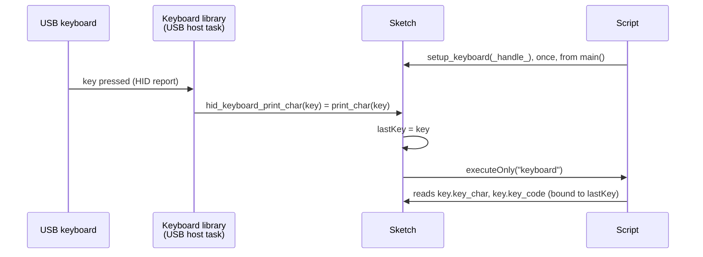

1. **The script registers itself.** Its `main()` calls `setup_keyboard(_handle_)`. `_handle_` is the address of the script's own `ScriptExecutable`, filled in by the loader; the sketch keeps it in `keyboardScript`. This is the same pattern as the 5" sketch, and it lets the script decide when it starts receiving keys.
2. **The library reports a key.** The keyboard library runs its own USB host task. When a key arrives it translates the HID code into a character and calls the function pointer `hid_keyboard_print_char`, which the sketch set to `print_char()`.
3. **The sketch stores the key and calls the script.** `print_char()` copies the key into `lastKey` and calls `keyboardScript->executeOnly("keyboard")`.
4. **The script reads the key.** In the script, `key` is bound to the sketch's `lastKey`: `key.key_char` and `key.key_code` are read straight from the sketch's memory, no copy.

## The sketch, part by part

**The key and its structure.** `struct key_return { unsigned char key_char; unsigned char key_code; }` is defined in the keyboard library's header, not in the sketch, so it is bound with [`BIND_STRUCT`](#a-structure-from-a-library), which writes the script's definition from the C type and checks the layout:

```cpp
key_return lastKey;                                   // the last key, filled by print_char()

BIND_STRUCT(key_return, key_char, key_code);          // the script knows key_return
bindVariable((char *)"key_return", (char *)"key", NULL, (void *)&lastKey);   // `key` in the script is lastKey
bindFunction((char *)"void", (char *)"setup_keyboard", (char *)"uint32_t", (void *)setup_keyboard);
```

**The callback.** It runs on the keyboard library's task, once per key:

```cpp
void print_char(key_return k)
{
   lastKey = k;
   if (keyboardScript != NULL)
      keyboardScript->executeOnly("keyboard");
}
```

`executeOnly()` and not `execute()`: `execute()` first runs the script's top-level initialization again (global initializers and constructors), which would reset `len` to 0 and lose the line on every key. `executeOnly()` only calls the function, so the script's globals keep their values between keys.

**`setup()`**, in this order:

| Step | Why there |
|---|---|
| `BIND_STRUCT`, `bindVariable`, `bindFunction` | Bindings must exist before compiling. |
| `static ScriptExecutable exec = parseScript(script);` | `static`: the script must outlive `setup()`, since keys arrive later. A local would be freed when `setup()` returns. |
| `exec.execute("main");` | Runs the initialization, then `main()`, which calls `setup_keyboard(_handle_)`. |
| `hid_keyboard_print_char = print_char; app_main_keyboard();` | Only now start the USB host: the script is ready for the first key. |

## The script

```c
char line[100];
int len = 0;

void keyboard()
{
   if (key.key_code == 40)            // Enter: show the line typed
   {
      printf("line (%d chars): ", len);
      for (int i = 0; i < len; i++)
         printf("%c", line[i]);
      printfln("");
      len = 0;
   }
   else if (key.key_code == 42)       // Backspace
   {
      if (len > 0)
         len--;
      printfln("backspace, %d chars", len);
   }
   else if (key.key_char != 0)        // a key that types something
   {
      if (len < 99)
      {
         line[len] = key.key_char;
         len++;
      }
      printfln("key '%c' code %d", key.key_char, key.key_code);
   }
   else                               // Shift, arrows, F keys...
      printfln("key code %d (no character)", key.key_code);
}

void main()
{
   setup_keyboard(_handle_);
   printfln("ready: type on the USB keyboard, Enter shows the line");
}
```

`key_code` is the USB HID usage code of the key (40 Enter, 42 Backspace, 41 Escape, 79 to 82 the arrows, 225 left Shift), and `key_char` the character it types, or 0 when it types none. The library already applies Shift: `!` arrives as `key_char` `'!'`.

Typing `hiy`, Backspace, `!` and Enter prints:

```
ready: type on the USB keyboard, Enter shows the line
key 'h' code 11
key 'i' code 12
key 'y' code 28
backspace, 2 chars
key '!' code 30
key code 225 (no character)
line (3 chars): hi!
```

## Going further

- **Change what the keys do without re-flashing.** Edit the script text, recompile it with `parseScript()` (from a file, the serial port, a web page), and keys go to the new script once it has called `setup_keyboard(_handle_)`.
- **Bind more.** Give the script your display functions and `keyboard()` becomes a text editor or a game controller (the 5" sketch draws the typed line on its screen).
- **Keep `keyboard()` short.** It runs on the keyboard library's USB task; a long computation there delays the next keys. Store the key and let a script running as a task (see [Running scripts in the background](#running-scripts-in-the-background)) do the heavy work.

> [!NOTE]
> - Nothing printed when typing: check the keyboard is powered by the S3's host port, and that the serial monitor is on the port `Serial` prints to (`ready: ...` appears at start-up when it is).
> - `BIND_STRUCT(key_return): ...` at start-up means your `keyboard.h` defines `key_return` differently: list its fields, in order.

---

# Saving executables

You can compile a script once, save the binary to LittleFS or an SD card, and run it later without the source, even from another sketch.

To compile without loading or running: `parseScriptToBinary()`. It returns `NULL` (and has printed the error) if something went wrong:

```cpp
// compiling sketch: never runs the script
uint32_t size = 0;
uint8_t *serialized = parseScriptToBinary(script, &size);
if (serialized != NULL)
{
   // ... write serialized (size bytes) to LittleFS / SD ...
   free(serialized);
}
```

To load it back: `createExecutableFromBuffer()`, which gives you a normal `ScriptExecutable`:

```cpp
// another sketch, later: doesn't need the source
bindVariable(...);   // same external names as when it was compiled
bindFunction(...);
// ... read the saved bytes into buf ...
ScriptExecutable exec = createExecutableFromBuffer(buf, size);
if (exec.isExeExists())
{
   int32_t result = 0;
   exec.execute("someFunction", &result);
}
```

See [SaveScriptBinary](examples/SaveScriptBinary) and [LoadScriptBinary](examples/LoadScriptBinary) for the full pair.

> [!NOTE]
> If you need the lower-level steps (printing the generated assembly before saving, keeping the raw `executable`...), `Parser`, `createBinary()`, `serializeBinary()`, `deserializeBinary()` and `createExecutableFromBinary()` are all still available. See [LanguageBasics](examples/LanguageBasics) where every step is spelled out.

## Binded functions

Same as v1: the bound functions and variables are not saved with the binary. The sketch that loads it needs to call `bindFunction()`/`bindVariable()` for every `external` name the script uses, **before** loading. They are matched by name, so the two sketches only need to agree on the names.

---

# What you can do with the language

Like any normal language you can have:
- loops (`while`, `for`)
- `break`, `continue`
- testing: `if`, `else`, `(test) ? true_statement : false_statement`
- `switch`/`case`/`default`, as in C (see [SwitchCase](examples/SwitchCase)):

  ```c
  switch (mode)
  {
  case MODE_FIRE:
     drawFire();
     break;
  case 1:
  case 2:            // either 1 or 2
     drawStars(mode);
     break;
  default:
  {
     int t = millis() / 100;   // a braced body can have its own variables
     drawPlasma(t);
  }
  }
  ```
  The case values are integer constants (a number, hex, negative, or a `#define`).
- blocks `{ ... }` with their own local variables
- `++`, `--`: for integers and pointers
- `+=`, `-=`, `/=`, `*=`
- pointers
- strings as `char *`: functions returning one (script or bound host function), `char *` parameters, `%s` in `printfln` (see [StringFunctions](examples/StringFunctions)):

  ```c
  char *dayName(int d)
  {
     if (d == 0)
        return "Sunday";
     return "weekday";
  }

  void main()
  {
     char *s = dayName(1);
     printfln("%s / %s", dayName(0), s);   // Sunday / weekday
  }
  ```
  NB: indexing a `char *` local (`s[0]`) is not supported yet.
- `^` for power (`x^2` is x squared, not a xor)
- `>>` and `<<`
- bitwise `&` and `|` (`if (bits & 1)`, `(v >> n) & 1`). NB: they bind like `*`, not below `+` and the comparisons as in C: `a + b & 4` is `a + (b & 4)`, so put parentheses around them when mixing
- `&&`, `||` (or `and`, `or`)
- type conversion `(float)(expr)`, `(int)(expr)`. The parentheses around `expr` are needed: `(int)x` alone doesn't compile.
  NB: the conversion float <-> int is automatic. In an expression whose result is a `float`, `/` between ints divides as floats, unlike C: `float f = 57 / 13;` is 4.38 (C: 4). Compute the quotient into an `int` first when you want C's. `%` between ints is the integer remainder there too (`float f = 57 % 13;` is 5).
- `define`: see below
- predefined functions:
  * `printf`, `printfln`
  * `alloc(size)`, `free(p)`, `writeInt(p, offset, value)`, `readInt(p, offset)`: the language has no `*p` syntax, so a block from `alloc()` is read and written with these (see [MemoryAllocator](examples/MemoryAllocator))

## Use of define

More or less like in C. **Unlike v1, the `#` is needed:**

```c
#define TOKEN 25

if (i < TOKEN)
{
  ...
}

will be compiled as

if (i < 25)
{
  ...
}
```

> [!NOTE]
> There are no macros yet.

---

# Running scripts in the background

You can run a script function as a task in the background (esp32 only): it runs on its own FreeRTOS task and `executeAsTask()` returns at once, so your sketch carries on.

```cpp
bool executeAsTask(const char *name,
                   uint32_t stackSize = 8192,
                   UBaseType_t priority = 1,
                   BaseType_t core = tskNO_AFFINITY,
                   const char *taskName = NULL);
```

|Parameter|What it is|Default|
|:----|:----|:----|
|`name`|the script function to run, e.g. `"main"`. It must stay valid while the task runs: a string literal is fine|--|
|`stackSize`|the task's stack, in bytes. Raise it for deep recursion or big local variables in the script|`8192`|
|`priority`|the FreeRTOS priority of the task. Arduino's `loop()` runs at 1, so with 1 they share the CPU; higher runs first|`1`|
|`core`|`0` or `1` to pin the task to that core, `tskNO_AFFINITY` to let FreeRTOS choose. Arduino's `loop()` runs on core 1, WiFi and Bluetooth on core 0|`tskNO_AFFINITY`|
|`taskName`|the name FreeRTOS shows for the task (task lists, statistics); `NULL` uses `name`. Same lifetime rule as `name`|`NULL`|

It returns `false` if the task could not be created (not enough memory for the stack, typically).

```cpp
exec.executeAsTask("main");                          // main() on its own task, defaults
exec.executeAsTask("main", 16384, 2, 0, "fire");     // 16KB stack, priority 2, core 0, named "fire"
```

Then, on that task:

|Call|What it does|Returns `false` when|
|:----|:----|:----|
|`exec.pause()`|stops the task where it is (`vTaskSuspend()`)|it is not running|
|`exec.restart()`|carries on from where it stopped (`vTaskResume()`); not a fresh start, call `executeAsTask()` again for that|it is not paused|
|`exec.kill()`|deletes the task (`vTaskDelete()`), also freeing a task whose function has already returned|it was not running or paused|
|`exec.state()`|`ScriptState::notStarted`, `running`, `paused` or `stopped` (killed, or the function returned)|--|
|`exec.isRunning()`, `exec.isPaused()`|shortcuts for the two states|--|
|`exec.task()`|the FreeRTOS `TaskHandle_t`, for reading its statistics (`vTaskGetInfo()`...); control the task through the calls above|--|

A control that doesn't apply (pausing a paused script...) does nothing and returns `false`. Calling `executeAsTask()` again kills the previous task first, and `free()` or the end of the `ScriptExecutable` kills it too. See [ExecuteAsTask](examples/ExecuteAsTask).

> [!WARNING]
> You can't choose where the task is stopped. It can be inside a host function the script called, holding `Serial`, a lock or a mutex of yours. If that matters, give the script a host function to call in its loop that checks a flag and returns at a point you choose.

## The script scheduler

To run several scripts at once and manage them by name, as v1's `scriptRuntime` did, use `scriptScheduler` (`script_scheduler.h`, esp32 only). Each running script is a FreeRTOS task of its own, and the scheduler also tells you how much CPU each one uses:

```cpp
#include "script_scheduler.h"

scriptScheduler.add("busy", busyScript);         // compile and register
scriptScheduler.add("blink", blinkScript);
scriptScheduler.run("busy", "main", 8192, 1, 1); // its own task, pinned to core 1
scriptScheduler.run("blink");                    // default: main(), 8KB stack, any core

scriptScheduler.list();                          // the table below
scriptScheduler.pause("busy");                   // vTaskSuspend()
scriptScheduler.restart("busy");                 // vTaskResume(): carries on where it stopped
scriptScheduler.kill("blink");                   // vTaskDelete()
scriptScheduler.remove("blink");                 // kill, free, forget
```

`list()` prints:

```
 #  name             state      CPU%   stack   code   data core prio  function
 1  busy             running    82.2    7328    176     32    1    1  main
 2  blink            running     0.0    7336     64     24  any    1  main
 3  countdown        stopped       -    6228    128     68  any    1  main
    core 0 load 0.0%   core 1 load 83.8%
```

|Column|Meaning|
|:----|:----|
|`state`|`ready` (added, never run), `running`, `paused`, `stopped` (killed, or its function returned)|
|`CPU%`|share of one core used since the previous `list()` or `sample()`, from FreeRTOS run-time statistics|
|`stack`|bytes of its task's stack never used so far (FreeRTOS high water mark)|
|`code`, `data`|bytes of machine code and of globals|
|`core`, `prio`|what `run()` asked for|
|core load|100% minus the time each core's idle task ran|

|Call|What it does|
|:----|:----|
|`add(name, source)`|compiles `source` and registers it as `name`, replacing a script of the same name; `false` if it doesn't compile (`showCompileError()` says why)|
|`run(name, function, stackSize, priority, core)`|runs `function` (default `"main"`) on a new task and returns at once (v1's `executeAsTask`). `stackSize` (default `8192` bytes), `priority` (default `1`) and `core` (default `tskNO_AFFINITY`) mean the same as for `executeAsTask()` above; the task is named after the script|
|`execute(name, function)`|runs it on the calling task and waits (v1's `execute`)|
|`pause(name)`, `restart(name)`, `kill(name)`|stop where it is, carry on, delete the task|
|`remove(name)`|kill, free the compiled script, forget the name (v1's `deleteExe`)|
|`killAll()`, `removeAll()`|the same for every script|
|`list()`, `sample()`, `coreLoad(core)`|the table, a CPU measurement, a core's load|
|`count()`, `info(index or name, &info)`|the same figures in a `ScriptInfo`, to show them your own way|
|`find(name)`|the script's `ScriptExecutable`, for `executeOnly()`, an interrupt...|

It is all FreeRTOS underneath: `xTaskCreatePinnedToCore()`, `vTaskSuspend()`/`vTaskResume()`/`vTaskDelete()`, a mutex around the registry, `vTaskGetInfo()` for the CPU time and `uxTaskGetStackHighWaterMark()` for the stack. There is no STL in it: the registry is a fixed array of `SCRIPT_SCHEDULER_MAX` scripts (8; `#define` it before including the header for more). See [SchedulerDemo](examples/SchedulerDemo), which pauses, restarts, kills and removes scripts while they run.

> [!WARNING]
> A script running as a task has to give the CPU back from time to time, by calling a host function that waits (a bound `delay()`...). Otherwise the lower-priority tasks of its core never run, including on core 0 the idle task the task watchdog checks: after 5 seconds the board resets.

What v1 has and v2 doesn't yet: `sync()` to synchronize the frames of several scripts, and pre/post kill. See [Known limitations](#known-limitations).

---

# Performance

Everything below was measured on a real esp32 (no PSRAM) at 240MHz, with `micros()` around the script's code only: compiling, and sending a frame to the leds (`show()`), are not counted. "Native" is the same code written in C++ and compiled by the Arduino IDE (gcc `-Os`); "v1" is ESPLiveScript 1.2.0. Where a test calls `hsv()`, it is FastLED's `CHSV` to `CRGB` conversion, for the script and the native code alike, as in a sketch driving a real panel. Every script result was checked against the native one: same frames, same checksums.

## Summary

|Test|Native|v1|v2|v2 / native||
|:----|----:|----:|----:|:----:|:----|
|`fib(40)`, recursive (331 million calls)|16.96s|22.41s|21.72s|1.28|`█████████████`|
|Game of Life 128x128, per generation|5.95ms|14.67ms|7.13ms|1.20|`████████████`|
|Mandelbrot 128x96 `float`, per frame|33.5ms|94.5ms|41.9ms|1.25|`████████████`|
|Mandelbrot 128x96 `ffloat`, per frame|30.0ms (fixed point)|--|31.5ms|1.05|`██████████`|
|60 bouncing balls 128x96 `float`, per frame|6.49ms|--|8.38ms|1.29|`█████████████`|
|60 bouncing balls 128x96 `ffloat`, per frame|7.02ms (fixed point)|--|6.86ms|0.98|`██████████`|
|Rainbow 128x96, one `hsv()` call per pixel, per frame|7.12ms|--|7.13ms|1.00|`██████████`|
|GPIO on/off through the registers|9.9MHz|--|9.9MHz|1.00|`██████████`|

<sub>Each █ is a tenth of the native time: ten blocks is exactly as fast as native code, fewer is faster.</sub>

So a script takes 1 to 1.3 times as long as precompiled code, and the same time when calls to the host (`hsv()` here) dominate; the `ffloat` balls are even slightly faster than the fixed point written by hand in C++. Against v1 it is 2 to 2.3 times faster on loops, arrays and floats, and about the same on function calls. The effects of a real multi-effect script are in [A real script: MultiEffectController](#a-real-script-multieffectcontroller).

## Function calls: fib(40)

```C
int fib(int n)
{
   if (n < 2)
      return n;
   return fib(n - 1) + fib(n - 2);
}
```

`fib(40)` = 102334155 takes 21.7s, about 15.7 cycles per call. At this recursion depth most of a call's cost is the register window overflow and underflow exceptions of the Xtensa windowed ABI, which native code pays too: gcc turns the second call into a loop, so it makes half as many calls. See `examples/FibonacciTiming`.

QEMU does not charge for the window exceptions, so it reads about 5 cycles per call: don't project real hardware times from it.

## Loops and arrays: Game of Life

`examples/GameOfLife`'s script on a 128x128 grid (`uint8_t copy[128, 128]` plus two line buffers, `external CRGB leds[128, 128]`), 50 generations: 357ms in the script, 297ms native, the 51 frames identical. v1 takes 733ms.

What closed most of the gap: array addresses and constants loaded once before a loop instead of at every access, locals kept in registers instead of the stack, 2D indexes computed with shifts, and `a && b` in a condition compiled as one branch per comparison (stopping at the first false one, as in C).

## Floating point: Mandelbrot

The Mandelbrot set on a 128x96 matrix, 50 iterations, `examples/MandelbrotCompare` (which runs all four versions and prints their times and checksums):

|Version|Time per frame|Checksum|
|:----|----:|:----:|
|Native `float`|33.5ms|0c584e72|
|Native fixed point|30.0ms|c026b3cf|
|Script `float`|41.9ms (24fps)|0c584e72|
|Script `ffloat`|31.5ms (32fps)|c026b3cf|
|v1 `float`|94.5ms|0c584e72|

The inner loop (`while (iter < maxIterations && x2 + y2 <= 4)`) is 12 instructions in `float`: the condition is two branches, the constants 2.0 and 4.0 are set once before the loop, and float registers are only saved around a call (the per-pixel divisions, `hsv()`) when their value is still needed after it.

## Structs and methods: bouncing balls

60 balls (a struct with a constructor and two methods, the scripts of `examples/BouncingBalls` and `examples/BouncingBallsFfloat`) drawn on a 128x96 matrix, 100 frames, each clearing the matrix and calling `hsv()` for every pixel lit, `examples/BouncingBallsCompare`:

|Version|Time per frame|Checksum|
|:----|----:|:----:|
|Native `float`|6.49ms|d82c6aa0|
|Native fixed point (16.16)|7.02ms|96c0e39f|
|Script `float`|8.38ms|d82c6aa0|
|Script `ffloat`|6.86ms|96c0e39f|

Here `ffloat` is 18% faster than `float` in a script, and slightly faster than fixed point written by hand in C++.

> [!TIP]
> The esp32 has a single-precision FPU, so `float` is already fast. `ffloat` wins where conversions, divisions and integer mixing dominate, as in the balls; in the Mandelbrot's inner loop it is fixed-point multiplies against single float instructions.

## Calling a host function per pixel: rainbow

`examples/RainbowCompare` draws a scrolling rainbow, 100 frames, the offset `h` going up by one each frame:

```C
for (int i = 0; i < width; i++)
   for (int j = 0; j < height; j++)
      leds[j * width + i] = hsv(i + h + j, 255, 180);
```

Every pixel is a call to the host's `hsv()` (FastLED's `CHSV`) and a `CRGB` store: 12288 calls per frame.

|Version|Time per frame|
|:----|----:|
|Native|7.12ms (140fps)|
|Script|7.13ms (140fps)|

The 100 frames are identical (same hash). The time is FastLED's colour conversion: around it, the script's loop and call cost the same as native code. With a small integer `hsv()` instead (`USE_FASTLED_HSV 0` in the example), native took 4.25ms and the script 6.77ms (measured on 2026-11-01). The script compiles in 0.12s.

## A real script: MultiEffectController

`examples/MultiEffectController` is a 730-line script: a particle fountain, stars, ripples, comets and a plasma, drawn on a 128x96 matrix with a fading trail, all host functions bound (`hsv()` is the sketch's own integer conversion here). Each effect function below was called 100 times on its own with `executeOnly()`, with `millis()` made to return a fixed sequence so the plasma draws the same frames in every build. Time per call:

|Effect|What it does|Time per call|
|:----|:----|----:|
|`fadeTrail()`|fades the 128x96 trail buffer|0.51ms|
|`renderParticles()`|160 particles (structs with methods): move, sort by life, draw, stamp the trail|1.55ms|
|`renderStars()`|twinkling stars: update, sort by brightness, draw|2.01ms|
|`renderRipples()`|expanding rings, restarted when they fade|1.07ms|
|`renderComets()`|move and draw the comets, stamp the trail|0.21ms|
|`renderPlasma()`|four `sin()`, one `hypot()` and six float divisions per pixel|28.1ms|
|`drawModeIndicator()`|the mode bar on the top row|0.06ms|

The plasma's time is the 12288 x 11 calls to `sin()`, `hypot()` and the float division routine. The frames are the same, hash for hash, as with the previous version of the compiler, which took 2.06ms for the particles, 1.18ms for the ripples and 0.37ms for the comets.

## GPIO switching speed

`examples/DirectGPIOSpeed` switches a pin on and off 10000 times by writing the GPIO registers from the script: 1011us, against 1006us for the same loop in C++. That is 9.9MHz on the pin (10MHz on a signal analyser), about 24 cycles per on/off. Both are limited by the peripheral bus, not by the code.

## Constant indexes and structure copies

A constant index is part of the instruction: `arr[3]` is one `l32i a2,a6,12`, and so are `parts[2].h` and `p[2].x` through a pointer. A structure passed by value is copied field by field, without its padding. Each function below called 20000 times on an esp32 at 240MHz, against the version before 2.0.0, which computed `index × size` at run time:

|Code|Before|Now|
|:----|----:|----:|
|`p[2].x = p[1].x + p[3].h; p->h = p[2].h + 1;` through `P *p`|6.20ms|**3.10ms**|
|`table[3] = table[1] + table[2]; table[7] = table[3] + table[5];`|8.29ms|**5.36ms**|
|`int byValue(P b) { return b.x + b.h; }` with a 16-byte `P`|2.52ms|**2.27ms**|

A variable index (`arr[i]`) is computed as before.

## Compiling

|Script|Lines|Compile time|
|:----|----:|----:|
|`fib()`|12|40ms|
|Rainbow|16|0.12s|
|Game of Life|55|0.78s|
|`MultiEffectController`|730|11s|

The compiler and runtime add about 162KB of flash and 8.6KB of RAM to a sketch. The loader alone (to run a saved binary, see [Saving executables](#saving-executables)) adds 10KB of flash and 1KB of RAM. A short script needs around 30-40KB of heap to compile; `MultiEffectController` uses most of a PSRAM-less esp32's heap but fits. Compiling gives back everything it allocates except the compiled script itself, so compiling again and again (a live-coding session, a scheduler replacing scripts) keeps the free heap flat.

---

# Advanced stuff

## Pointer to the executable and interrupts

Every script has a variable `_handle_` holding the address of the executable running it (v1 called it `_execaddr_`). You can use it to register an interrupt:

```c
external void pinInterrupt(uint32_t exec, char *name, int pin);

int number = 0;
void increase()
{
   number++;
}

void main()
{
   pinInterrupt(_handle_, "increase", 23);
   while (true)
   {
      printfln("number:%d", number);
   }
}
```

`pinInterrupt` is a normal bound function and the interrupt itself is set up on the C++ side (`gpio_isr_handler_add()`...). See [PinInterrupt](examples/PinInterrupt) for the complete sketch.

> [!WARNING]
> In the interrupt handler call the script with `callFunction((executable *)handle, name, NULL, 0, NULL)` or `exec.executeOnly(name)`, not `execute()`. `execute()` runs the global initializers first and would reset the script's globals on every interrupt.

---

# Testing

This is the part that is really new compared to v1:

- `test/host/`: the compiler built as a normal program on a computer. `make run` for the main suite, `make check-optimized` (same suite at `-Os`, the Arduino default), `make check-asan` (AddressSanitizer), `make run-sc` (every script from v1's `sc_examples`), `make run-large` (a size check for an esp32 without PSRAM).
- `test/qemu/`: the compiled machine code executed on Espressif's QEMU emulator: arithmetic, external calls, recursion, arguments, external variables, save/load, and the `fib()` timing above (run with QEMU's `-icount`, so its cycle counts are exact whatever else the computer is doing). See `test/qemu/README.md`.
- `test/effects/`: the led effects of the examples (plasma, fire, voronoi, mandala, Mandelbrot...) run under QEMU and compared frame by frame with the same code written in C.
- `test/fuzz/`: random programs run through the compiler and as plain C, results compared. Every bug found is kept in `test/fuzz/regressions/`. See `test/fuzz/README.md`.

---

# Examples

| Example | What it shows |
| --- | --- |
| `SimpleScript` | The first light example above. |
| `CompileErrors` | Scripts that don't compile (undeclared variable, missing `;`): the printed error, `showCompileError()`, and `lastCompileError()` to show it your own way. |
| `ScriptPrintf` | Printing from a script with `printf()`/`printfln()`. |
| `Factorial` | `Arguments`: calling a function several times with different values. |
| `CallScriptFunction` | Calling a function with a raw `int32_t[]` and using its return value. |
| `TwoScripts` | Two scripts one after the other, freeing the first with `exec.free()`. |
| `FibonacciTiming` | Timing a script with `micros()`. |
| `DisplayIcon` | v1's `dsiplayicon.sc` unchanged: pixel-art sprites with palettes over a scrolling rainbow, `sync()` as the display's show (see [A v1 script: the display icon](#a-v1-script-the-display-icon)). |
| `BouncingBalls` | Structs with methods and constructors, an array of structs, several bound functions. |
| `StructsAndHostBindings` | Structs with `bindFunction()`/`bindVariable()`, smaller. |
| `StructArguments` | Structures by value and by pointer, `->`, `&`, and the sketch calling a script function with a pointer to its own struct (see [Structures](#structures)). |
| `HostStructs` | A structure defined once in the sketch with `SCRIPT_STRUCT`, shared with the script through `bindStruct()`, as a variable and an array. |
| `LibraryStruct` | `BIND_STRUCT()`: structures defined in libraries (the USB keyboard's `key_return`, the C library's `struct tm`) bound to a script, layout checked. |
| `KeyboardCallback` | An `external` variable, calling a loaded script again from an event handler. |
| `JsonLiveSettings` | A script on its own task getting new JSON settings every 2 seconds, applied between two frames. esp32 only. |
| `JsonInput` | Script variables filled from a JSON document given to `execute()`, as in v1's `jsonexample` (needs ArduinoJson). |
| `KeyboardTest` | A USB keyboard on an ESP32-S3 driving a script: the library's `key_return` bound with `BIND_STRUCT`, `executeOnly()` on every key (see [A USB keyboard driving a script](#a-usb-keyboard-driving-a-script)). Needs the `ESP32_USB_Host_HID` library. |
| `LanguageBasics` | Every compiling step one by one, printing the AST and the generated assembly. |
| `SaveScriptBinary` / `LoadScriptBinary` | Compile once, save to flash, load and run from another sketch. |
| `PrintBinaryHex` | Hex dump of a compiled script and its relocation header. |
| `PrintFibonacciAssembly` | The generated Xtensa assembly of a recursive `fib()`, then running `fib(10)`. |
| `MultiEffectController` | A real multi-effect script of several hundred lines, every binding real. |
| `GameOfLife` | Conway's Game of Life on a 2D `external CRGB leds[h, w]` matrix. |
| `ProceduralEffects` | Five effects for a 128x96 matrix: plasma, fire, Voronoi, mandala and spinning squares ([frames](examples/ProceduralEffects/README.md)). |
| `FloatVsFfloat` | The same calculations in `float` and in `ffloat`, timed side by side. |
| `BouncingBallsFfloat` | The bouncing balls with `ffloat`, and how to stay within ±32768. |
| `MandelbrotFfloat` | The float Mandelbrot with `float` replaced by `ffloat`. |
| `BouncingBallsCompare` | The bouncing balls four ways -- native C++ float and fixed point, script `float` and `ffloat` -- timed, with checksums (see [Performance](#structs-and-methods-bouncing-balls)). |
| `MandelbrotCompare` | The Mandelbrot set four ways -- native C++ float and fixed point, script `float` and `ffloat` -- timed, with a checksum showing they draw the same picture. |
| `MandelbrotFixedPoint` | The Mandelbrot set with integers only, fixed point done by hand. |
| `SchedulerDemo` | Three scripts on their own tasks, managed by name with `scriptScheduler`: list with CPU %, pause, restart, kill, remove. esp32 only. |
| `ExecuteAsTask` | `main()` on its own FreeRTOS task, with `pause()`/`restart()`/`kill()`/`state()`. esp32 only. |
| `PinInterrupt` | A GPIO interrupt calling back into the running script. esp32 only. |
| `DirectGPIO` | Driving pins from a script through the GPIO and IO_MUX registers; esp32 and esp32-S3. |
| `RainbowCompare` | A scrolling rainbow drawn by a script and natively, 100 frames timed, with a hash showing they are identical (see [Performance](#calling-a-host-function-per-pixel-rainbow)). |
| `DirectGPIOSpeed` | The fastest a script can switch a pin through the registers, timed against native code (see [GPIO switching speed](#gpio-switching-speed)). |
| `SwitchCase` | `switch`/`case`/`default`: a state machine, shared cases, fall-through, `break` vs `continue`. |
| `StringFunctions` | `char *` in and out of functions, `%s`. |
| `MemoryAllocator` | `alloc()`/`free()`/`writeInt()`/`readInt()`. |
| `SafeMode` | `safe_mode`: an out-of-range write stops the script and reports the array and index. |

### On the ESP32-S3-Touch-LCD-7

The examples in [examples/matouch](examples/matouch) are for the **ESP32-S3-Touch-LCD-7**, a 7-inch **800x480** RGB touch screen with an ESP32-S3 (16MB flash, 8MB PSRAM). Each script draws straight into the screen's frame buffer, bound as `led16` (a `uint16_t *`, see [Binding an array or a pointer](#binding-an-array-or-a-pointer)), and calls `show16()` for each frame.

| Example | What it shows |
| --- | --- |
| `matouch/RainbowScript` | A scrolling rainbow over the whole 800x480 screen. |
| `matouch/BouncingBalls` | Bouncing balls, each erased and redrawn per frame, the display and the script on separate cores. |
| `matouch/GameOfLife` | Conway's Game of Life on 800x480 cells, or bigger cells with `setPixelsize()`. |
| `matouch/Mandelbrot` | A Mandelbrot zoom in `float` on the full 800x480 (`setPixelsize(1)` in the script; 2, 3 or 4 for bigger cells and faster frames), starting over after 300 frames. |
| `matouch/Tetris` | Tetris at 400x240 (`setPixelsize(2)`) played with a USB keyboard (Q left, D right, Z rotate, S down, Space drop): a colour per tetromino drawn as bevelled blocks, a ghost of the landing place, score, lines, level and next piece in a 3x5 pixel font drawn by the script. Needs the ESP32_USB_Host_HID library as in [A USB keyboard driving a script](#a-usb-keyboard-driving-a-script). |
| `matouch/CreateTetrisBinary` | Compiles the Tetris script and saves the compiled binary to the microSD card as `/tetris.bin` (read back and checked). Prints only: run it once, then upload ExecuteTetrisBinary. |
| `matouch/ExecuteTetrisBinary` | Plays Tetris from `/tetris.bin` without compiling: the sketch has no script, it loads the binary and binds its names. On the board: compiling the script takes 9.9 s, loading the binary 3 ms, and the sketch is 100 KB smaller without the compiler. See [Saving and loading compiled scripts](#saving-and-loading-compiled-scripts-script_executableh). |
| `matouch/MazeChase` | A maze game at 400x240 played with a USB keyboard (Z Q S D): an orb eats the dots while four drones hunt it, each with its own strategy; power cells, a bonus apple, score, high score, lives and levels. Plays itself until Space is pressed. |
| `matouch/NeonRacer` | An anti-gravity race at 400x240 on a neon track in perspective (curves, hills, boost pads), against three rivals over 3 laps, played with a USB keyboard (Q D steer, S brakes). Runs by itself until Space is pressed. |
| `matouch/PrismBreak` | A brick breaker at 400x240: patterned bevelled bricks (silver take two hits, gold none), a scrolling diamond background, a metal-framed field, sparks, falling capsules (wider paddle, three balls, slower ball, a life), five layouts. Q D move the paddle, S stops it, Space serves. Plays itself until Space is pressed. |
| `matouch/XenoWing` | A horizontal shoot'em up at 400x240: an organic manta ship over an alien world in five parallax layers (a ringed planet, mountains, a forest of strange trees, crystals, plants in front), waves of bio creatures, a boss, power-ups and spore bombs. The art is pixel art in flash, bound to the script as pointers. Plays itself until Space is pressed. |
| `matouch/GameLauncher` | A menu of compiled games read from the FFat partition (Tetris, MazeChase, NeonRacer, PrismBreak and XenoWing are in its `data` folder): pick one with the keyboard, it loads in a few milliseconds and runs; Escape comes back to the menu. |

In every game, **Escape** gives the game up (Tetris ends it, the others go back to their demo; in the GameLauncher it goes back to the menu), and the **arrow keys** work as Z Q S D.

Board settings: *ESP32S3 Dev Module*, PSRAM *OPI PSRAM*, Flash Size *16MB*. They need FastLED and a LovyanGFX with the modified `Bus_RGB` driver (double frame buffer with `show()`); `Matouch7.h`, next to each sketch, is the screen's configuration.

#### Tetris: a whole game in a script

The scripts are not limited to LED effects: the language is a general-purpose one, compiled on the board into native Xtensa code. [matouch/Tetris](examples/matouch/Tetris) is a complete game written as a script of about 400 lines (17 functions, compiled into 5 KB of machine code and 1.4 KB of globals), and the sketch around it only connects the screen and the keyboard. Frames from a game, played by a program pressing the keys:

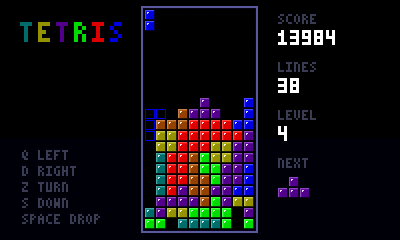

*Seven seconds of a game, up to a four-row clear (emulated ESP32-S3, real time).*

| | |
| --- | --- |
| 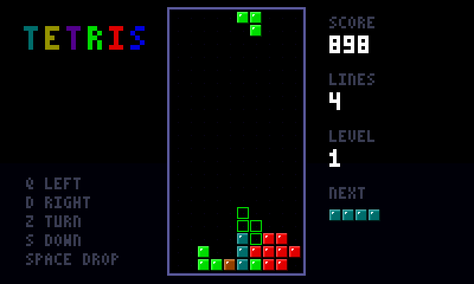 | 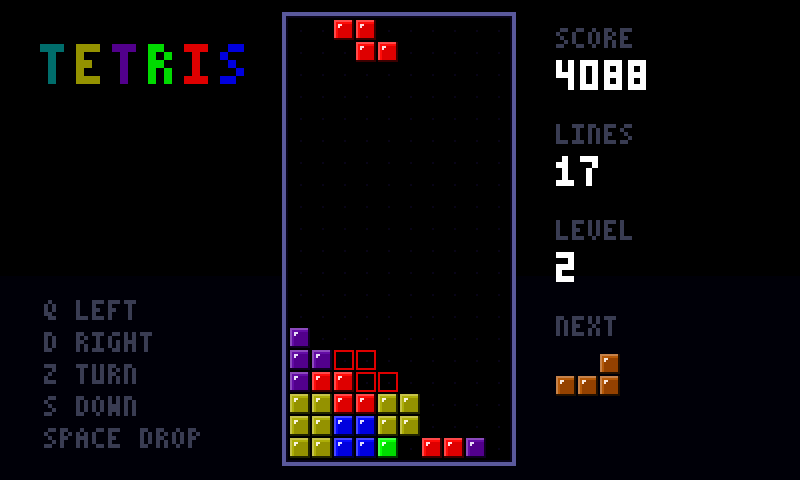 |
| The start of a game: each tetromino has its colour and is drawn as a bevelled block. | A falling piece and its ghost, the outline of where it will land. |
| 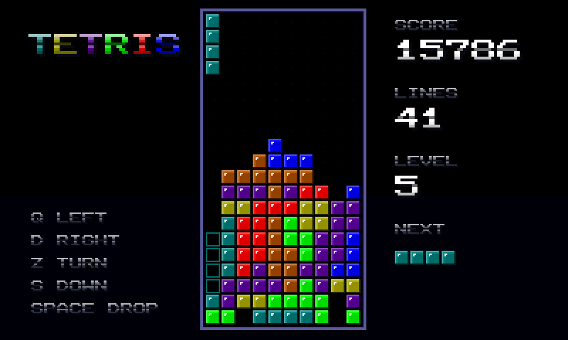 | 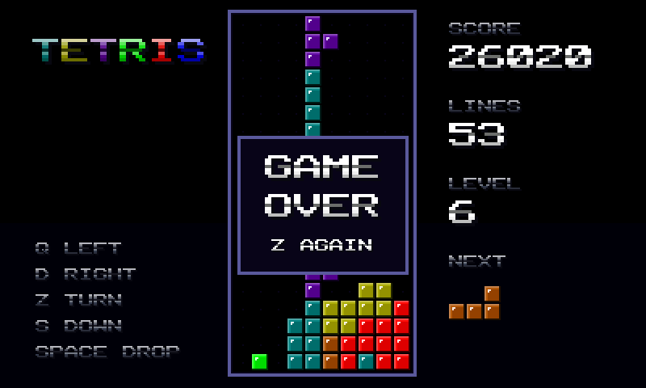 |
| Level 5: the I piece is about to clear four rows at once (800 points × the level). | Game over, with the score, the lines and the level. Z starts a new game. |

Everything on the screen is drawn by the script, pixel by pixel, into the frame buffer: the background, the well, the blocks, the text. What the game uses from the language:

- **arrays of 2 and 3 dimensions with initializers**: the well is `uint8_t board[BH, BW]`, the seven tetrominoes `uint8_t shapes[7, 4, 4] = {...}`, indexed `board[y, x]` or as one row of values (`shapes[p * 16 + i]`);
- **`#define` constants** for the layout (`CELL`, `BX`, `BW`...);
- **functions** with parameters and return values: `bool collide(int dx, int dy)` tells whether the piece fits after a move, and is used for moving, rotating (with a step aside when the piece hits a wall), dropping and the ghost;
- **strings**: `drawText(PANEL, 14, "SCORE", 2, grey)` passes a `char *` and walks it with `s[i]` until the 0;
- **a pixel font in an `int` table**: each character of the 3x5 font is 15 bits, read with `>>` and `&`; numbers are cut into digits with `%` and `/`;
- **game state in globals** (score, lines, level, the current and next piece), changed by the rules: lines are cleared by moving the rows down, the level goes up every 10 lines and the pieces fall faster;
- **the C++ side through bound functions**: `readKey()` for the USB keyboard, `millis()` for the falling speed, `rand(7)` for the next piece, `hsv2()` for the colours, `show16()` to show the frame; `led16`, the frame buffer, is a bound pointer.

As with any script, it is compiled from text when the sketch runs, so the game could come from an SD card, a file uploaded over WiFi or the serial port, and be changed without rebuilding the sketch.

The game can also be compiled once and kept on the SD card: CreateTetrisBinary saves the compiled binary, ExecuteTetrisBinary loads it in 3 ms instead of compiling for 9.9 s, the same 5152 bytes of code.

The frames above come from this script, compiled by the library and run on an emulated ESP32-S3 (Espressif QEMU), with `STRIDE` set to 400 because the emulator has no PSRAM for an 800-pixel-wide frame buffer.

#### MazeChase: a maze game with four hunters

[matouch/MazeChase](examples/matouch/MazeChase) goes further: about 1100 lines of script (13 KB of machine code, 11 KB of globals) for a maze game with its own maze, characters and rules. An orb eats the dots of the maze while four drones hunt it, each in its own way, and everything is drawn by the script each frame: the neon walls, the dots, the sprites, the text.

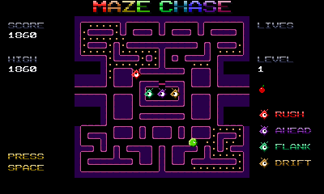

*Eight seconds of the demo: a power cell, the drones turning blue and fleeing, the apple (emulated ESP32-S3, real time).*

| | |
| --- | --- |
| 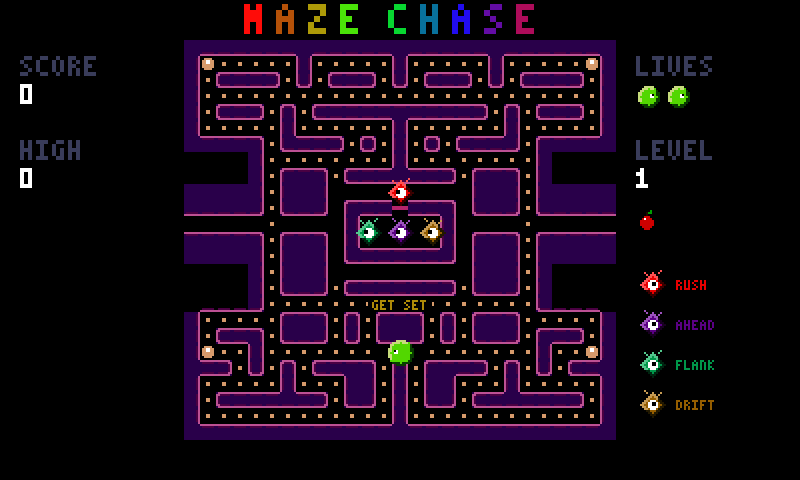 | 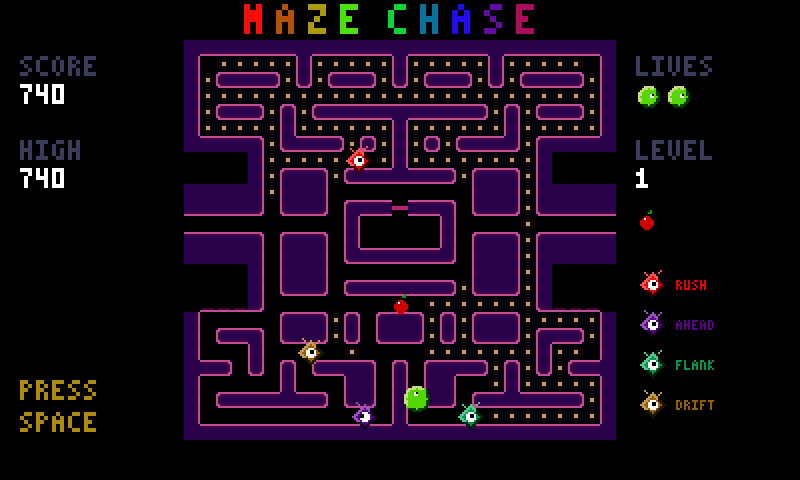 |
| GET SET: the drones wait in their base, crimson already out. | The four drones hunt the orb; the bonus apple waits under the base. |
| 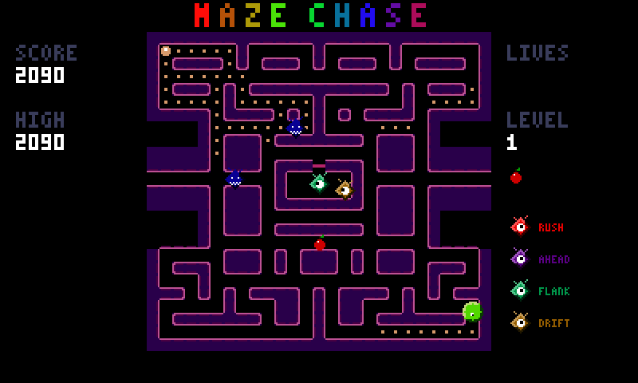 | 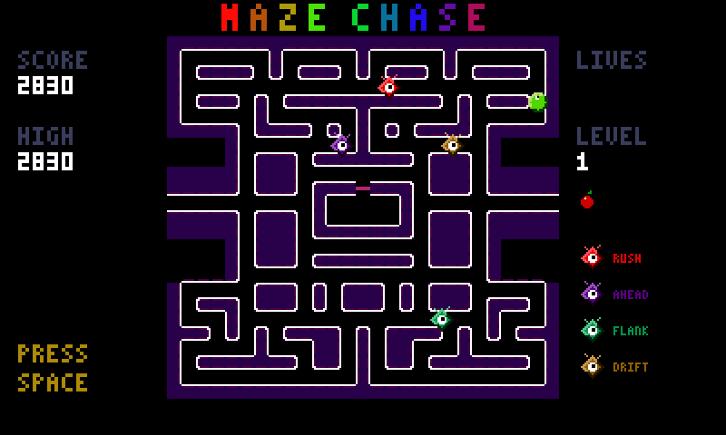 |
| After a power cell the drones turn blue and flee: the orb can eat them (200, 400, 800, 1600). | The last dot eaten: the maze flashes before the next, faster level. |

- **Four strategies**, one function: at each crossing a drone takes the way that brings it closest to its target, never turning back. Crimson targets the orb, violet 3 tiles ahead of it, teal the point opposite crimson across the orb (they close in from two sides), gold the orb when far away, and a random way when close. Waves of "go to your corner" and "chase" alternate on a timer, and every drone turns around when the wave changes.
- **Power cells** frighten the drones for a few seconds (shorter at each level); they flash before it ends. An eaten drone goes home as an eye, enters its base and comes out again.
- **The demo** is a player written in the script: a breadth-first search over the maze (arrays used as a queue) finds the nearest dot, power cell, apple or frightened drone, keeping 3 tiles away from the drones that can catch it. The frames above come from it.
- **Motion** at a fixed 60 steps per second, whatever the frame rate: each step adds the speed (in hundredths of a pixel) to an accumulator and moves one pixel per 100. The orb turns at tile centres, reverses at once, and takes the tunnels at the sides of the maze.

The game's logic was checked against the same code compiled by gcc: 8000 steps of demo play (a cleared maze, the next level, a lost game) give the same positions and scores on the emulated ESP32. Doing so found a compiler bug, fixed: negative values in a global array initializer (`int dys[4] = {-1, 0, 1, 0};`) were stored as 0. The frames come from the emulated ESP32-S3 like Tetris's.

#### NeonRacer: a race in perspective

[matouch/NeonRacer](examples/matouch/NeonRacer) draws a 3D track and 3D ships with nothing but the frame buffer and `float`s: about 1050 lines of script (15 KB of machine code, 16 KB of globals). A hover ship races three rivals over 3 laps of a neon track at sunset.

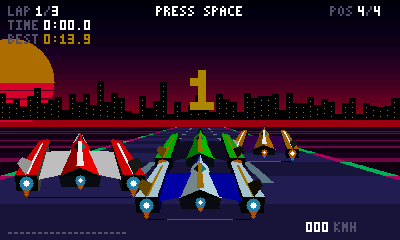

*Eight seconds from the start: GO, the pack of rivals, the first curve (emulated ESP32-S3, real time).*

| | |
| --- | --- |
| 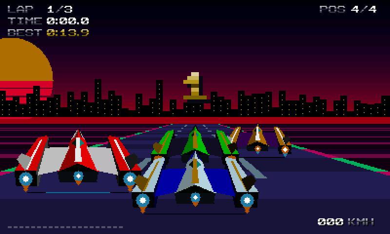 |  |
| The countdown, the four ships on the grid. | Side by side with a rival on a climb. |
| 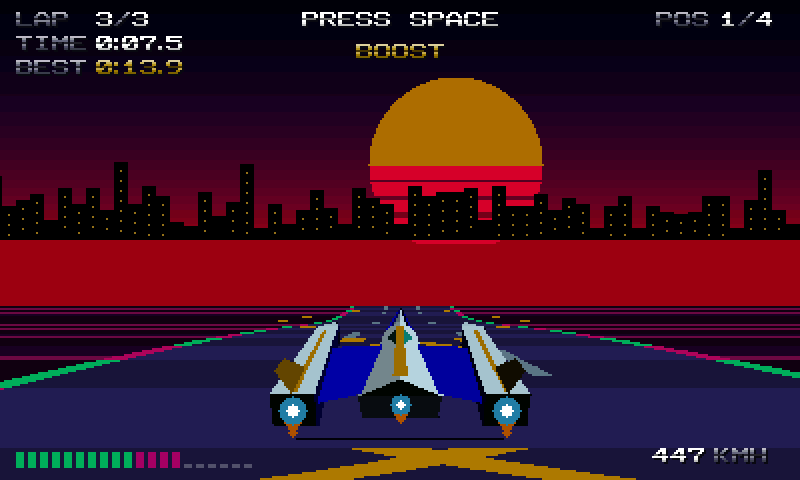 | 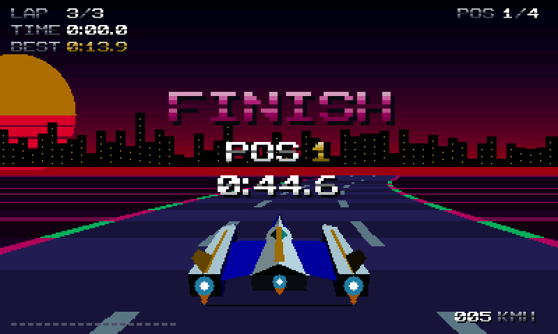 |
| Over the top of a hill, on the yellow chevrons of a boost pad. | The finish: the place and the race time. |

- **The track** is a list of 1000 segments, each with its curve and its height, built from 16 sections (the curves and hills ease in and out). Each frame projects the 70 segments ahead of the ship: a segment's point gives a screen line, a scale and a road width; the road is filled row by row between two lines, and a hill hides what is behind it (each line is only drawn above the previous one). The curve of each segment is added to a running offset, which bends the road.
- **The ships** are 3D models: 63 points and 35 faces (an arrowhead hull with a spine stripe and a glass canopy, two long engine pods on swept wings, canted fins, the team's two colours), seen from a camera behind and above. Each frame turns the points (rolled when the ship turns), projects them, sorts the faces from the farthest, and fills each as triangles in a shade given by the angle between the face and the light; the engines glow on top, with their exhaust. The model is a table of points and faces in the script, generated from a short description.
- **The rivals** are drawn after the road, farthest first, at the scale of their segment and cut by the hill in front of them. Each has its top speed and its way of weaving across the track; running into one from behind bounces the ship off.
- **The ship** is pulled outwards in the curves (more at speed), slows down in sparks off the track, and goes faster for a while after a boost pad. Speed, lap time, best lap and place are on the screen.
- **The sky**: a sun cut by bands, a city of lit towers, both sliding with the curves.

Its logic, checked against gcc like MazeChase's, gives the same positions, speeds, places and laps bit for bit, once the C side writes its constants as floats (`0.9f`): a script's `0.9` is a single-precision float, C's is a double.

#### PrismBreak: a brick breaker

[matouch/PrismBreak](examples/matouch/PrismBreak): about 1030 lines of script (12 KB of machine code, 8.5 KB of globals).

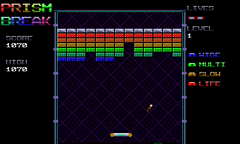

*Eight seconds of the demo (emulated ESP32-S3, real time).*

| | |
| --- | --- |
| 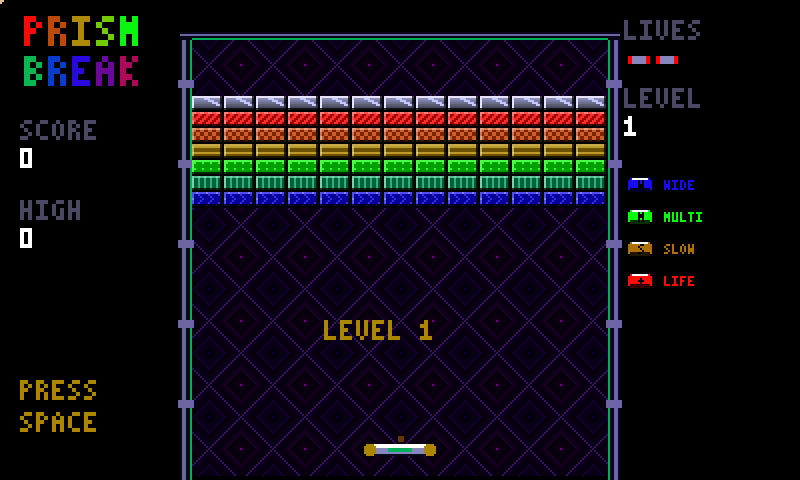 | 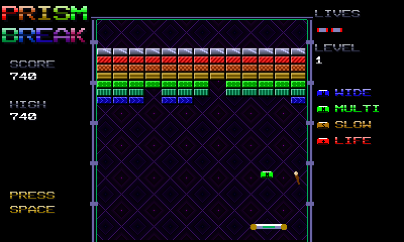 |
| The first layout: silver, then the six patterned colours. | A capsule falls from a broken brick. |
| 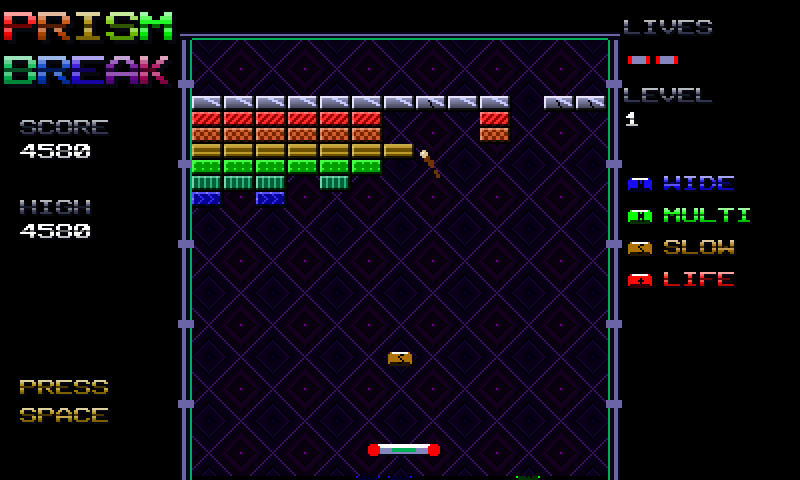 | 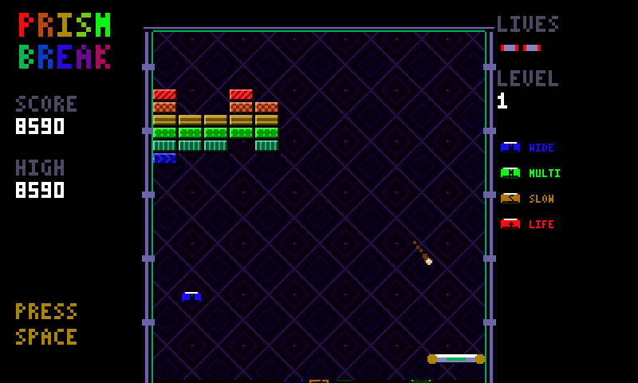 |
| Silver bricks crack at the first hit; a slow-ball capsule. | Late in the level, a wide-paddle capsule on the diamond background. |

- **Bricks** are textures made once at the start, 16 x 8 pixels per kind: each colour has its pattern (diagonal stripes, checks, bands, dots, vertical stripes, chevrons, cross hatching) inside a bevel; silver is a metal gradient with a shine and cracks at the first hit, gold has rivets and never breaks. Drawing a brick copies its texture; a hit makes it flash.
- **The background** is a 32 x 32 tile of diamonds in rings, made for each level in its colours and scrolled down slowly; the field is framed by metal pipes with joints and a glowing line.
- **The ball** moves in sub-steps, one axis at a time, so it can't pass through a brick, and bounces off the side it hit; where it meets the paddle sets its angle. It goes a little faster with each brick, up to a limit.
- **Capsules** fall from about one brick in five: W widens the paddle, M splits the ball in three, S slows it down for ten seconds, + is a life. Broken bricks throw sparks that fall.
- **Five layouts** (rows, a diamond, waves between gold posts, a fortress, stairs and a checker), then they start again, faster.
- **The demo** keeps the paddle under the ball that will come down first, working out where it lands with the side walls folded back.

Comparing its logic with gcc found how the language treats `/` between ints in an expression whose result is a `float`: it divides as floats (`float y = 40 + (57 / 13) * 8;` is 75.1, not 72, see below), so PrismBreak computes such values into `int` variables first; with that, 6000 steps of play match gcc exactly. It also found `%` giving its left value there (`float f = 57 % 13;` was 57); that one is fixed.

#### XenoWing: a shoot'em up with real art

[matouch/XenoWing](examples/matouch/XenoWing) goes beyond drawing with code: its sprites and backgrounds are pixel art, 650 KB of images in flash, which the script draws through bound pointers. About 1250 lines of script.

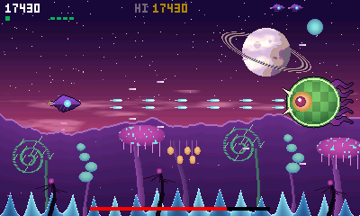

*Eight seconds of the boss fight, from the demo (emulated ESP32-S3, real time).*

| | |
| --- | --- |
| 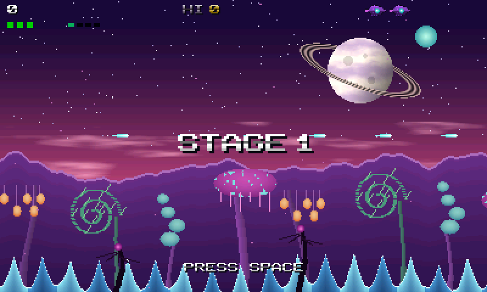 |  |
| Stage 1: the manta over the alien world. | Twin shots against a jelly over the forest. |
| 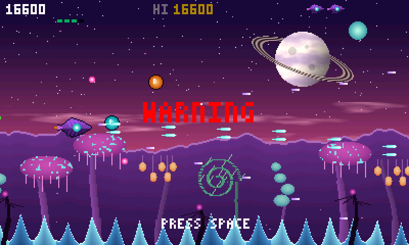 | 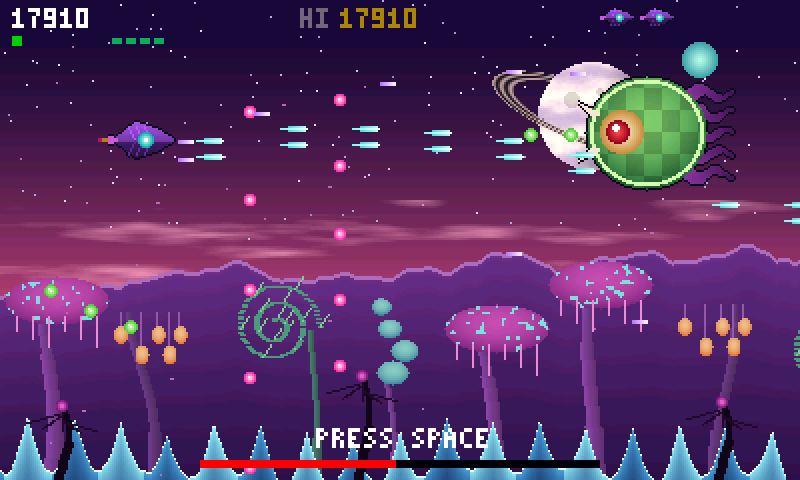 |
| WARNING: the hive mother is coming. | The hive mother fires spreads and spores; its life at the bottom. |

- **The art** is made by [tools/assets.py](examples/matouch/XenoWing/tools/assets.py) (pure Python, no library), which writes [xenowing_assets.h](examples/matouch/XenoWing/xenowing_assets.h): RGB565, byte-swapped as the frame buffer wants it, magenta for transparent. Every sprite is in one array, `gfx`; the script knows where each starts and its size from the `#define`s the tool writes, pasted at the script's top. The sketch binds the arrays as `uint16_t *` pointers (`bindVariable("uint16_t *", "gfx", NULL, &gfxPtr)`), so they stay in flash and cost no RAM.
- **Five layers** scroll at their own speeds: the sky (a ringed planet, a teal moon, clouds) stays, far mountains drift, a forest of strange trees (mushroom trees with glowing caps, twisted trunks with hanging bulbs, curled ferns, balloon pods) goes by, a crystal ridge passes fast, and dark plants pass in front. The ridges and the forest tile over 512 pixels. Each layer is drawn only where the layers in front of it leave gaps: the sky stops where the far mountains are solid.
- **The game**: the manta fires by itself; P orbs widen its shots (two, then four with a spread, then faster), B orbs give spore bombs that clear the screen. Bugs fly in waves on sine curves, jellies drift and aim spores at the ship, crawlers dash low and shoot ahead. After a minute: WARNING, and the hive mother, which sways, opens its eye and fires spreads and spores. The ship's weak point is its core only, as in arcade shooters. Each stage comes back faster.
- **Positions** are integers in sixteenths of a pixel, and the curves come from a 64-entry sine table, so the script needs no `float` at all.

Writing it found a third compiler bug, fixed: `if (rand(400) == 0)`, with `rand` returning a `uint32_t`, did not assemble ("Opcode bneu not found"). Unsigned comparisons use `bltu`/`bgeu`, but `==` and `!=` compare bits, signed or not, and Xtensa has no `bequ`/`bneu`; the compiler now uses `beq`/`bne` for them. A fuzz regression (`unsigned_equality`) checks it against gcc. No script that compiled before changes.

#### GameLauncher: games from the FFat partition

[matouch/GameLauncher](examples/matouch/GameLauncher) has no game in it: it lists the `.bin` files of the FFat partition, and loads and runs the one you pick. Its `data` folder holds `tetris.bin`, `mazechase.bin`, `neonracer.bin`, `prismbreak.bin` and `xenowing.bin`, the five games above compiled with `parseScriptToBinary()` (the same bytes as [CreateTetrisBinary](#saving-and-loading-compiled-scripts-script_executableh) makes on the board).

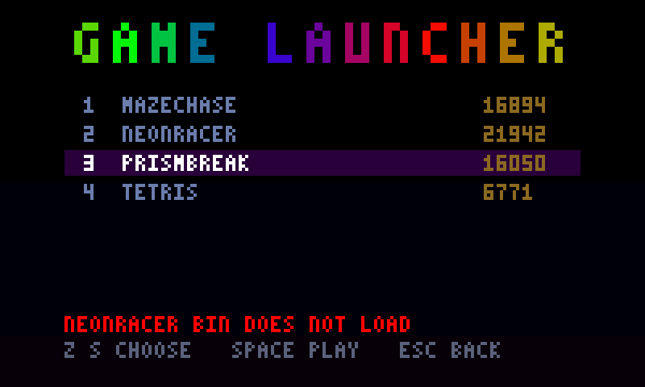

- **Keys**: Z/S or the arrows to choose, Space or Enter to play, 1-9 to play a game at once; in a game, Escape comes back to the menu. The arrows arrive in the games as Z Q S D.
- **Bindings**: the launcher binds the names the games use (`led16`, `width`, `height`, `hsv2`, `show16`, `setPixelsize`, `millis`, `rand`, `readKey`, and XenoWing's art: `gfx`, `sky`, `farRidge`, `forest`, `nearRidge`, `frontPlants`, from a copy of `xenowing_assets.h` in the launcher); any other game compiled against the same names shows up in the menu too.
- **Coming back**: each game runs on its own task (`executeAsTask()`). Every game calls `readKey()` once per frame; after Escape, `readKey()` never returns, so the game's task waits in a function of the sketch that holds nothing, and the launcher kills it and frees the game (built with placement `new`, since a `ScriptExecutable` can't be moved). Killing it anywhere else, inside `show16()` say, could leave the screen driver half way.

**Putting the data folder on the partition.** The partition scheme is *16M Flash (3MB APP/9.9MB FATFS)*: the FFat partition starts at `0x610000` and is `0x9E0000` bytes. FFat keeps a wear-levelling layer around the FAT, so the image is made with ESP-IDF's `wl_fatfsgen.py`, with the core's settings (4096-byte sectors, long names), and written with esptool:

```sh
python $IDF_PATH/components/fatfs/wl_fatfsgen.py --output_file ffat.img \
    --partition_size 0x9E0000 --sector_size 4096 --long_name_support examples/matouch/GameLauncher/data
esptool.py --chip esp32s3 --port /dev/cu.wchusbserial... write_flash 0x610000 ffat.img
```

(esptool comes with the core: `~/Library/Arduino15/packages/esp32/tools/esptool_py/<version>/esptool` on a Mac.) The launcher mounts the partition with `FFat.begin(false)`: a partition that doesn't mount is never formatted; the menu then says there is no game.

The launcher was run on the emulated ESP32-S3 with this image (a copy with no screen and the games built for a 400-pixel-wide frame buffer): the partition mounts, the four games are listed and read back byte for byte, Tetris, MazeChase and PrismBreak load in a few milliseconds, play, and Escape brings the menu back. NeonRacer does not fit there: the emulator has no PSRAM, so its 192 KB frame buffer leaves about 96 KB of internal RAM, short of what the racer's code and globals need beside the file; on the board the frame buffers are in PSRAM. The racer itself was run from the same binary on the emulator.

---

# Known limitations

- **No `sync()` and no pre/post kill** from v1's `scriptRuntime`. Running, listing, pausing, restarting and killing scripts by name is there: see [The script scheduler](#the-script-scheduler).
- **`import`** (v1's `import rand`...) **doesn't work yet.** Declare the function `external` and bind a host function instead.
- **No built-in `hsv()` or led support**: bind them yourself (see [CRGB and the hue function](#crgb-and-the-hue-function)).

---

# Conclusion

It all started with led animations. I wanted to try a new effect on my panel without going through the IDE and re-flashing the esp32 every time, and that is still what ESPLiveScript does best: the Mandelbrot, the plasma or the bouncing balls of this page run at close to the speed of precompiled code.

But along the way the language outgrew the leds. Once you have structs, arrays, recursion, `switch`, strings and interrupts, you are not writing an animation any more, you are writing a program. The best proof is **Tetris** 🎮: the whole game is one script. The board, the seven tetrominoes, rotation, collisions, clearing the full lines, the falling speed and the buttons are all script code, and the leds are only where it shows.

This is its game logic (from v1's `sc_examples`, compiled by v2's test suite; tidied a little, and it runs as is on v2):

```c
#define WIDTH 10
#define HEIGHT 20
uint8_t board[HEIGHT, WIDTH];
uint8_t currentShape[4, 4];
int currentX = 0;
int currentY = 0;

bool checkCollision(int dx, int dy)
{
   for (int y = 0; y < 4; y++)
      for (int x = 0; x < 4; x++)
         if (currentShape[y, x] > 0)
         {
            int newX = currentX + x + dx;
            int newY = currentY + y + dy;
            if (newX < 0 || newX >= WIDTH || newY >= HEIGHT || board[newY, newX])
               return true;
         }
   return false;
}

void clearFullLines()
{
   for (int y = 0; y < HEIGHT; y++)
   {
      bool full = true;
      for (int x = 0; x < WIDTH; x++)
         if (board[y, x] == 0)
         {
            full = false;
            break;
         }
      if (full)
      {
         for (int ty = y; ty > 0; ty--)
            for (int x = 0; x < WIDTH; x++)
               board[ty, x] = board[ty - 1, x];
         for (int x = 0; x < WIDTH; x++)
            board[0, x] = 0;
      }
   }
}
```

and the controls are three buttons, each a GPIO interrupt calling back into the running script (see [Pointer to the executable and interrupts](#pointer-to-the-executable-and-interrupts)):

```c
pinInterrupt(_handle_, "left", 23);
pinInterrupt(_handle_, "right", 2);
pinInterrupt(_handle_, "rotate", 15);
```

v1 was my first try at "can I build a language for this". v2 is the answer to "can I trust it", and more and more to "what else can I build with it". The goal hasn't changed: write code live on an esp32, without an IDE in the loop. It just doesn't have to be a led animation any more.

Issues and feature requests are welcome, same as v1.

As always enjoy and have fun.

<div align="center">

**⚡ Happy scripting! ⚡**

</div>

---

# API reference

Everything a sketch calls, grouped by header. Strings are plain C strings; a `(char *)` cast in the examples only silences the compiler's warning about string literals. All of it runs on the esp32, esp32-S2 and esp32-S3; the calls marked **esp32 only** need FreeRTOS tasks.

## Compiling and running `script_executable.h`

### `parseScript()`

```cpp
ScriptExecutable parseScript(const char *script);
```

Compiles `script` and loads it, ready to run.

| | |
|---|---|
| `script` | The script's source text. Only read during the call. |
| **Returns** | A `ScriptExecutable`. Check `isExeExists()`: on a compile error it is empty and `showCompileError()` / `lastCompileError()` say why. |

Keep the result alive as long as you run the script, and declare it `static` (or global) when something calls it after the current function returns (a task, an interrupt, a callback). It can't be copied or moved.

```cpp
static ScriptExecutable exec = parseScript(script);
if (!exec.isExeExists())
   showCompileError();
```

### `ScriptExecutable`

| Method | Inputs | Returns | What it does |
|---|---|---|---|
| `isExeExists()` | | `bool` | `true` when the script compiled, loaded and has at least one function. |
| `execute(name, result)` | `const char *name`: the script function; `int32_t *result`: receives its return value, or `NULL` | `bool` | Runs the script's initialization (global initializers, constructors), then `name`. `false` if there is no such function or a runtime error stopped it. |
| `execute(name, args, result)` | `Arguments *args`: the arguments, up to 6 | `bool` | The same, with arguments. |
| `execute(name, args, nargs, result)` | `const int32_t *args`, `int nargs`: up to 6 raw 32-bit arguments | `bool` | The same, from an array. |
| `executeOnly(...)` | the same three forms | `bool` | Calls `name` **without** the initialization, so globals keep their values between calls. Use it for callbacks (keys, interrupts) on a script already started. |
| `execute(name, json, result)` | `const char *json`: a JSON document | `bool` | Initialization, then the `json` variables filled from the document, then `name`. `false` if the JSON can't be read. Needs `<ArduinoJson.h>` included, see [Filling variables from JSON](#filling-variables-from-json). |
| `executeOnly(name, json, result)` | the same | `bool` | The same without the initialization. |
| `updateJson(json)` | `const char *json` | `bool` | Only fills the `json` variables. |
| `free()` | | | Frees the compiled script now (also kills its task). The destructor does the same. |
| `hasRuntimeError()` | | `bool` | `true` if the last call was stopped by a `safe_mode` check. |
| `runtimeError()` | | `const runtime_error_struct &` | Which array, its size and the index, see [Runtime errors](#runtime-errors-runtime_functionsh). |

A float argument or return value travels as its 32-bit pattern: use `Arguments::add(float)`, and read a float result with `memcpy(&f, &result, 4)`. A structure goes as its address: `args.add((int)(uintptr_t)&myStruct)`, with a script function taking a pointer.

## Arguments `arguments.h`

```cpp
Arguments args;
args.add(42);        // int
args.add(1.5f);      // float
exec.execute("move", &args);
```

| Method | Inputs | Returns | What it does |
|---|---|---|---|
| `add(int)` | an integer (also a pointer: `(int)(uintptr_t)&x`) | | Appends an argument. |
| `add(float)` | a float | | Appends a float argument. |
| `clear()` | | | Empties the list, to reuse it. |
| `size()` | | `int` | Number of arguments. |

## Running as a task `script_executable.h`

**esp32 only.**

```cpp
bool executeAsTask(const char *name, uint32_t stackSize = 8192, UBaseType_t priority = 1,
                   BaseType_t core = tskNO_AFFINITY, const char *taskName = NULL);
```

| | |
|---|---|
| `name` | The script function to run. Must stay valid while the task runs (a string literal is fine). |
| `stackSize` | The task's stack in bytes. Default `8192`. |
| `priority` | FreeRTOS priority. Default `1`, the same as `loop()`. |
| `core` | `0`, `1`, or `tskNO_AFFINITY` (default) to let FreeRTOS choose. |
| `taskName` | The name FreeRTOS shows; `NULL` uses `name`. |
| **Returns** | `true` once the task is created, `false` if FreeRTOS couldn't create it (not enough memory). A task this script already had is killed first. |

| Method | Returns | What it does |
|---|---|---|
| `pause()` | `bool`, `false` if not running | Suspends the task where it is. |
| `restart()` | `bool`, `false` if not paused | Resumes it from where it stopped. |
| `kill()` | `bool`, `false` if not running or paused | Deletes the task. |
| `state()` | `ScriptState` | `notStarted`, `running`, `paused` or `stopped` (killed, or the function returned). |
| `isRunning()`, `isPaused()` | `bool` | Shortcuts for `state()`. |
| `task()` | `TaskHandle_t` | The FreeRTOS handle, for statistics. |

The script must give the CPU back regularly (call a bound `delay()`), or the core's lower-priority tasks, the watchdog's idle task included, never run. See [Running scripts in the background](#running-scripts-in-the-background).

## Compile errors `script_executable.h`

| Function | Inputs | Returns | What it does |
|---|---|---|---|
| `showCompileError()` | | | Prints the last error: the message, the line and a caret under the position. |
| `lastCompileError()` | | `const CompileError &` | The last error, to show it your own way. |

```cpp
struct CompileError
{
   bool failed;           // false: the last compile succeeded
   int line;              // line in your script, from 1 (0 when unknown)
   int position;          // column, from 1
   char message[160];     // e.g. "Expecting ;", with details when there are any
   char sourceLine[120];  // the text of that line
};
```

## Saving and loading compiled scripts `script_executable.h`

| Function | Inputs | Returns | What it does |
|---|---|---|---|
| `parseScriptToBinary(script, size)` | `const char *script`; `uint32_t *size`: receives the length in bytes | `uint8_t *`, or `NULL` on a compile error | Compiles without loading and returns the machine code and its relocations as one buffer, to write to a file. You own it: `free()` it. |
| `createExecutableFromBuffer(buf, size)` | `const uint8_t *buf`, `uint32_t size`: a buffer from `parseScriptToBinary()` | `ScriptExecutable` | Loads a saved script. Bind every `external` name it uses first, with the same names. Check `isExeExists()`. |

See [Saving executables](#saving-executables).

## Binding your C++ functions, variables and structures `binding.h`

Call these **before** compiling (and before loading a saved script). A script then uses the names without declaring them.

### `bindFunction()`

```cpp
void bindFunction(char *returnType, char *name, char *parameterTypes, void *function);
```

| | |
|---|---|
| `returnType` | The return type in script terms: `"void"`, `"int"`, `"float"`, `"uint32_t"`, `"CRGB"`... |
| `name` | The name the script calls it by. |
| `parameterTypes` | The parameter types, comma separated: `"int,int,float"`; `"char*,Args"` for a printf-like function; `NULL` for none. |
| `function` | The function's address: `(void *)myFunction`. |

```cpp
bindFunction((char *)"void", (char *)"setPixel", (char *)"int,int,int", (void *)setPixel);
```

### `bindVariable()`

```cpp
void bindVariable(char *type, char *name, char *arraySize, void *address);
```

| | |
|---|---|
| `type` | The type in script terms: `"int"`, `"float"`, `"uint8_t"`, `"CRGB"`, a pointer such as `"uint16_t *"`, or a bound structure's name. |
| `name` | The name the script uses. |
| `arraySize` | `NULL` for a single variable, `"[10]"` for an array, `"[]"` when the script's own `external` declaration gives the size (a 2D `external CRGB leds[96, 128];`). |
| `address` | The variable's address: `(void *)&value`, or `(void *)array` for an array. |

Reads and writes go straight to your variable: nothing is copied.

An array and a pointer are bound differently (`"CRGB"` with `"[]"` and the array's address, or `"CRGB *"` with the pointer variable's address): see [Binding an array or a pointer](#binding-an-array-or-a-pointer).

### `replaceExternal()`

```cpp
void replaceExternal(char *name, void *address);
```

Points an already bound name at another function or variable, for the scripts loaded afterwards.

### `bindStruct()`

```cpp
void bindStruct(const char *definition);
```

| | |
|---|---|
| `definition` | A structure definition as text: `"struct key_event { char key; char code; };"`. Every script compiled afterwards knows the type. |

### `SCRIPT_STRUCT()`

```cpp
SCRIPT_STRUCT(name, { fields })
```

Declares the C++ struct `name` and keeps its definition in `name_definition`, for `bindStruct(name_definition)`. At file scope.

### `BIND_STRUCT()`

```cpp
bool BIND_STRUCT(type, field1, field2, ...);
```

| | |
|---|---|
| `type` | A struct type defined anywhere, a library's header included. |
| `field1, ...` | Every field, in order (up to 16), each a number, `char` or `bool` of 1, 2 or 4 bytes. |
| **Returns** | `true` once bound. `false`, with the reason printed, if the script's layout wouldn't match C's (a field missing or out of order). Other field types stop the compilation of the sketch. |

See [Structures](#structures) for all three.

## Runtime errors `runtime_functions.h`

A script compiled with `safe_mode` checks its array indexes. An out-of-range write stops it: the call that entered the script returns `false`.

```cpp
struct runtime_error_struct
{
   bool error;        // true after such a stop
   char array[32];    // the array's name in the script
   uint32_t size;     // its number of elements
   int32_t index;     // the index that was out of range
};

extern void (*onScriptRuntimeError)(const runtime_error_struct *error);
```

Set `onScriptRuntimeError` to your own function to report the error your way; otherwise one line is printed. See [Safe mode and arrays](#safe-mode-and-arrays).

## The script scheduler `script_scheduler.h`

**esp32 only.** One global object, `scriptScheduler`, holds up to 8 named scripts (`SCRIPT_SCHEDULER_MAX`), each on its own task.

| Method | Inputs | Returns | What it does |
|---|---|---|---|
| `add(name, source)` | `const char *name` (up to 23 characters), `const char *source` | `bool`, `false` on a compile error | Compiles `source` under `name`, replacing a script of that name. |
| `run(name, function, stackSize, priority, core)` | as `executeAsTask()`; `function` defaults to `"main"` | `bool` | Runs `function` on a new task, named after the script. |
| `execute(name, function)` | `function` defaults to `"main"` | `bool` | Runs it on the calling task and waits. |
| `pause(name)`, `restart(name)`, `kill(name)` | | `bool` | As on `ScriptExecutable`. |
| `remove(name)` | | `bool` | Kills it, frees it, forgets the name. |
| `killAll()`, `removeAll()` | | | The same for every script. |
| `count()` | | `int` | Number of scripts. |
| `info(index, &info)`, `info(name, &info)` | `int index` or `const char *name`, `ScriptInfo *out` | `bool`, `false` if there's no such script | Fills a `ScriptInfo`. |
| `find(name)` | | `ScriptExecutable *`, or `NULL` | The script itself, e.g. for `executeOnly()`. |
| `sample()` | | | Measures CPU use since the previous sample. |
| `coreLoad(core)` | `int core`: `0` or `1` | `float` | The core's load in % at the last sample, `-1` before the first. |
| `list()` | | | Prints a table of every script and the core loads (it samples first). |

```cpp
struct ScriptInfo
{
   char name[24];
   char function[24];     // what run() started
   ScriptState state;
   float cpuPercent;      // % of one core since the previous sample, -1 unknown
   uint32_t stackFree;    // bytes of its stack never used, 0 without a task
   uint32_t codeSize;     // bytes of machine code
   uint32_t dataSize;     // bytes of globals
   int core;              // core it is pinned to, -1 if none
   UBaseType_t priority;
};
```

## Built into every script

Available in every script, nothing to bind:

| Name | Signature | What it does |
|---|---|---|
| `printf` | `void printf(char *format, ...)` | Prints like C's `printf`: `%d`, `%i`, `%u`, `%x`, `%o`, `%c`, `%s`, `%p`, `%%`, and floats with `%f`, `%e`, `%g` (widths and precisions too: `%8.3f`, `%-6s`). Every argument is 32 bits, so length modifiers (`%ld`, `%lld`) are ignored. |
| `printfln` | `void printfln(char *format, ...)` | The same, followed by a new line. |
| `alloc` | `uint32_t alloc(int bytes)` | Allocates `bytes` bytes (`malloc`), returns the address, 0 if there isn't enough memory. |
| `free` | `void free(uint32_t address)` | Frees memory from `alloc()`. |
| `writeInt` | `void writeInt(uint32_t address, int offset, int value)` | Writes a 32-bit `value` at `address + offset` (`offset` in bytes, a multiple of 4). |
| `readInt` | `int readInt(uint32_t address, int offset)` | Reads the 32-bit value at `address + offset`. |
| `_handle_` | `uint32_t` | The address of the script's own `ScriptExecutable`, to hand to the sketch (`setup_keyboard(_handle_)`, `pinInterrupt(_handle_, "f", 23)`). |
| `true`, `false` | | `1` and `0`. |
| `safe_mode` | keyword | Turns on index checks, see [Safe mode and arrays](#safe-mode-and-arrays). |
| `json path as type name;` | declaration | A global variable the sketch's JSON fills, see [Filling variables from JSON](#filling-variables-from-json). |
