# ⚡ ESPLiveScript 2: the games

The games written with ESPLiveScript 2 to show what its compiler can do with whole programs: on the ESP32-S3-Touch-LCD-7 (800x480) and on the Guition ESP32-4848S040 (480x480). The language, the API and everything else are in the main [README](README.md).

## Contents

* [On the ESP32-S3-Touch-LCD-7](#on-the-esp32-s3-touch-lcd-7)
  * [Tetris: a whole game in a script](#tetris-a-whole-game-in-a-script)
  * [MazeChase: a maze game with four hunters](#mazechase-a-maze-game-with-four-hunters)
  * [NeonRacer: a race in perspective](#neonracer-a-race-in-perspective)
  * [PrismBreak: a brick breaker](#prismbreak-a-brick-breaker)
  * [XenoWing: a shoot'em up with real art](#xenowing-a-shootem-up-with-real-art)
  * [ChromaQuest: colour back to three worlds](#chromaquest-colour-back-to-three-worlds)
  * [Vault13H: a VGA maze shooter](#vault13h-a-vga-maze-shooter)
  * [GameLauncher: games from the FFat partition](#gamelauncher-games-from-the-ffat-partition)
* [On the Guition ESP32-4848S040: the games on a touch screen](#on-the-guition-esp32-4848s040-the-games-on-a-touch-screen)
* [Ironforge: a shooter with mid-90s technology](#ironforge-a-shooter-with-mid-90s-technology)
* [Valmora: an adventure in the style of the early role-playing games](#valmora-an-adventure-in-the-style-of-the-early-role-playing-games)

## On the ESP32-S3-Touch-LCD-7

The examples in [examples/matouch](examples/matouch) are for the **ESP32-S3-Touch-LCD-7**, a 7-inch **800x480** RGB touch screen with an ESP32-S3 (16MB flash, 8MB PSRAM). Each script draws straight into the screen's frame buffer, bound as `led16` (a `uint16_t *`, see [Binding an array or a pointer](README.md#binding-an-array-or-a-pointer)), and calls `show16()` for each frame.

**Why these examples.** The games were written by AI, not really to be played but to show what the compiler can do at a larger scale than an LED effect: whole programs of 400 to 1250 lines, with many functions, arrays of two and three dimensions, game state, `float` 3D projection, integer fixed point, strings, pixel art read from flash, keyboard input and timing, all compiled on the ESP32-S3 itself into native Xtensa code and run at full speed. Their game logic was checked against the same code compiled by gcc, step by step, and doing so found and fixed several compiler bugs on the way (binary `&`, negative values in initializers, `==` between unsigned values, `%` in a float expression).

**Compile once, replay at will.** Compiling such a script on the board takes time. Measured on the ESP32-S3 at 240 MHz:

| Game | Lines of script | Machine code | Compiling on the board |
| --- | --- | --- | --- |
| Tetris | 440 | 5.2 KB | 9.9 s |
| PrismBreak | 1032 | 12.1 KB | 31.7 s |
| NeonRacer | 1062 | 14.8 KB | 35.8 s |
| MazeChase | 1163 | 13.3 KB | 36.6 s |
| XenoWing | 1252 | 14.2 KB | 51.4 s |

A game doesn't have to be compiled every time it starts. `parseScriptToBinary()` turns a script into a binary that can be saved (to the SD card, or the FFat partition), and `createExecutableFromBuffer()` loads it back: no parsing, no compiler at all, and it is instantaneous: about a millisecond (Tetris 0.8 ms, PrismBreak 1.8 ms on the board), against 10 to 50 seconds of compiling. A sketch that only loads binaries is also about 100 KB smaller, because the compiler is not linked into it. [CreateTetrisBinary](examples/matouch/CreateTetrisBinary) and [ExecuteTetrisBinary](examples/matouch/ExecuteTetrisBinary) show it with the SD card, and [GameLauncher](examples/matouch/GameLauncher) runs every game of this chapter from binaries on the FFat partition, each starting in a few milliseconds. See [Saving and loading compiled scripts](README.md#saving-and-loading-compiled-scripts-script_executableh).

| Example | What it shows |
| --- | --- |
| `matouch/RainbowScript` | A scrolling rainbow over the whole 800x480 screen. |
| `matouch/BouncingBalls` | Bouncing balls, each erased and redrawn per frame, the display and the script on separate cores. The number of balls is `main(int n)`'s parameter: type a number (1 to 100) in the Serial Monitor to restart with that many. |
| `matouch/GameOfLife` | Conway's Game of Life on 800x480 cells, or bigger cells with `setPixelsize()`. |
| `matouch/Mandelbrot` | A Mandelbrot zoom in `float` on the full 800x480 (`setPixelsize(1)` in the script; 2, 3 or 4 for bigger cells and faster frames), starting over after 300 frames. |
| `matouch/Tetris` | Tetris at 400x240 (`setPixelsize(2)`) played with a USB keyboard (Q left, D right, Z rotate, S down, Space drop): a colour per tetromino drawn as bevelled blocks, a ghost of the landing place, score, lines, level and next piece in an 8x8 font with a shaded gradient and a drop shadow, drawn by the script. Needs the ESP32_USB_Host_HID library as in [A USB keyboard driving a script](README.md#a-usb-keyboard-driving-a-script). |
| `matouch/CreateTetrisBinary` | Compiles the Tetris script and saves the compiled binary to the microSD card as `/tetris.bin` (read back and checked). Prints only: run it once, then upload ExecuteTetrisBinary. |
| `matouch/ExecuteTetrisBinary` | Plays Tetris from `/tetris.bin` without compiling: the sketch has no script, it loads the binary and binds its names. On the board: compiling the script takes 9.9 s, loading the binary 3 ms, and the sketch is 100 KB smaller without the compiler. See [Saving and loading compiled scripts](README.md#saving-and-loading-compiled-scripts-script_executableh). |
| `matouch/MazeChase` | A maze game at 400x240 played with a USB keyboard (Z Q S D): an orb eats the dots while four drones hunt it, each with its own strategy; power cells, a bonus apple, score, high score, lives and levels. Plays itself until Space is pressed. |
| `matouch/NeonRacer` | An anti-gravity race at 400x240 on a neon track in perspective (curves, hills, boost pads), against three rivals over 3 laps, played with a USB keyboard (Q D steer, S brakes). Runs by itself until Space is pressed. |
| `matouch/PrismBreak` | A brick breaker at 400x240: patterned bevelled bricks (silver take two hits, gold none), a scrolling diamond background, a metal-framed field, sparks, falling capsules (wider paddle, three balls, slower ball, a life), five layouts. Q D move the paddle, S stops it, Space serves. Plays itself until Space is pressed. |
| `matouch/XenoWing` | A horizontal shoot'em up at 400x240: an organic manta ship over an alien world in five parallax layers (a ringed planet, mountains, a forest of strange trees, crystals, plants in front), waves of bio creatures, a boss, power-ups and spore bombs. The art is pixel art in flash, bound to the script as pointers. Plays itself until Space is pressed. |
| `matouch/ChromaQuest` | Three grey worlds made from NASA photographs (the Moon with the Earth rising, Mount Sharp on Mars, Saturn) whose red, green and blue come back as a lantern drone catches the colour drops of the thieves it shoots: the script mixes each photograph's grey and colour, channel by channel, every frame. |
| `matouch/Vault13H` | A first-person maze shooter in the VGA style: 320x240 in the 256 colours of the VGA default palette, each pixel 2x2, so 640x480 in the middle of the panel. Ray-cast textured walls, drones to shoot, gold, health and ammo, three looks (a keep, a crypt, a base). Everything is drawn by the script, no art files. |
| `matouch/Ironforge` | The first-person shooter of the Guition chapter ([Ironforge](#ironforge-a-shooter-with-mid-90s-technology)), played with the USB keyboard: its 240x128 view and the status bar at pixel size 3, 720x480 in the middle of the panel; the monsters, the face and the guns from a WAD on the FFat partition. |
| `matouch/Valmora` | A top-down adventure in the style of the early role-playing games ([Valmora](#valmora-an-adventure-in-the-style-of-the-early-role-playing-games)): a world map, towns, torch-lit dungeons; every picture, map and line of talk from a WAD on the FFat partition. |
| `matouch/GameLauncher` | A menu of compiled games read from the FFat partition (Tetris, MazeChase, NeonRacer, PrismBreak, XenoWing, ChromaQuest, Ironforge and Valmora are in its `data` folder): pick one with the keyboard, it loads in a few milliseconds and runs; Escape comes back to the menu. |

In every game, **Escape** gives the game up (Tetris ends it, the others go back to their demo; in the GameLauncher it goes back to the menu), and the **arrow keys** work as Z Q S D.

Board settings: *ESP32S3 Dev Module*, PSRAM *OPI PSRAM*, Flash Size *16MB*. They need FastLED and a LovyanGFX with the modified `Bus_RGB` driver (double frame buffer with `show()`); `Matouch7.h`, next to each sketch, is the screen's configuration.

### Tetris: a whole game in a script

The scripts are not limited to LED effects: the language is a general-purpose one, compiled on the board into native Xtensa code. [matouch/Tetris](examples/matouch/Tetris) is a complete game written as a script of about 400 lines (17 functions, compiled into 5 KB of machine code and 1.4 KB of globals), and the sketch around it only connects the screen and the keyboard. Frames from a game, played by a program pressing the keys:

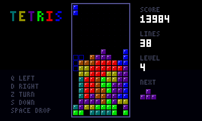

*Seven seconds of a game, up to a four-row clear (emulated ESP32-S3, real time).*

| | |
| --- | --- |
| 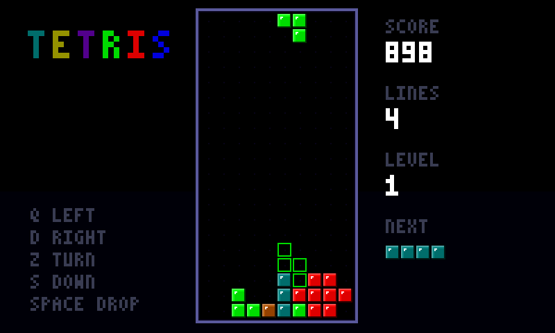 | 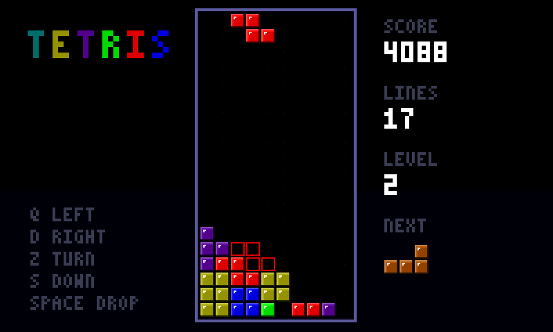 |
| The start of a game: each tetromino has its colour and is drawn as a bevelled block. | A falling piece and its ghost, the outline of where it will land. |
| 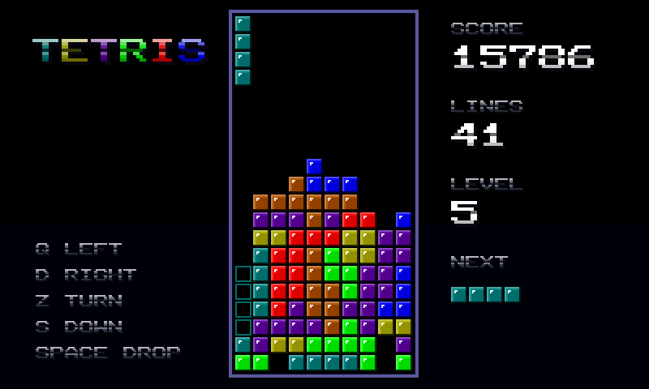 | 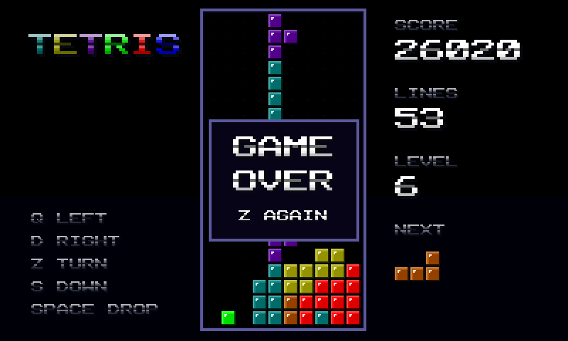 |
| Level 5: the I piece is about to clear four rows at once (800 points × the level). | Game over, with the score, the lines and the level. Z starts a new game. |

Everything on the screen is drawn by the script, pixel by pixel, into the frame buffer: the background, the well, the blocks, the text. What the game uses from the language:

- **arrays of 2 and 3 dimensions with initializers**: the well is `uint8_t board[BH, BW]`, the seven tetrominoes `uint8_t shapes[7, 4, 4] = {...}`, indexed `board[y, x]` or as one row of values (`shapes[p * 16 + i]`);
- **`#define` constants** for the layout (`CELL`, `BX`, `BW`...);
- **functions** with parameters and return values: `bool collide(int dx, int dy)` tells whether the piece fits after a move, and is used for moving, rotating (with a step aside when the piece hits a wall), dropping and the ghost;
- **strings**: `drawText(PANEL, 14, "SCORE", 2, grey)` passes a `char *` and walks it with `s[i]` until the 0;
- **a pixel font in a `uint8_t` table**: each character of the 8x8 font is 8 bytes, a row each, read with `>>` and `&`; each row gets its own shade of the text's colour (the colour's red, green and blue taken apart with `>>` and `&`, scaled, and put back together), and a dark copy one dot down and right makes the shadow; numbers are cut into digits with `%` and `/`;
- **game state in globals** (score, lines, level, the current and next piece), changed by the rules: lines are cleared by moving the rows down, the level goes up every 10 lines and the pieces fall faster;
- **the C++ side through bound functions**: `readKey()` for the USB keyboard, `millis()` for the falling speed, `rand(7)` for the next piece, `hsv2()` for the colours, `show16()` to show the frame; `led16`, the frame buffer, is a bound pointer.

As with any script, it is compiled from text when the sketch runs, so the game could come from an SD card, a file uploaded over WiFi or the serial port, and be changed without rebuilding the sketch.

The game can also be compiled once and kept on the SD card: CreateTetrisBinary saves the compiled binary, ExecuteTetrisBinary loads it in 3 ms instead of compiling for 9.9 s, the same 5152 bytes of code.

The frames above come from this script, compiled by the library and run on an emulated ESP32-S3 (Espressif QEMU), with `STRIDE` set to 400 because the emulator has no PSRAM for an 800-pixel-wide frame buffer.

### MazeChase: a maze game with four hunters

[matouch/MazeChase](examples/matouch/MazeChase) goes further: about 1100 lines of script (13 KB of machine code, 11 KB of globals) for a maze game with its own maze, characters and rules. An orb eats the dots of the maze while four drones hunt it, each in its own way, and everything is drawn by the script each frame: the neon walls, the dots, the sprites, the text.

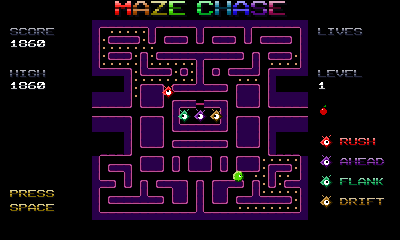

*Eight seconds of the demo: a power cell, the drones turning blue and fleeing, the apple (emulated ESP32-S3, real time).*

| | |
| --- | --- |
| 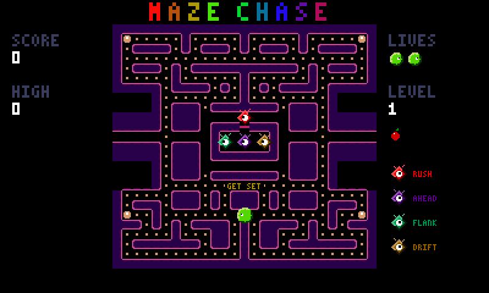 | 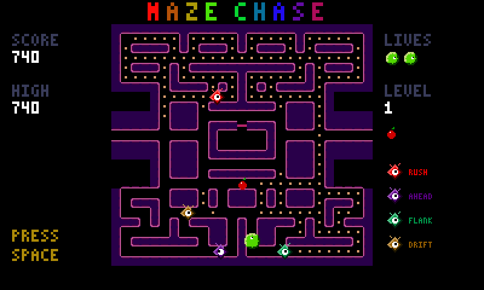 |
| GET SET: the drones wait in their base, crimson already out. | The four drones hunt the orb; the bonus apple waits under the base. |
| 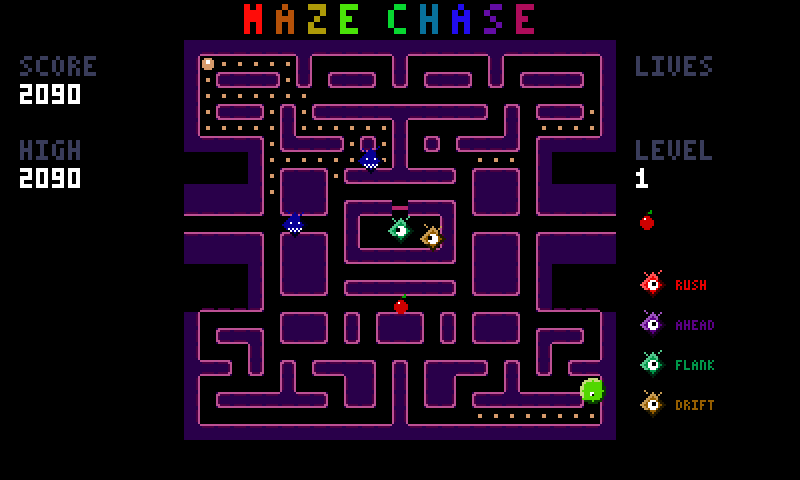 | 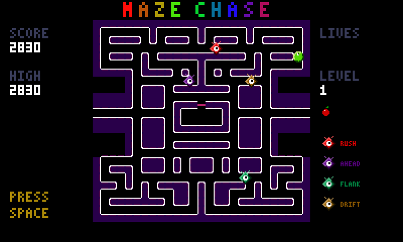 |
| After a power cell the drones turn blue and flee: the orb can eat them (200, 400, 800, 1600). | The last dot eaten: the maze flashes before the next, faster level. |

- **Four strategies**, one function: at each crossing a drone takes the way that brings it closest to its target, never turning back. Crimson targets the orb, violet 3 tiles ahead of it, teal the point opposite crimson across the orb (they close in from two sides), gold the orb when far away, and a random way when close. Waves of "go to your corner" and "chase" alternate on a timer, and every drone turns around when the wave changes.
- **Power cells** frighten the drones for a few seconds (shorter at each level); they flash before it ends. An eaten drone goes home as an eye, enters its base and comes out again.
- **The demo** is a player written in the script: a breadth-first search over the maze (arrays used as a queue) finds the nearest dot, power cell, apple or frightened drone, keeping 3 tiles away from the drones that can catch it. The frames above come from it.
- **Motion** at a fixed 60 steps per second, whatever the frame rate: each step adds the speed (in hundredths of a pixel) to an accumulator and moves one pixel per 100. The orb turns at tile centres, reverses at once, and takes the tunnels at the sides of the maze.

The game's logic was checked against the same code compiled by gcc: 8000 steps of demo play (a cleared maze, the next level, a lost game) give the same positions and scores on the emulated ESP32. Doing so found a compiler bug, fixed: negative values in a global array initializer (`int dys[4] = {-1, 0, 1, 0};`) were stored as 0. The frames come from the emulated ESP32-S3 like Tetris's.

### NeonRacer: a race in perspective

[matouch/NeonRacer](examples/matouch/NeonRacer) draws a 3D track and 3D ships with nothing but the frame buffer and `float`s: about 1050 lines of script (15 KB of machine code, 16 KB of globals). A hover ship races three rivals over 3 laps of a neon track at sunset.

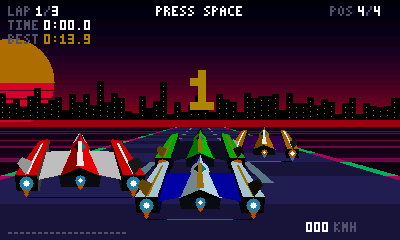

*Eight seconds from the start: GO, the pack of rivals, the first curve (emulated ESP32-S3, real time).*

| | |
| --- | --- |
| 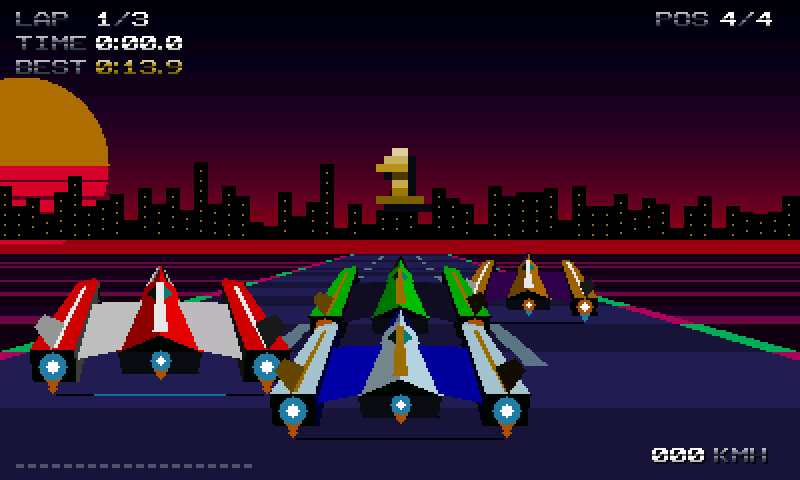 | 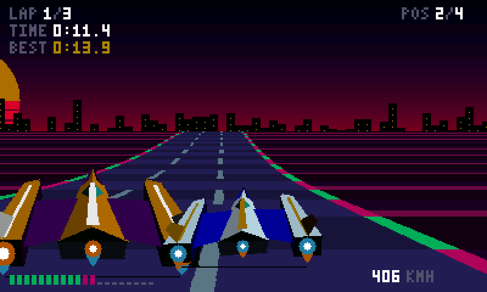 |
| The countdown, the four ships on the grid. | Side by side with a rival on a climb. |
| 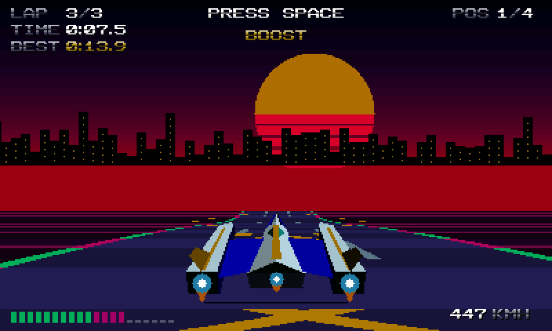 | 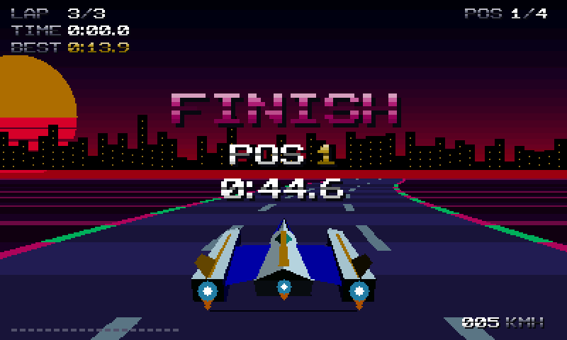 |
| Over the top of a hill, on the yellow chevrons of a boost pad. | The finish: the place and the race time. |

- **The track** is a list of 1000 segments, each with its curve and its height, built from 16 sections (the curves and hills ease in and out). Each frame projects the 70 segments ahead of the ship: a segment's point gives a screen line, a scale and a road width; the road is filled row by row between two lines, and a hill hides what is behind it (each line is only drawn above the previous one). The curve of each segment is added to a running offset, which bends the road.
- **The ships** are 3D models: 63 points and 35 faces (an arrowhead hull with a spine stripe and a glass canopy, two long engine pods on swept wings, canted fins, the team's two colours), seen from a camera behind and above. Each frame turns the points (rolled when the ship turns), projects them, sorts the faces from the farthest, and fills each as triangles in a shade given by the angle between the face and the light; the engines glow on top, with their exhaust. The model is a table of points and faces in the script, generated from a short description.
- **The rivals** are drawn after the road, farthest first, at the scale of their segment and cut by the hill in front of them. Each has its top speed and its way of weaving across the track; running into one from behind bounces the ship off.
- **The ship** is pulled outwards in the curves (more at speed), slows down in sparks off the track, and goes faster for a while after a boost pad. Speed, lap time, best lap and place are on the screen.
- **The sky**: a sun cut by bands, a city of lit towers, both sliding with the curves.

Its logic, checked against gcc like MazeChase's, gives the same positions, speeds, places and laps bit for bit, once the C side writes its constants as floats (`0.9f`): a script's `0.9` is a single-precision float, C's is a double.

### PrismBreak: a brick breaker

[matouch/PrismBreak](examples/matouch/PrismBreak): about 1030 lines of script (12 KB of machine code, 8.5 KB of globals).

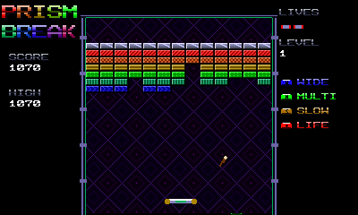

*Eight seconds of the demo (emulated ESP32-S3, real time).*

| | |
| --- | --- |
| 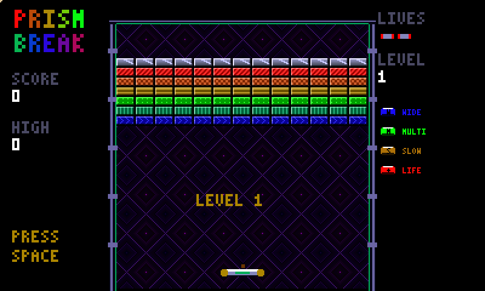 | 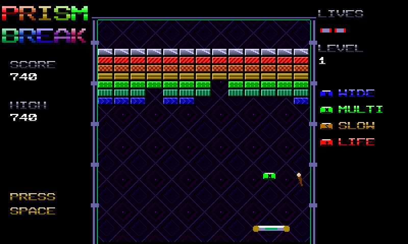 |
| The first layout: silver, then the six patterned colours. | A capsule falls from a broken brick. |
| 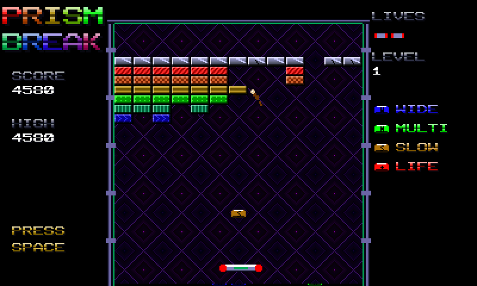 | 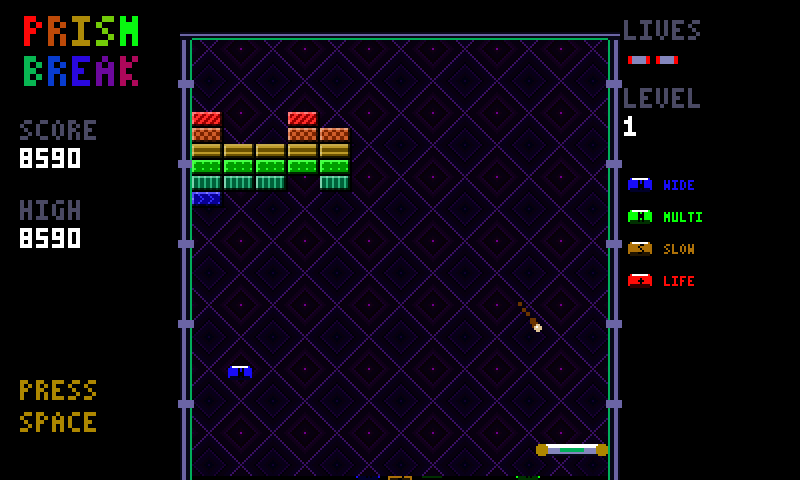 |
| Silver bricks crack at the first hit; a slow-ball capsule. | Late in the level, a wide-paddle capsule on the diamond background. |

- **Bricks** are textures made once at the start, 16 x 8 pixels per kind: each colour has its pattern (diagonal stripes, checks, bands, dots, vertical stripes, chevrons, cross hatching) inside a bevel; silver is a metal gradient with a shine and cracks at the first hit, gold has rivets and never breaks. Drawing a brick copies its texture; a hit makes it flash.
- **The background** is a 32 x 32 tile of diamonds in rings, made for each level in its colours and scrolled down slowly; the field is framed by metal pipes with joints and a glowing line.
- **The ball** moves in sub-steps, one axis at a time, so it can't pass through a brick, and bounces off the side it hit; where it meets the paddle sets its angle. It goes a little faster with each brick, up to a limit.
- **Capsules** fall from about one brick in five: W widens the paddle, M splits the ball in three, S slows it down for ten seconds, + is a life. Broken bricks throw sparks that fall.
- **Five layouts** (rows, a diamond, waves between gold posts, a fortress, stairs and a checker), then they start again, faster.
- **The demo** keeps the paddle under the ball that will come down first, working out where it lands with the side walls folded back.

Comparing its logic with gcc found how the language treats `/` between ints in an expression whose result is a `float`: it divides as floats (`float y = 40 + (57 / 13) * 8;` is 75.1, not 72, see below), so PrismBreak computes such values into `int` variables first; with that, 6000 steps of play match gcc exactly. It also found `%` giving its left value there (`float f = 57 % 13;` was 57); that one is fixed.

### XenoWing: a shoot'em up with real art

[matouch/XenoWing](examples/matouch/XenoWing) goes beyond drawing with code: its sprites and backgrounds are pixel art, 650 KB of images in flash, which the script draws through bound pointers. About 1250 lines of script.

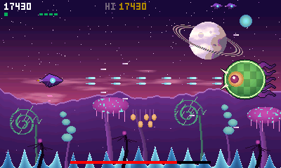

*Eight seconds of the boss fight, from the demo (emulated ESP32-S3, real time).*

| | |
| --- | --- |
| 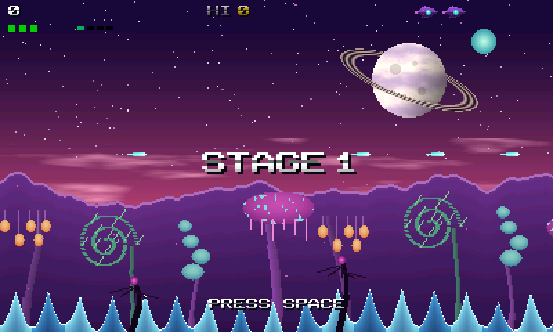 | 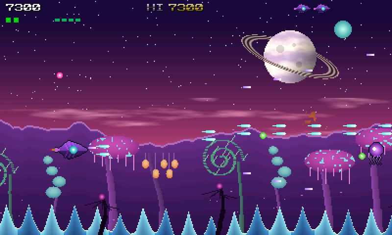 |
| Stage 1: the manta over the alien world. | Twin shots against a jelly over the forest. |
| 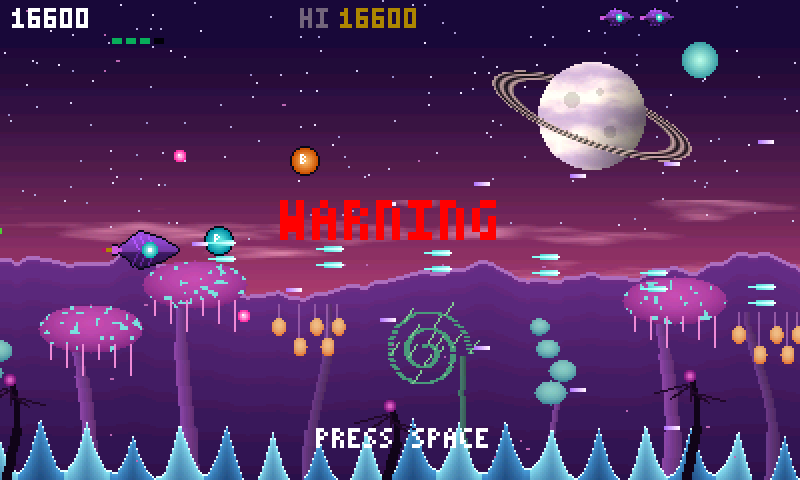 | 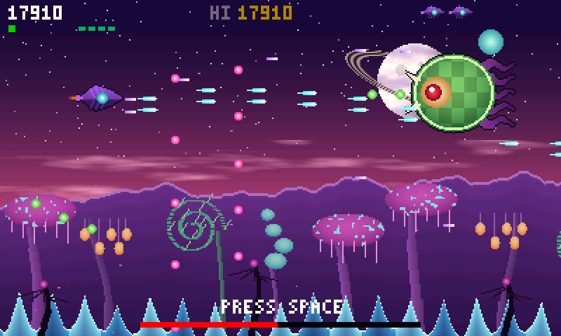 |
| WARNING: the hive mother is coming. | The hive mother fires spreads and spores; its life at the bottom. |

- **The art** is made by [tools/assets.py](examples/matouch/XenoWing/tools/assets.py) (pure Python, no library), which writes [xenowing_assets.h](examples/matouch/XenoWing/xenowing_assets.h): RGB565, byte-swapped as the frame buffer wants it, magenta for transparent. Every sprite is in one array, `gfx`; the script knows where each starts and its size from the `#define`s the tool writes, pasted at the script's top. The sketch binds the arrays as `uint16_t *` pointers (`bindVariable("uint16_t *", "gfx", NULL, &gfxPtr)`), so they stay in flash and cost no RAM.
- **Five layers** scroll at their own speeds: the sky (a ringed planet, a teal moon, clouds) stays, far mountains drift, a forest of strange trees (mushroom trees with glowing caps, twisted trunks with hanging bulbs, curled ferns, balloon pods) goes by, a crystal ridge passes fast, and dark plants pass in front. The ridges and the forest tile over 512 pixels. Each layer is drawn only where the layers in front of it leave gaps: the sky stops where the far mountains are solid.
- **The keys**: Z Q S D or the arrows move the ship while they are held (with the key-release hook described in [A USB keyboard driving a script](README.md#a-usb-keyboard-driving-a-script)), Space drops a spore bomb, Escape gives the game up.
- **The game**: the manta fires by itself; P orbs widen its shots (two, then four with a spread, then faster), B orbs give spore bombs that clear the screen. Bugs fly in waves on sine curves, jellies drift and aim spores at the ship, crawlers dash low and shoot ahead. After a minute: WARNING, and the hive mother, which sways, opens its eye and fires spreads and spores. The ship's weak point is its core only, as in arcade shooters. Each stage comes back faster.
- **Positions** are integers in sixteenths of a pixel, and the curves come from a 64-entry sine table, so the script needs no `float` at all.

Writing it found a third compiler bug, fixed: `if (rand(400) == 0)`, with `rand` returning a `uint32_t`, did not assemble ("Opcode bneu not found"). Unsigned comparisons use `bltu`/`bgeu`, but `==` and `!=` compare bits, signed or not, and Xtensa has no `bequ`/`bneu`; the compiler now uses `beq`/`bne` for them. A fuzz regression (`unsigned_equality`) checks it against gcc. No script that compiled before changes.

### ChromaQuest: colour back to three worlds

[matouch/ChromaQuest](examples/matouch/ChromaQuest) uses real photographs: three worlds from NASA's image library, each starting all grey. Grey colour thieves have taken its red, its green and its blue; Lumo, a lantern drone, shoots them, and each one drops the colour glowing in its heart. Every drop caught gives part of that colour back to the world, and when the three gauges are full the world is restored. About 1000 lines of script.


*The demo playing the three worlds, sped up: a frame every 40 (emulated ESP32-S3).*

| | |
| --- | --- |
| 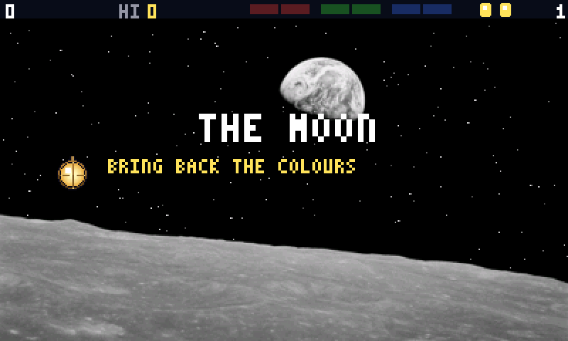 | 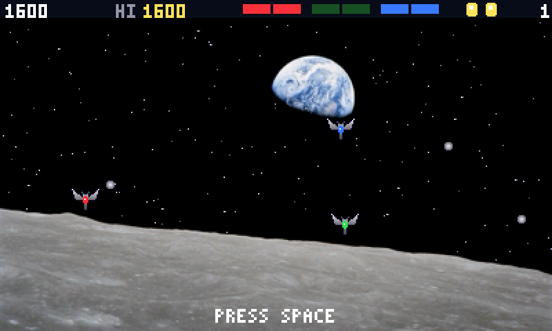 |
| The Moon, all grey: the Earth rising over its horizon. | Red and blue caught: the Earth is blue again. |
| 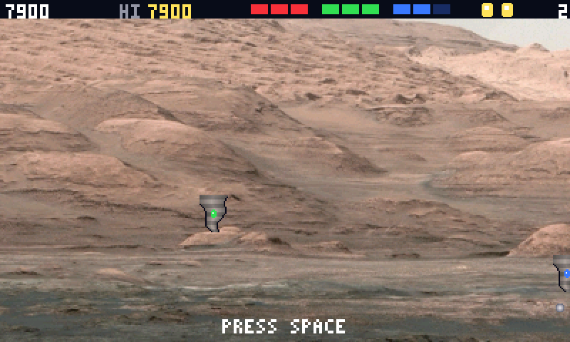 | 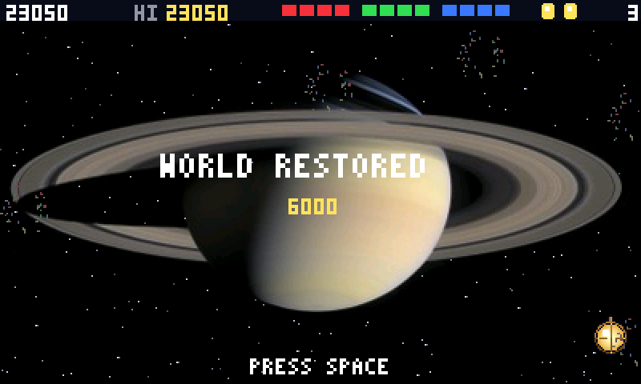 |
| Mount Sharp on Mars, its colours almost back. | Saturn restored. |

- **The worlds** are NASA photographs, public domain: *Earthrise* (Apollo 8, AS08-14-2383), *Mount Sharp Buttes and Layers From Near Darwin* (Curiosity, PIA19083, NASA/JPL-Caltech/MSSS) and *The Greatest Saturn Portrait ...Yet* (Cassini, PIA06193, NASA/JPL/Space Science Institute), from [images.nasa.gov](https://images.nasa.gov). Each was cropped and scaled to 400x240 with macOS's `sips` (the three are in the example's `tools` folder), and the Moon and Saturn got a few faint stars in their black sky.
- **Grey to colour, every frame**: the art keeps each world twice, its colour (RGB565, 192 KB) and its brightness (a byte a pixel, 96 KB). The script draws the world mixing the two, each channel by its own amount: `r = grey + (red - grey) * fill / 16`, and the same for green and blue. All grey is one table lookup a pixel, all colour a copy; in between, the three mixes. The amount shown eases towards the drops caught, so the colour washes in.
- **The game**: Lumo moves while a key is held (with the key-release hook of [A USB keyboard driving a script](README.md#a-usb-keyboard-driving-a-script)) and fires ahead of where it last went. Dust moths flutter over the Moon, dust devils sway on Mars, ice shards bounce around Saturn; each carries a colour the world still needs and fires grey bolts at Lumo. Drops hop out and fall gently; caught, they fill a gauge. Each world needs more drops than the last, then they come round again. Score, high score, lives; a demo until Space; Escape gives a game up.
- **The art** is made by [tools/chroma_assets.py](examples/matouch/ChromaQuest/tools/chroma_assets.py) (the photographs, Lumo, the drops, the thieves, the splashes), 885 KB in flash, read through bound pointers like XenoWing's.
- **The text** is an 8x8 font of its own, bold and rounded, drawn by [tools/font8.py](examples/matouch/ChromaQuest/tools/font8.py): each row of a character has its colour from a gradient (chrome, gold, fire, ice), over a dark shadow, in the style of the Amiga demos. The other games and the launcher's menu use the same font, each row a shade of the text's colour.

### Vault13H: a VGA maze shooter

[matouch/Vault13H](examples/matouch/Vault13H) is a first-person shooter in the style of the early-90s VGA games: a 320x240 picture in the 256 colours of the VGA default palette (mode 13h), each pixel 2x2 on the panel, so the game fills 640x480 in the middle of the 800x480 screen with black bars on the sides. Drones guard a vault; reach the green EXIT panel. About 1600 lines of script, 24 KB of machine code, and no art at all: the palette, the textures, the sprites and the font are made by the script when it starts.

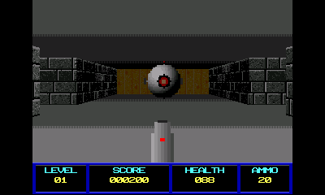

*A drone shot down in the keep, the crypt's torches, the base up to the exit (rendered with a Python copy of the script's drawing code).*

| | |
| --- | --- |
| 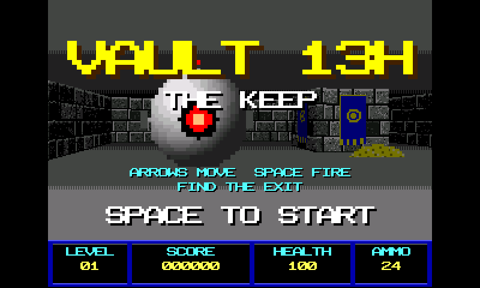 | 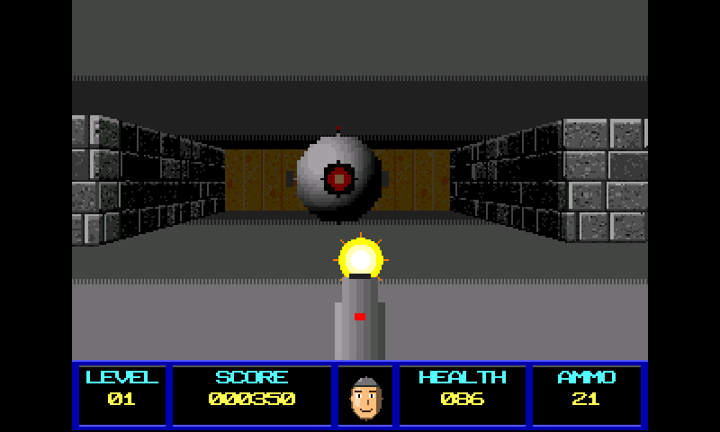 |
| The title screen over the keep; 1 2 3 pick the look. | The keep: uneven grey stone, oak panels, a drone. |
| 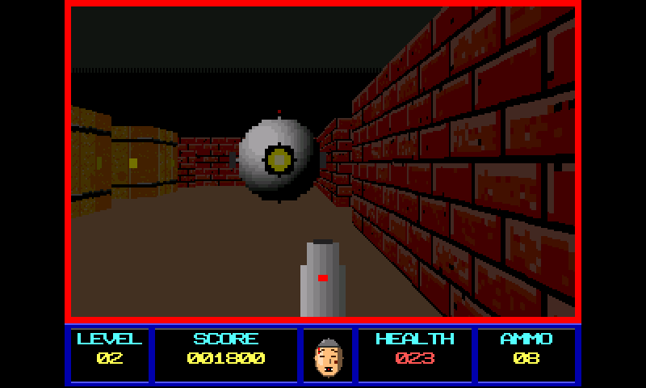 | 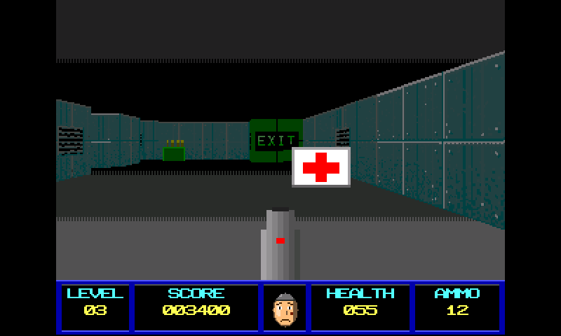 |
| The crypt: a drone firing, the red hurt border, health in red. | The base: brushed teal plates, a vent, the EXIT panel. |

- **The palette** is the real VGA default one, rebuilt by the script: the 16 EGA colours, 16 greys, then 24 hues around the wheel in three intensities (bright, medium, dark) and three saturations. Its layout does the distance shading, as the games of the time did: the darker copy of a colour is 72 entries further, so `shadeTab[]` maps each colour to its copies at three distances, and the ceiling and floor bands are dithered where they meet.
- **The walls** are ray-cast, one column of the view at a time through a 24x24 map: each column's 64 texels are shaded once, then stretched down the column, so every pixel of the view is written once a frame and nothing is cleared. The textures are generated: stones of uneven sizes and bricks, each with a bevel, grain and chips; wood with wavy grain, knots and nails; brushed metal with rivets and grime; cracks, soot and moss on worn variants of the main wall, which some map cells use.
- **The sprites** (drones, wrecks, gold, health kits, ammo) are sorted far to near and clipped against the walls' depth per column. The drones see the player through the map, follow and fire; two hits bring one down.
- **The face** in the middle of the status bar is a vault raider in a steel helmet, 24x30 pixels drawn by the script each frame: smiling above 80 health, then tired, bruised, cut with clenched teeth, bloody with a swollen eye at 20 or less, grey with crossed eyes when dead. It glances left and right now and then, and winces, eyes shut and mouth open, when a drone hits.
- **The keys**: Z forward, S back, Q and D turn (or the arrows), while held (with the key-release hook of [A USB keyboard driving a script](README.md#a-usb-keyboard-driving-a-script)); Space starts and fires; Escape quits.

Writing it found and fixed two compiler issues: a parse error inside nested blocks (`hp[best]--;`, a form the language does not take) crashed the cleanup of the failed compile (part of the parse tree was freed twice), and `?:` or a comparison worked as a value only in parentheses (`(x > 2) ? 1 : 0`): `x > 2 ? 1 : 0`, `a && b ? x : y` and `y = x > 2;` now compile, as in v1.

### GameLauncher: games from the FFat partition

[matouch/GameLauncher](examples/matouch/GameLauncher) has no game in it: it lists the `.bin` files of the FFat partition, and loads and runs the one you pick. Its `data` folder holds `tetris.bin`, `mazechase.bin`, `neonracer.bin`, `prismbreak.bin`, `xenowing.bin` and `chromaquest.bin`, the six games above compiled with `parseScriptToBinary()` (the same bytes as [CreateTetrisBinary](README.md#saving-and-loading-compiled-scripts-script_executableh) makes on the board), and `ironforge.bin`, the [shooter](#ironforge-a-shooter-with-mid-90s-technology) (59,456 bytes, loaded in 17 ms instead of 345 s of compiling), whose monsters are in `ironforge.wad` on the same partition.

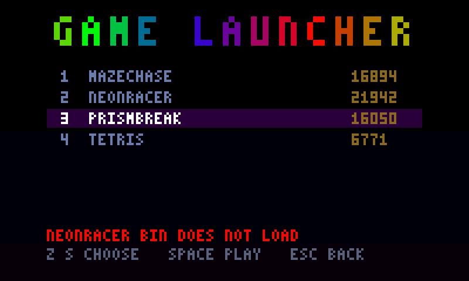

- **Keys**: Z/S or the arrows to choose, Space or Enter to play, 1-9 to play a game at once; in a game, Escape comes back to the menu. The arrows arrive in the games as Z Q S D.
- **Bindings**: the launcher binds the names the games use (`led16`, `width`, `height`, `hsv2`, `show16`, `setPixelsize`, `millis`, `rand`, `readKey`, XenoWing's art: `gfx`, `sky`, `farRidge`, `forest`, `nearRidge`, `frontPlants`, from a copy of `xenowing_assets.h` in the launcher, and ChromaQuest's: `chromaGfx`, `worldColor`, `worldLum`, from `chroma_assets.h`); Ironforge's: `touchHeld`, `sin`, `hypot`, `atan2`, `wad`, `wadLoaded`, `wadSprite`, `wadFind`; Valmora's, the names of SolarOS's script runtime, so that one `valmora.bin` runs in both: `display` (the same frame buffer as `led16`), `stride`, `updateDisplay` (`show16`), `enableGraphicMode`, `keyHeld`, `delay`; any other game compiled against the same names shows up in the menu too. The launcher sets `setScriptCodeMemory(SCRIPT_CODE_AUTO)`: a game's code goes to PSRAM when no internal block is big enough.
- **Coming back**: each game runs on its own task (`executeAsTask()`). Every game calls `readKey()` once per frame; after Escape, `readKey()` never returns, so the game's task waits in a function of the sketch that holds nothing, and the launcher kills it and frees the game (built with placement `new`, since a `ScriptExecutable` can't be moved). Killing it anywhere else, inside the panel driver say, could leave the screen half way. Ironforge never calls `readKey()`: it reads the keys held in `touchHeld` (a bit per key, as in its own sketch), so after Escape its task waits at the start of `show16()` instead, before the panel is touched. The launcher reads `ironforge.wad` into PSRAM when Ironforge first starts, and draws it 13 pixels in, as its sketch does; Valmora gets `valmora.wad` the same way (one WAD is kept at a time).

**Putting the data folder on the partition.** The partition scheme is *16M Flash (3MB APP/9.9MB FATFS)*: the FFat partition starts at `0x610000` and is `0x9E0000` bytes. FFat keeps a wear-levelling layer around the FAT, so the image is made with ESP-IDF's `wl_fatfsgen.py`, with the core's settings (4096-byte sectors, long names), and written with esptool:

```sh
python $IDF_PATH/components/fatfs/wl_fatfsgen.py --output_file ffat.img \
    --partition_size 0x9E0000 --sector_size 4096 --long_name_support examples/matouch/GameLauncher/data
esptool.py --chip esp32s3 --port /dev/cu.wchusbserial... write_flash 0x610000 ffat.img
```

For Ironforge's monsters, make the image from a folder holding the `.bin` files and `examples/matouch/Ironforge/data/ironforge.wad` (see [Ironforge](#ironforge-a-shooter-with-mid-90s-technology)); without the WAD it plays with drawings of its own. Valmora needs `examples/matouch/Valmora/data/valmora.wad` beside it (without it the game stops at once).

(esptool comes with the core: `~/Library/Arduino15/packages/esp32/tools/esptool_py/<version>/esptool` on a Mac.) The launcher mounts the partition with `FFat.begin(false)`: a partition that doesn't mount is never formatted; the menu then says there is no game.

The launcher was run on the emulated ESP32-S3 with this image (a copy with no screen and the games built for a 400-pixel-wide frame buffer): the partition mounts, the four games are listed and read back byte for byte, Tetris, MazeChase and PrismBreak load in a few milliseconds, play, and Escape brings the menu back. NeonRacer does not fit there: the emulator has no PSRAM, so its 192 KB frame buffer leaves about 96 KB of internal RAM, short of what the racer's code and globals need beside the file; on the board the frame buffers are in PSRAM. The racer itself was run from the same binary on the emulator.

## On the Guition ESP32-4848S040: the games on a touch screen

The examples in [examples/guiton](examples/guiton) are the games above on the **Guition ESP32-4848S040**, a 4-inch **480x480** RGB touch screen (ST7701S panel, GT911 touch controller) with an ESP32-S3 (16MB flash, 8MB PSRAM). There is no keyboard: the controls are on the screen. The scripts are the matouch ones; only the frame buffer's width changes (480 instead of 800).

| | |
| --- | --- |
| 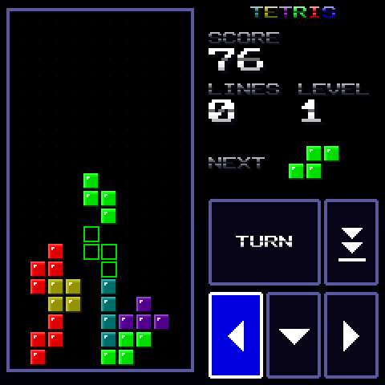 | 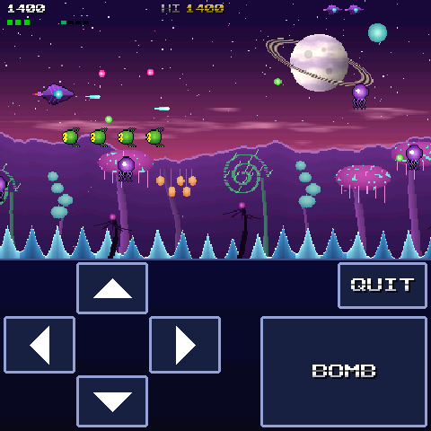 |
| Tetris, laid out again for a square screen; LEFT held. | XenoWing over its touch pad. |
| 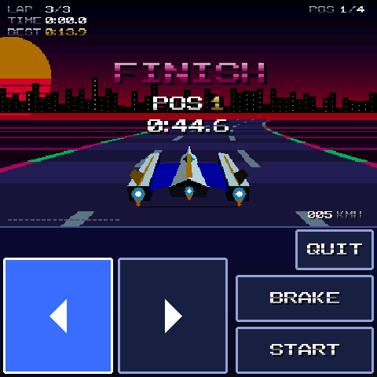 | 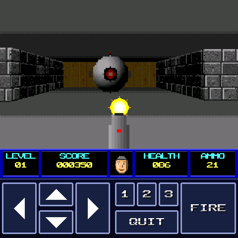 |
| NeonRacer: steering left, held. | Vault13H, its view 1.5 times larger. |

*The games' frames from the emulated ESP32-S3 (the demos playing; Vault13H's from its matouch run), scaled as the sketches scale them, over the pads drawn by the sketches' own code.*

- **The board**: each sketch has `Guition4848S040.h`, its LovyanGFX configuration: LovyanGFX's own `Panel_ST7701_guition_esp32_4848S040` (the ST7701S is set up over a 3-wire SPI on pins 39, 48, 47), the 16 colour lines, the sync timings, a 12 MHz pixel clock, the backlight on GPIO 38 and the GT911 on I2C (SDA 19, SCL 45). It uses the same modified `Bus_RGB` driver as the matouch boards; the driver now takes the screen's height from the panel instead of 480.
- **The layout**: the games were written for 400x240 (an 800x480 panel at pixel size 2). Pixel size 2 gives only 240x240 here, too narrow for them, and the panel's driver only scales by whole numbers. So each script draws its 400x240 picture into a buffer of its own (`led16` is bound to it, in PSRAM), and the sketch's `show16()` copies it **1.2 times larger** across the screen's width, 480x288: each five pixels become six, each five rows six. The 192 rows under the game are a touch pad: the controls never cover the game, no button has to be transparent. Vault13H's 3D view is 320x240, so it is scaled **1.5 times**, to 480x360, with a pad of 120 rows and smaller buttons. Tetris is the exception: its 240x240 version fits pixel size 2, so it is laid out again (the well left, the score and five buttons right) and its script draws the buttons itself.
- **The same code**: only the frame buffer's width changes in the scripts (480 instead of 800). `setPixelsize(2)`, which every game calls, keeps the size at 1; the scaling costs the sketch about a frame buffer's copy per frame.

**How the touches become keys.** The scripts already read a keyboard through `readKey()`: a queue the USB keyboard fills, read once per frame by the script. The touch pad fills the same queue with the same keys, so no script had to change. In each sketch, `TouchPad.h` does it:

1. **Reading**: a FreeRTOS task on core 0 asks the GT911 for up to three touch points (`lcd.getTouchRaw(points, 3)`) every 16 ms. The script runs on core 1 and never waits for the touch controller.
2. **Which button**: each point is tested against the sketch's buttons, rectangles in the pad (480x240) with a key and a mode:

   ```cpp
   const PadButton padButtons[] = {
     {4, 64, 140, 172, 'q', PAD_HOLD_STOP, "<"},
     {150, 64, 140, 172, 'd', PAD_HOLD_STOP, ">"},
     {300, 64, 176, 172, ' ', PAD_TAP, "SERVE"},
     {376, 4, 100, 52, 27, PAD_TAP, "QUIT"},
   };
   ```
3. **Keys, from what changed since the last read**: a button just touched sends its key; then, by its mode,

   | Mode | While held | When let go | Used by |
   | --- | --- | --- | --- |
   | `PAD_TAP` | nothing | nothing | START, SERVE, BOMB, FIRE, QUIT, MazeChase's arrows |
   | `PAD_REPEAT` | the key again after 150 ms, then every 40 ms, as a keyboard repeats | nothing | NeonRacer's steering and brake |
   | `PAD_HOLD` | nothing | the key + 128, the release the games know from the keyboard's key-release hook | XenoWing, ChromaQuest, Vault13H: moving while held |
   | `PAD_HOLD_STOP` | nothing | `s` when no other such button is held | PrismBreak: the paddle stops when the finger lifts |

   Two fingers work: XenoWing's ship can move and drop a bomb at once.
4. **Showing it**: the buttons held are a bit mask, `padHeld`. The sketch's `show16()` calls `padShow()` before each frame is shown: it redraws the pad (a dark background, the buttons, bright while held, their arrows and words in the games' 8x8 font) only when what is held changed since that frame buffer last showed it (there are two buffers), so a frame costs nothing when the fingers don't move. Where the pad starts is `PAD_Y`, set by the sketch before it includes `TouchPad.h` (288, or 360 for Vault13H). Tetris does the same with its own buttons: the sketch tests the touches, and the script, which draws the buttons, reads the held mask through a bound variable, `touchHeld`.

| Example | Controls |
| --- | --- |
| [guiton/Tetris](examples/guiton/Tetris) | TURN, DROP; LEFT, DOWN, RIGHT repeat while held. TURN starts a new game after a game over. |
| [guiton/MazeChase](examples/guiton/MazeChase) | The arrows turn the orb; START; QUIT. |
| [guiton/NeonRacer](examples/guiton/NeonRacer) | Left and right steer, repeated while held; BRAKE; START; QUIT. |
| [guiton/PrismBreak](examples/guiton/PrismBreak) | Left and right move the paddle while held; SERVE; QUIT. |
| [guiton/XenoWing](examples/guiton/XenoWing) | The arrows move the ship while held; BOMB; QUIT. |
| [guiton/ChromaQuest](examples/guiton/ChromaQuest) | The arrows move Lumo while held; START; QUIT. |
| [guiton/Vault13H](examples/guiton/Vault13H) | The arrows walk and turn while held; FIRE; 1 2 3 pick the look on the title screen; QUIT. |
| [guiton/Ironforge](examples/guiton/Ironforge) | A first-person shooter (below): the cross walks and turns, FIRE, USE. |
| [guiton/GameLauncher](examples/guiton/GameLauncher) | All seven and Ironforge, from binaries on the FFat partition: touch a game to play it, QUIT comes back to the menu (in Tetris, touch the TETRIS title; in Ironforge, hold the status bar a second). |

On the board, compiling takes 13.5 s for Tetris, 36.4 s for PrismBreak and 86.3 s for Vault13H; from the launcher, a game loads in 2 to 4 ms.

**The light.** The backlight is on GPIO 38, driven by PWM (`Light_PWM` in `Guition4848S040.h`, at 1 kHz: the board's backlight driver doesn't follow LovyanGFX's usual 44.1 kHz, and any level under 255 left the screen black), so `lcd.setBrightness(level)` sets it, from 0 (off) to 255. Every guiton sketch binds it for its script:

```c
setBrightness(64);     // a quarter: a dark scene, a pause screen
setBrightness(255);    // full again
```

(`void setBrightness(int level)`, the level kept between 0 and 255.) In the launcher's menu, - and + under the games step the light through 16 levels, each about 10% under the one before (as the eye sees light), from 255 down to 48 (at 31 the backlight driver already turns the screen black); the launcher starts at full light every time, and puts the menu's level back when a game that changed it ends.

**The launcher.** [guiton/GameLauncher](examples/guiton/GameLauncher) works as the matouch one (QUIT sends Escape, the game's task stops in `readKey()` and is freed), with a menu to touch, a row per game. Each game is shown as in its own sketch: the launcher knows them by their file's name, and switches the scaling, the pad's height and the buttons when one starts (`LauncherPad.h` is `TouchPad.h` with these set at run time). Ironforge draws its own pad and reads only `touchHeld`, so for it the launcher turns each finger into the same bits as its sketch (`padBitsAt` in `LauncherPad.h`, several fingers at once), plus one of its own, the status bar: held a second, it is QUIT, and the game's task stops at the start of `show16()`. Its `data` folder holds the seven games and `ironforge.bin` compiled against the launcher's names; they go on the partition as for the matouch launcher, with `ironforge.wad` beside them (the command under [Ironforge](#ironforge-a-shooter-with-mid-90s-technology)):

```sh
python $IDF_PATH/components/fatfs/wl_fatfsgen.py --output_file ffat.img \
    --partition_size 0x9E0000 --sector_size 4096 --long_name_support examples/guiton/GameLauncher/data
esptool --chip esp32s3 --port /dev/cu.wchusbserial... write_flash 0x610000 ffat.img
``` Board: *ESP32S3 Dev Module*, PSRAM *OPI PSRAM*, Flash Size *16MB*, Partition Scheme *16M Flash (3MB APP/9.9MB FATFS)* (XenoWing and ChromaQuest carry their art in flash).

## Ironforge: a shooter with mid-90s technology

[guiton/Ironforge](examples/guiton/Ironforge) is a first-person shooter whose engine goes a step beyond Vault13H's flat maze: every cell of the map has its own floor height, ceiling height (or the open sky), floor and ceiling textures and light level. That gives stairs, ledges, a balcony, sunken toxic pools and lava, low dark corridors, tall halls, a yard under a red ash sky, and doors that rise into the ceiling. Three levels: the Foundry, the Furnace (a hall crossed by lava on a narrow bridge, the key on a raised platform), the Smelter Yard. The engine, the levels and the textures are its own (the palette and the wall textures' makers come from Vault13H); the monsters, the face in the status bar, the guns and the pickups are [Freedoom](https://freedoom.github.io)'s, the free game data set, under its BSD licence, read from a WAD file on the FFat partition with a title picture of Ironforge's own (below).

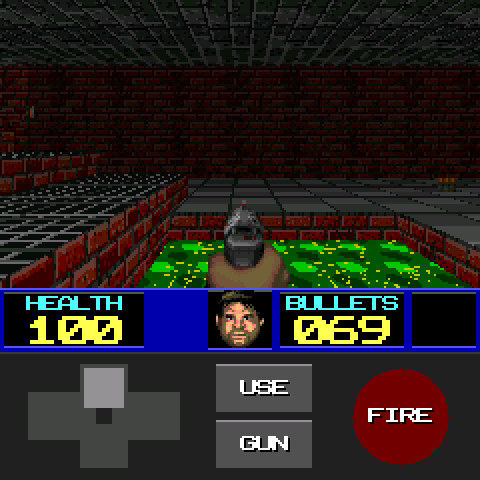

*Captured from the board: into the hall, firing the pistol at a creature by the blue door, the face hurt at 70 (the screen as it is, 480x480, the touch pad under the view).*

| | |
| --- | --- |
| 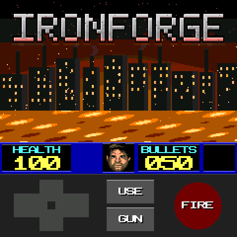 | 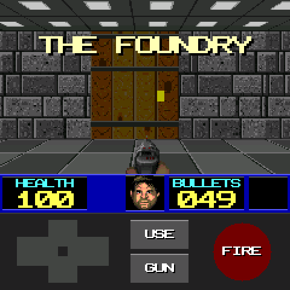 |
| The title picture, TITLEPIC in the WAD. | The Foundry: the level's name, the pistol, the face. |
| 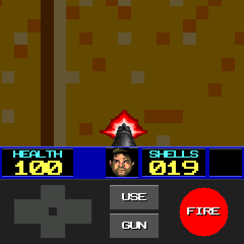 | 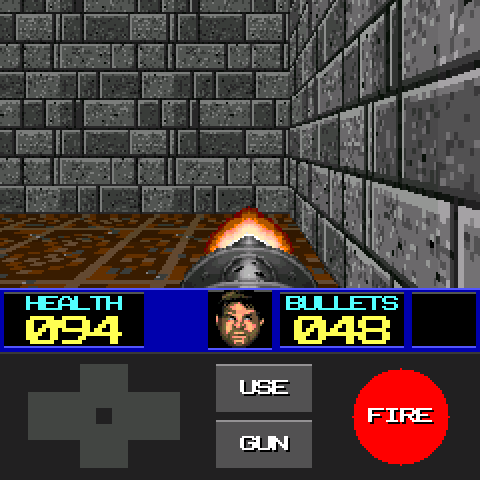 |
| The Furnace: the shotgun firing, SHELLS in the status bar. | The Smelter Yard: the chaingun firing. |

*All captured from the board itself: a test copy of the sketch plays a scripted route and sends chosen frames over USB.*

- **The renderer**: one ray per view column through the grid, from the eye outwards. In each cell it crosses, it draws that cell's floor and ceiling between where it entered and where it leaves (textured per pixel, from a per-row distance table), then at the next cell the step up to a higher floor and the step down of a lower ceiling, or the wall of a solid cell. What is drawn closes the column from the bottom and from the top; the rows still open are kept at each cell boundary, and the sprites further on show only through them, so a monster behind a ledge is hidden by it. Under the sky, walls are 2.5 cells high, with the sky and its mountains above them. Far floors are sampled in blocks of texels, a cheap mipmap.
- **Light**: 16 levels per colour in a table made at start, each cell's own level dimmed with distance.
- **The rules**: walking with steps up to a quarter of a cell, falling down ledges, doors that open with USE and close behind, a blue key for each level's blue door, the exit switch to the next level; monsters wake on sight and come (one strikes and throws fire, one floats and shoots, a flame flies at you); toxic pools and lava hurt. Three guns: the pistol, the shotgun (a spread, harder up close; shells) and the chaingun (fast; bullets), found in the levels, GUN to change.
- **The status bar**: health, Freedoom's face (five states of health, looking about, wincing when hurt), the ammo of the gun in hand, the blue key.
- **The controls**, on the touch pad: the cross walks and turns (a finger between two arms does both), FIRE (held for more), USE, GUN.
- **The levels** are drawn as text in [tools/data.py](examples/guiton/Ironforge/tools/data.py), which checks each one can be finished: the key reached from the start without the blue door, the exit with it (steps up of a quarter of a cell at most).

**The WAD.** A WAD has the classic layout: a header (`PWAD`, the number of entries, where the directory is), the entries, then the directory (offset, size, an 8-character name each). Pictures are in the classic column format (width, height, the offsets of their anchor, then each column as runs of pixels, so clear pixels cost nothing) and named after the old convention: `HUSKA1` is a monster walking (frame A) seen from the front (angle 1), `HUSKA5` from behind, `HUSKG0` falling, the same from every side.

[tools/freedoom.py](examples/guiton/Ironforge/tools/freedoom.py) makes `data/ironforge.wad` from the release of Freedoom (0.13.0, `freedoom2.wad`): four of its monsters, written under the names the script asks for (each angle its own picture: Freedoom keeps some angles once for two sides, flipped), its status-bar face (`STFST00`-`STFST42`, `STFOUCH0`-`4`, `STFDEAD0`), its guns as they are held with their flashes (`PISG`, `SHTG`, `CHGG`), its pickups, all turned into the game's 256 colours, and `TITLEPIC`, the 240x144 title picture drawn by [tools/title.py](examples/guiton/Ironforge/tools/title.py). 122 pictures. Freedoom's art is © the Freedoom project's contributors, under the BSD licence in [data/freedoom-COPYING.txt](examples/guiton/Ironforge/data/freedoom-COPYING.txt), which goes with the WAD. ([tools/wad.py](examples/guiton/Ironforge/tools/wad.py) writes monsters of the game's own, rendered from simple 3D shapes from 8 angles, under the same names.)

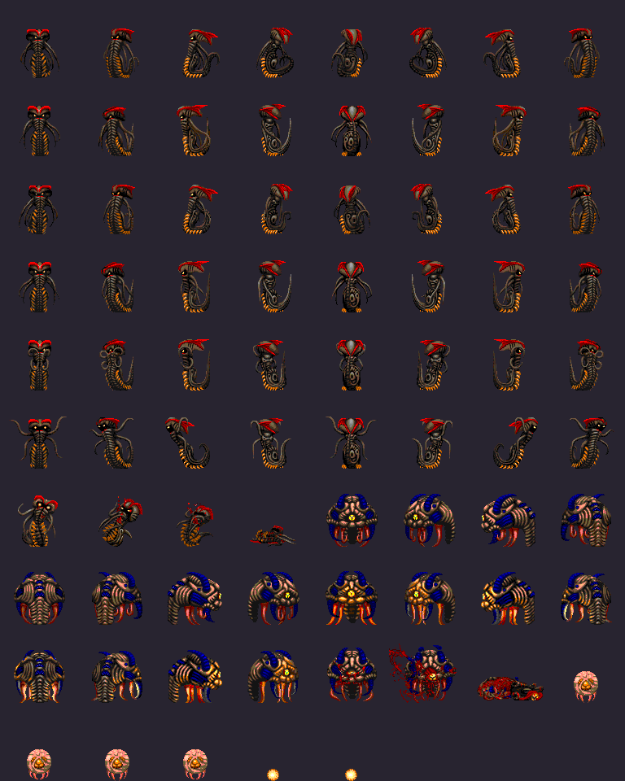

The sketch mounts the FFat partition, reads `/ironforge.wad` into PSRAM, and binds it for the script, so any script can use a WAD the same way:

```cpp
bindVariable("uint8_t *", "wad", NULL, &wadData);         // its bytes
bindVariable("int", "wadLoaded", NULL, &wadLoaded);       // 1 when it was read
bindFunction("int", "wadSprite", "char*,int,int", wadSprite);  // "HUSK", frame, angle -> where it starts
bindFunction("int", "wadFind", "char*", wadFind);              // "TITLEPIC" -> where it starts
```

The script finds its pictures once (`huskWalk[f * 8 + a] = wadSprite("HUSK", f, a + 1);`, `pistol[0] = wadFind("PISGA0");`), and draws them from `wad[]`: the title and the face as they are, the guns as the old games held them (scaled to the 240x144 view), the monsters and the pickups scaled to their distance and clipped like the other sprites. Each monster looks the way it moves; `atan2()` of where it looks, less where the player stands, picks which of the 8 views to show, numbered as the old sprites are. Without the file, the game runs with drawings of its own.

The partition holds the GameLauncher's games and the WAD together:

```sh
mkdir ffat && cp examples/guiton/GameLauncher/data/*.bin examples/guiton/Ironforge/data/ironforge.wad ffat/
python $IDF_PATH/components/fatfs/wl_fatfsgen.py --output_file ffat.img \
    --partition_size 0x9E0000 --sector_size 4096 --long_name_support ffat
esptool --chip esp32s3 --port /dev/cu.wchusbserial... write_flash 0x610000 ffat.img
```

**On the ESP32-S3-Touch-LCD-7.** [matouch/Ironforge](examples/matouch/Ironforge) is the same script with four `#define`s changed at its top (the view 240x128 instead of 240x144, its horizon, the frame buffer's width, no touch pad): at pixel size 3 the 800x480 panel is 266x160 big pixels, and the game's 240x160 (the view and the status bar) sits in the middle of it, 720x480 on the panel. The USB keyboard plays it: the arrows or Z Q S D walk and turn while held, Space fires, E or Enter uses, G or Tab changes the gun; the sketch keeps a bit per key down, from the keyboard's presses and releases, in the same `touchHeld` the touch pad fills on the Guition. Its FFat partition holds the matouch GameLauncher's games and the WAD:

```sh
mkdir ffat && cp examples/matouch/GameLauncher/data/*.bin examples/matouch/Ironforge/data/ironforge.wad ffat/
```

then `wl_fatfsgen.py` and `esptool` as above.

| | |
| --- | --- |
| Script | 3217 lines, 90 KB of text |
| Machine code | 40,504 bytes (59,404 bytes as a saved binary) |
| Compiling on the board | 324 s |
| Its arrays | about 125 KB: 14 textures (56 KB), the light table (8 KB), the per-column records (34 KB), the three levels |
| The WAD | 122 pictures, 317 KB, read from the FFat partition into PSRAM at start |
| View | 240x144, shown 480x288 (pixel size 2) |
| Frame rate | 21 to 42 frames shown a second (the panel's 42.3 is the most); the script takes 20 to 40 ms a frame in play |

Writing it found a compiler bug: a cast used as the left operand of an operator, as in `((int)(x * 64.0)) & 63`, lost the operator (the floors were noise until the cast was put in a variable first). The script works around it; the compiler is fixed since (the cast passed the type of its operands, float, to the expression around it, instead of its own).


## Valmora: an adventure in the style of the early role-playing games

[matouch/Valmora](examples/matouch/Valmora) is a top-down adventure of the kind the first role-playing games made: a world seen from above, tile by tile, towns where everybody has something to say, dungeons lit by the torch you carry. The story, the world, the people and every picture are its own: the sorcerer Morvath has broken the Sunstone Crown in three, and the shards wait in the Mossdeep Caves, the Drowned Crypt and the Ember Mines, each at the bottom of two floors and guarded; bring them to King Aldren and the gate to Morvath's Spire, beyond the lava lake, opens.

| | |
| --- | --- |
| 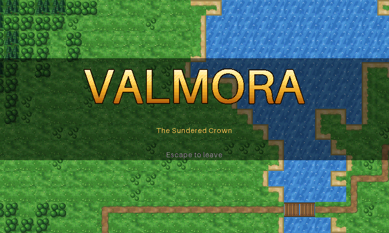 | 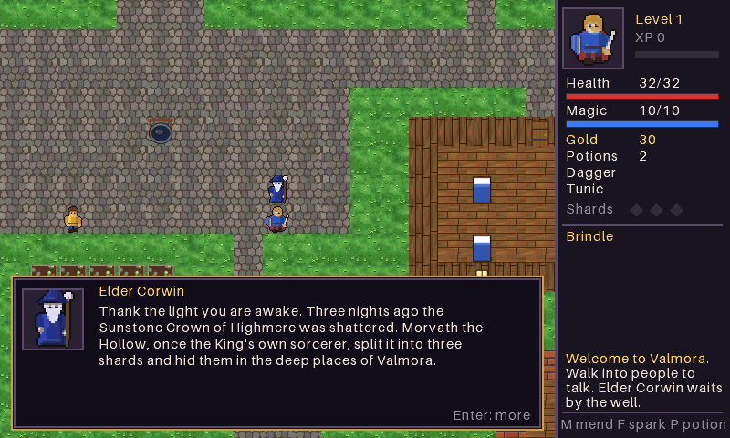 |
| 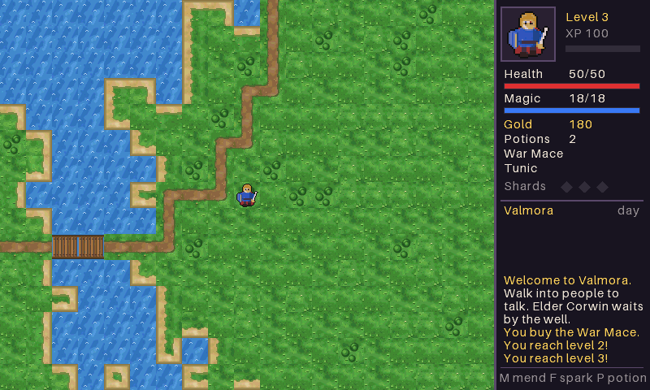 | 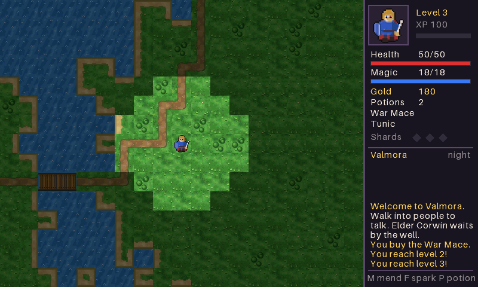 |
| 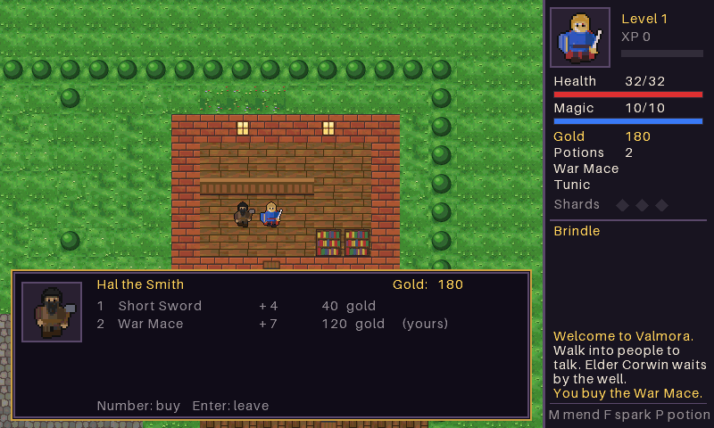 |  |

- **The world**: 96x80 tiles, from a 48x40 map drawn as text, with roads found between the places, a bridge where they cross the river, beaches where grass meets water. Three towns (Brindle, Highmere and its castle, the port of Saltmarsh, drawn as text too) and 30 people: shopkeepers (weapons, armour, potions), inns, healers, the King, and everyone else with a hint. Four dungeons of two floors, rooms and corridors made from a seed, with chests, monsters and, on the last floor, a boss and the shard's altar.
- **Playing**: you walk tile by tile (the view scrolls smoothly, the creatures too); walking into someone talks, into a monster fights. Monsters roam the world by its ground and your level, hunt you when near. Levels, gold, five weapons and five armours, potions, two spells (Mend, Spark). Night falls on the world: everything dims but a pool of light around you. In a dungeon you see what your torch lights, and remember, darker, what you have seen.
- **The pictures**: 32x32 tiles and creatures, each with its own 16 colours out of the 4096 of 4 bits a channel, 4 bits a pixel in the WAD. The script draws them straight from the WAD, two pixels a byte, through each tile's palette at full light or dimmed (made at start, 12 KB). A first version decoded every tile into a 758 KB cache of panel colours: reading that much per frame on SolarOS, whose panel refresh copies its lines from PSRAM through the same cache, made the picture shake; a quarter of the reads, and a pause of 1 ms every two rows of tiles, keep it steady. Text in an antialiased font (4 shades), proportional.
- **Drawing only when needed**: a new picture only when something changed (a key, a move, the animation's tick, the panel), else `delay(10)`, so the other tasks run and the panel keeps its share of the PSRAM bus.
- **The tools** ([tools](examples/matouch/Valmora/tools)): `art.py` draws every tile and creature (shapes 4 times larger, antialiased, scaled down; tileable textures), `content.py` holds the world, the towns, the people, their words and the monsters, `make_wad.py` packs them into `data/valmora.wad` and writes the `#define` block at the top of `valmora.sc`, `make_sketch.py` puts the script into `Valmora.ino`, and `host.c` runs the script as C on a computer, played from a file of keys, saving screenshots (the pictures above).

Keys: the arrows or Z Q S D walk, M mends, F then a direction throws a spark, P drinks a potion, Space waits, Enter turns a page. Its FFat partition holds the WAD:

```sh
mkdir ffat && cp examples/matouch/Valmora/data/valmora.wad ffat/
```

then `wl_fatfsgen.py` and `esptool` as above (with the GameLauncher's games beside it, the launcher runs `valmora.bin` too). The same script runs on SolarOS (`asm run valmora.bin`, the WAD beside it).

| | |
| --- | --- |
| Script | 2,420 lines, 52 KB of text |
| Saved binary | 32 KB |
| Its arrays | about 30 KB: the tiles' palettes (12 KB), the map being played and what has been seen of it (16 KB) |
| The WAD | 185 pictures (4-bit, 16 colours each), 12 maps, 30 people and their words, the font; 151 KB |

**Valmora Low, 400x240.** At 800x480 the picture can shake a little under SolarOS: its panel refresh copies every line from PSRAM through the cache, and a game redrawing the whole screen competes with it. `tools/make_wad.py --low valmoralow.wad valmoralow.sc` makes the same game at half the resolution: the WAD's tiles are 16x16 (the same art, made smaller; the tile size is in each tile's header) and its font is `tools/font6.py`, a font drawn pixel by pixel for 8 rows, so the letters keep their shape when shown 2x. The script is the same: it is laid out in 800x480 coordinates, and when the tiles are 16 pixels its few drawing functions halve them. `valmoralow.sc` takes the pixel size from its command line: `asm run valmoralow.bin` (2, the default) fills the panel, steady under SolarOS; `asm run valmoralow.bin 1` shows its 400x240 in the middle of the panel.

Writing it found a compiler bug: a number above 65535 in the script was cut to 16 bits, so `uint16_t cache[378880]` reserved 6784 elements (the globals after it overlapped it, and the game crashed as soon as it decoded its tiles), and `x == 65537` compared with 1. Fixed: the literal is read as 32 bits.
