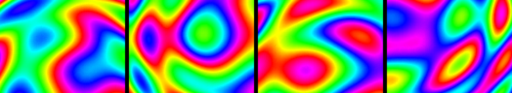
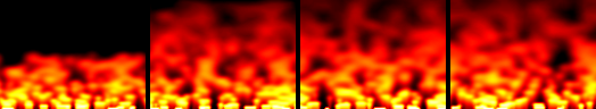
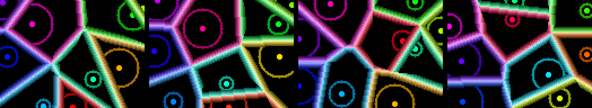
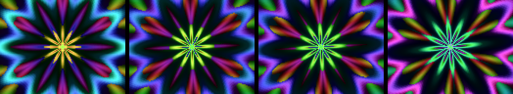
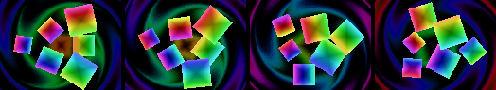

# ProceduralEffects

Five procedural effects for a 128x96 CRGB matrix, each a separate script
compiled on the device by `ProceduralEffects.ino` and run for 20 seconds in
turn. No stored graphics: every pixel is computed.

The images below are the actual `leds` buffers written by the compiled
scripts running under QEMU (esp32), four frames per effect, one image pixel
per LED enlarged three times. They were not captured from a physical panel.

## Plasma

Four sine waves summed per pixel and mapped through a rainbow palette.

## Fire

Embers along a hidden bottom row are re-lit in random bursts; heat rises,
spreads sideways and cools. It uses `rand()`, so every run differs.

## Voronoi

Nine seeds wander on sine paths. Cell borders glow with an even width and a
ring pulses around each seed.

## Mandala

A six-fold kaleidoscope: petal-shaped rings drift outward and swell with a
slow breath while the colours travel around the hue wheel.

## Spinning squares

Six gradient squares orbit the centre while each spins on itself, over a dim
swirl of twisted concentric squares.

